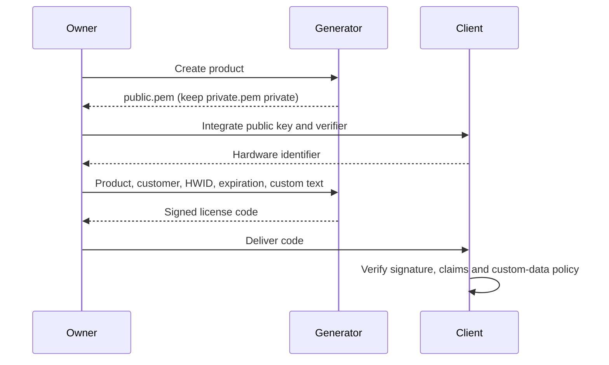

# Architecture and security contract

[Español](docs/es/ARCHITECTURE.md) · **English** · [Deutsch](docs/de/ARCHITECTURE.md) · [Português](docs/pt/ARCHITECTURE.md) · [中文](docs/zh/ARCHITECTURE.md)

## Responsibilities

Avalonia views display state and invoke MVVM commands. View models coordinate application services. Services own filesystem, desktop integration, settings, localization, signing and backup operations. Models describe the license data and signing contract. The regression console verifies observable behavior, including the standalone client example compiled into the app.

Page construction performs no license-store I/O. Navigation displays a page before
awaiting its cancellable load, and retains page instances so form drafts survive
navigation. View models schedule the existing synchronous store operations on
worker threads, then update their observable state on the UI context. Busy commands
reject duplicate mutations. A write already started finishes honestly; changing
the form invalidates its displayed result without losing the saved license.

`WorkspaceSnapshot` reads applications and history under the same storage lock.
Dashboard totals use that one snapshot. Skipped corrupt history is reported instead
of silently presenting incomplete counts. Lists cache their filtered results and
paginate those results without rereading storage.

Responsive geometry belongs to the views: `AdaptiveGrid` measures visible children
and chooses columns from available width and text scale. Owned confirmation dialogs
provide modality, initial Cancel focus and focus restoration. View models request
confirmation through `IDialogService`, allowing tests to approve or reject safely.

The generator owns private keys; client applications receive only public keys. RSA signs the license claims. Each client verifies the signature, expected product and hardware identifier, expiration, and its own optional custom-data rules.



## Transport and keys

A license code is standard padded Base64 of UTF-8 JSON. JSON property names are case-sensitive. JSON whitespace and property order do not affect the signature because the signed message is constructed from the fields below.

Keys are RSA-2048. `private.pem` uses PKCS#8 and `public.pem` uses SubjectPublicKeyInfo. Signatures use RSA PKCS#1 v1.5 with SHA-256, then standard padded Base64. A verifier must select this algorithm explicitly.

| Property | JSON type | Meaning |
| --- | --- | --- |
| AppId | string | Exact product identifier |
| RegistrationName | string | Customer/registration name |
| HardwareId | string | Exact client-supplied hardware identifier; empty means no hardware binding |
| ExpirationDate | ISO date-time string or null | Signed Gregorian calendar date, or no expiration |
| Signature | string | Base64 RSA signature |
| UserDefined | string, omitted when empty | Optional application-defined signed text |
| FormatVersion | integer, omitted for legacy | `2` when UserDefined is nonempty |

All text is case-sensitive and must be preserved without normalization or trimming when reconstructing a signature. Product and customer names must not be blank. HardwareId is a string and may be empty for an unbound license. An absent, null or empty UserDefined value selects legacy format and must not be used as an entitlement. Generators omit the two new properties in that case, preserving compatibility with existing clients that reject unknown JSON properties.

Text limits are measured in UTF-16 code units, as with C# `string.Length`: AppId 128, RegistrationName 1,024, HardwareId 1,024 and UserDefined 8,192. AppId also has a limit of 255 UTF-8 bytes to fit portable directory names. Reject invalid Unicode surrogate sequences instead of silently replacing them during UTF-8 encoding. The reference verifier bounds the complete encoded license to 131,072 characters and JSON nesting to eight levels.

## Legacy signed message

For legacy licenses, FormatVersion is absent, null or `1` and UserDefined is absent, null or empty. Generators omit the version for compatibility. Sign these UTF-8 bytes:

```text
AppId|RegistrationName|HardwareId|yyyy-MM-dd
```

Use `NEVER` instead of the date when expiration is null. Format the Gregorian date with invariant culture. The three text fields cannot contain `|`: ambiguous field boundaries could otherwise allow a signed value to be interpreted as different claims. New generation and the reference verifier reject such legacy licenses; reissue an older license containing that separator.

## Format 2 signed message

Nonempty UserDefined requires `FormatVersion: 2`. Independently encode each of the following five strings with standard padded Base64 over its UTF-8 bytes:

1. AppId
2. RegistrationName
3. HardwareId
4. Invariant `yyyy-MM-dd`, or `NEVER`
5. UserDefined

Join the five encoded strings with `|` and prefix `LG2|`. Sign the UTF-8 bytes of that complete string:

```text
LG2|Base64(AppId)|Base64(RegistrationName)|Base64(HardwareId)|Base64(date)|Base64(UserDefined)
```

The `Base64(...)` notation is explanatory, not literal text. Encoding individual fields keeps separators, Unicode and multiline custom text unambiguous. Format 2 with empty custom text is invalid. Reject any unknown version, conflicting format/custom-data combination, malformed JSON, duplicate property names or malformed signature. Never retry a format-2 failure as legacy.

An older client cannot verify format 2. Update it first, or leave UserDefined empty when issuing compatible licenses.

## Expiration and verification

Only the calendar date is signed; time-of-day text and timezone conversion must never extend it. The expiration cutoff is **00:00:00 UTC at the start of that date**, not the end. For `2030-06-10`, the last valid instant precedes `2030-06-10T00:00:00Z`. A null date means no expiration. This retains the original beginning-of-date cutoff while making the timezone explicit.

The [reference verifier](docs/examples/LicenseVerifier.cs) takes the current time as an argument. Revalidate at each access decision; a cached successful result must not bypass expiration. Reject a mismatched AppId and a nonempty HardwareId that differs from the expected value using ordinal comparison. An empty signed HardwareId explicitly permits use on any machine. Read and interpret UserDefined only from a successfully verified result.

The app's inspector compiles that same source file, rather than maintaining a
second parser. `TryVerify` keeps its boolean client contract. `Inspect` additionally
returns a closed diagnostic result: rejected input has no authenticated claims;
an authenticated result carries independent product, hardware and expiration
checks. A null expected hardware ID means **not checked** for a bound license,
and cannot yield `IsValid`. Signature mismatch cannot distinguish a wrong public
key from changed signed data. The UI requires an explicitly selected local public
key or a pasted trusted public key; it never selects trust from the received JSON.
Inspection does not write history, contact a server or implement revocation.

## Persistence

```text
<LocalApplicationData>/LicenseGenerator/
├── Keys/<AppId>/private.pem
├── Keys/<AppId>/public.pem
├── Licenses/<unique-name>.json
├── settings.json
└── Logs/
```

Windows normally resolves the base to `%LOCALAPPDATA%`; Linux resolves the current user's local data directory through .NET. The executable path is separate. Backups include keys, license history and settings. They are ZIP archives **without encryption** and must be protected like private keys.

Import validates the archive and key pairs before making changes. It merges missing products/history without deleting existing entries, refuses conflicting keys or conflicting history filenames, and replaces valid settings atomically. Export before import when you need a recovery point. An import does not revoke or replace licenses already delivered to customers.

## Security boundaries

- Signatures detect changed claims; they do not hide customer names or custom data.
- HWID is an application policy, not proof of an unmodifiable physical machine. Use a stable identifier with sufficient entropy; fail when it cannot be obtained instead of returning a shared placeholder.
- Offline licenses cannot be remotely revoked. Updates may enforce a signed-license blacklist or a deliberate key change.
- Client code and clocks can be modified by a user controlling that machine. Add an online trust mechanism if your requirements include stronger revocation or trusted time.
- Keep private keys out of client applications, source control, support tickets and public releases. A leaked private key requires a key-rotation and client-update plan.

The product's legal terms remain in [LICENSE](LICENSE).
