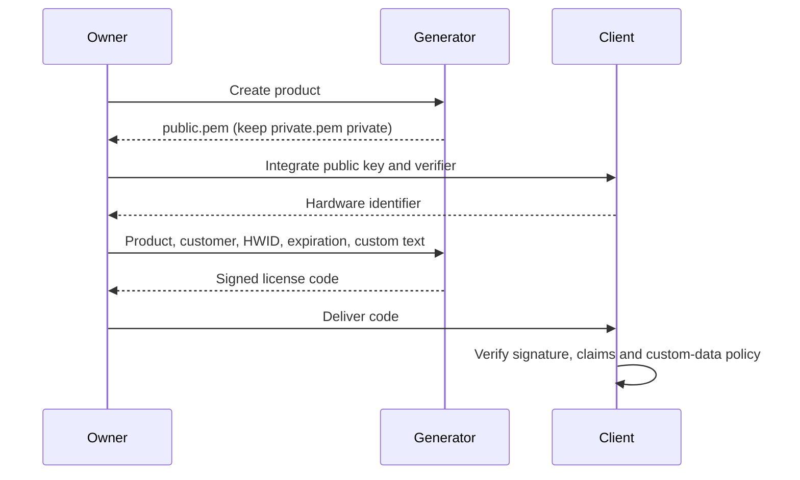

# License format and security contract

[Español](docs/es/ARCHITECTURE.md) · **English** · [Deutsch](docs/de/ARCHITECTURE.md) · [Português](docs/pt/ARCHITECTURE.md) · [中文](docs/zh/ARCHITECTURE.md)

This document defines every byte a License Generator license contains and every
rule a client must apply to it. The [integration guide](INTEGRATION.md) shows how
to apply them in an application; the reference verifiers in C#, Python and
Node.js implement them and pass the same published test vectors.

## Roles

The generator owns private keys; client applications receive only public keys. RSA signs the license claims. Each client verifies the signature, expected product and hardware identifier, expiration, and its own optional custom-data rules.



## Transport and keys

A license code is standard padded Base64 of UTF-8 JSON. JSON property names are case-sensitive. JSON whitespace and property order do not affect the signature because the signed message is constructed from the fields below. The generator indents its JSON with the line breaks of the system it runs on, so two licenses with the same claims can differ in their text; never compare license texts.

Keys are RSA-2048. `private.pem` uses PKCS#8 and `public.pem` uses SubjectPublicKeyInfo. Signatures use RSA PKCS#1 v1.5 with SHA-256, then standard padded Base64. A verifier must select this algorithm explicitly.

| Property | JSON type | Meaning |
| --- | --- | --- |
| AppId | string | Exact product identifier |
| RegistrationName | string | Customer/registration name |
| HardwareId | string | Exact client-supplied hardware identifier; empty means no hardware binding |
| ExpirationDate | ISO date-time string or null | Signed Gregorian calendar date, or no expiration |
| Signature | string | Base64 RSA signature |
| UserDefined | string, omitted when empty | Optional application-defined signed text |
| FormatVersion | integer, omitted for legacy | `2` when UserDefined is nonempty |

All text is case-sensitive and must be preserved without normalization or trimming when reconstructing a signature. Product and customer names must not be blank. HardwareId is a string and may be empty for an unbound license. An absent, null or empty UserDefined value selects legacy format and must not be used as an entitlement. Generators omit the two new properties in that case, preserving compatibility with existing clients that reject unknown JSON properties.

Text limits are measured in UTF-16 code units, as with C# `string.Length` and JavaScript `String.length`: AppId 128, RegistrationName 1,024, HardwareId 1,024 and UserDefined 8,192. AppId also has a limit of 255 UTF-8 bytes. Reject invalid Unicode surrogate sequences instead of silently replacing them during UTF-8 encoding.

## Legacy signed message

For legacy licenses, FormatVersion is absent, null or `1` and UserDefined is absent, null or empty. Generators omit the version for compatibility. Sign these UTF-8 bytes:

```text
AppId|RegistrationName|HardwareId|yyyy-MM-dd
```

Use `NEVER` instead of the date when expiration is null. Format the Gregorian date with invariant culture. The three text fields cannot contain `|`: ambiguous field boundaries could otherwise allow a signed value to be interpreted as different claims. New generation and the reference verifiers reject such legacy licenses; reissue an older license containing that separator.

## Format 2 signed message

Nonempty UserDefined requires `FormatVersion: 2`. Independently encode each of the following five strings with standard padded Base64 over its UTF-8 bytes:

1. AppId
2. RegistrationName
3. HardwareId
4. Invariant `yyyy-MM-dd`, or `NEVER`
5. UserDefined

Join the five encoded strings with `|` and prefix `LG2|`. Sign the UTF-8 bytes of that complete string:

```text
LG2|Base64(AppId)|Base64(RegistrationName)|Base64(HardwareId)|Base64(date)|Base64(UserDefined)
```

The `Base64(...)` notation is explanatory, not literal text. Encoding individual fields keeps separators, Unicode and multiline custom text unambiguous. Format 2 with empty custom text is invalid. Never retry a format-2 failure as legacy.

An older client cannot verify format 2. Update it first, or leave UserDefined empty when issuing compatible licenses.

## Expiration

Only the calendar date is signed; time-of-day text and timezone conversion must never extend it. The expiration cutoff is **00:00:00 UTC at the start of that date**, not the end. For an expiration date D, the last valid instant precedes midnight UTC at the start of D. A null date means no expiration. This retains the original beginning-of-date cutoff while making the timezone explicit.

The generator writes the date as `yyyy-MM-ddT00:00:00`. A verifier accepts an ExpirationDate text only when the whole text matches this expression, with nothing after it, not even a line break; its first ten characters are a Gregorian date from the year 1; the hour is at most 23, the minutes and seconds at most 59, the offset's minutes at most 59 and the offset at most 14:00; and the instant it writes, read as UTC when it has no offset and ignoring any fraction of a second, exists between the years 1 and 9999 in UTC:

```text
^[0-9]{4}-[0-9]{2}-[0-9]{2}(T[0-9]{2}:[0-9]{2}(:[0-9]{2}(\.[0-9]{1,16})?)?(Z|[+-][0-9]{2}(:[0-9]{2})?)?)?$
```

The first ten characters are the signed date; the time and the offset never move the cutoff. The `expirationTexts` table of the [test vectors](docs/examples/test-vectors.json) lists accepted and rejected texts, and the instants on either side of the cutoff at which every accepted text must be current and then expired.

## Verification rules

A verifier takes the license code, the trusted public key, the expected product, the expected hardware identifier and the current time from the application, never from the license. A blank expected product, and a public key that is blank or longer than 65,536 UTF-16 code units, are the application's errors and are rejected before the license is read. The verifier then applies these rules in order.

A text is **blank** when it is empty or made only of the whitespace that .NET's `char.IsWhiteSpace` defines: tab, line feed, vertical tab, form feed, carriage return, U+0085 and the Unicode space, line and paragraph separators (categories Zs, Zl and Zp). U+001C to U+001F are not whitespace here, although Java and Python treat them as such.

1. **Envelope.** Reject as malformed a code that is blank or longer than 131,072 UTF-16 code units, or that is not standard padded Base64; spaces, tabs, carriage returns and line feeds between Base64 characters are ignored, and no other character is. The decoded JSON must be at most 98,304 bytes of UTF-8 without a byte order mark, strict RFC 8259 JSON (no comments, trailing commas or `NaN`), nested at most eight levels deep, with an object at its root whose property names are unique and contain no unpaired surrogate escape. Unknown properties are ignored and their values are not read: they are not signed.
2. **Claims**, in this order. First the texts: AppId, RegistrationName, HardwareId and Signature must be strings, all but HardwareId nonblank, and UserDefined a string or null, none of them containing an unpaired surrogate escape. An absent ExpirationDate, UserDefined or FormatVersion reads as null, and so does an empty UserDefined; a UserDefined made of whitespace is not empty. Then FormatVersion must be null or a 32-bit integer written without a fraction or exponent; any integer other than 1 or 2 is an **unsupported format**, a distinct rejection. Then ExpirationDate must be null or a date text as above. Last, the text limits, the legacy separator and the format/custom-data combination are checked as in the sections above, and the Signature text must be standard padded Base64 of at least one byte, ignoring the same characters as the code. Every other failure of this step is malformed.
3. **Signature.** Only now is the key read. The trusted key must be at most 65,536 UTF-16 code units holding one PEM block labelled `PUBLIC KEY` with a SubjectPublicKeyInfo body or `RSA PUBLIC KEY` with a PKCS#1 body, with only whitespace around the block and only spaces, tabs, carriage returns and line feeds inside its Base64 body, whose DER encoding contains nothing after the key, for RSA of at least 2048 bits. A private key is never accepted. Verify RSA PKCS#1 v1.5 with SHA-256 over the signed message; a failure is a **signature mismatch**, which cannot distinguish a wrong public key from changed signed data.
4. **Policy.** Only an authenticated license is compared with the application's expectations, each check reported separately: the product matches when AppId equals the expected product by ordinal comparison; the hardware is not bound when HardwareId is empty, matches when it equals the expected value by ordinal comparison, and is **not checked** only when the application deliberately passes no expected value; the license is expired when the current time is at or after the cutoff.

A license is valid only when its product matches, its hardware is not bound or matches, and it never expires or has not expired. A license whose hardware was not checked is not valid. A function that returns only valid licenses requires an expected hardware identifier and returns no license without one, even for an unbound license, so that a missing value cannot skip the check. Revalidate at each access decision; a cached successful result must not bypass expiration. Read and interpret UserDefined only from a valid result.

An authenticated license also has a **revocation identifier**: the lowercase hexadecimal SHA-256 of the decoded signature bytes. The same license can be written in more than one way, for example with whitespace or escapes inside its Signature text, and every way gives the same identifier, so a revocation list holds identifiers and never signature texts. A license reissued with the same claims and key has the same signature, and so the same identifier.

The reference verifiers report rejections as `malformed`, `unsupported-format`, `signature-mismatch`, `invalid-public-key` and `invalid-expected-product`, and authenticated checks with the names the [test vectors](docs/examples/test-vectors.json) use. Another implementation must give the published result for every vector before release.

## Security boundaries

- Signatures detect changed claims; they do not hide customer names or custom data.
- HWID is an application policy, not proof of an unmodifiable physical machine. Use a stable identifier with sufficient entropy; fail when it cannot be obtained instead of returning a shared placeholder.
- Offline licenses cannot be remotely revoked. Updates may enforce a list of revoked license identifiers or a deliberate key change.
- Client code and clocks can be modified by a user controlling that machine. Add an online trust mechanism if your requirements include stronger revocation or trusted time.
- Keep private keys out of client applications, source control, support tickets and public releases. A leaked private key requires a key-rotation and client-update plan.

The product's legal terms are in the [EULA](LICENSE).
