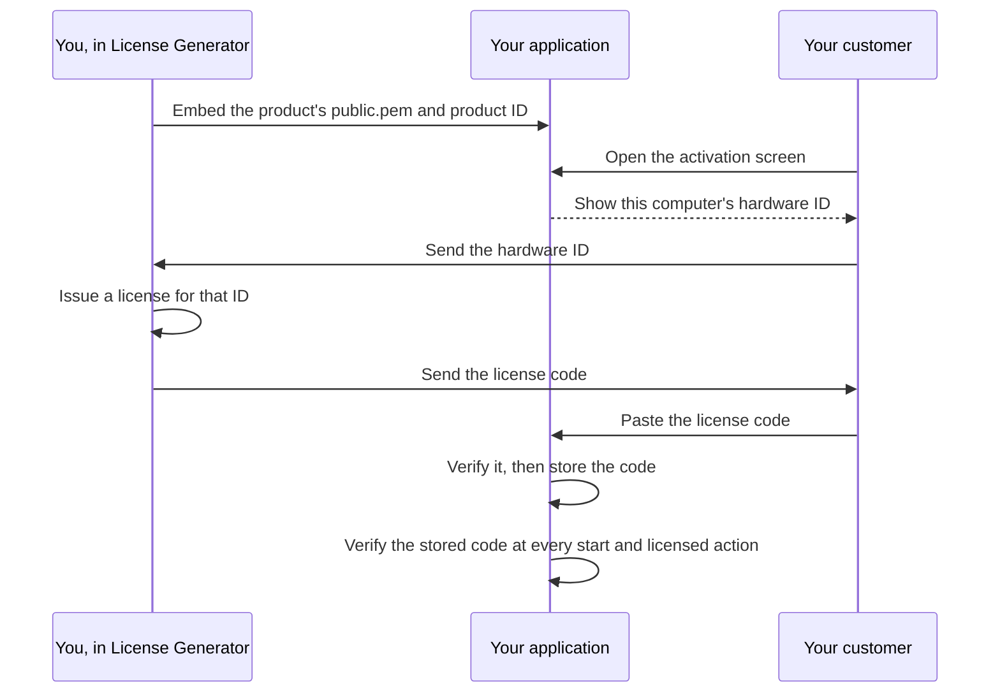

# Client integration guide

[Español](docs/es/INTEGRATION.md) · **English** · [Deutsch](docs/de/INTEGRATION.md) · [Português](docs/pt/INTEGRATION.md) · [中文](docs/zh/INTEGRATION.md)

This guide shows how to verify License Generator licenses in your own
application: which verifier to use, how an activation screen and a startup check
use it, how to choose a hardware identifier, and how to test your integration.
The [format and security contract](ARCHITECTURE.md) defines every byte and rule
the verifiers apply; the [operations guide](OPERATIONS.md) covers the generator
itself.

## How licensing works



The generator signs each license with the product's private key, which never
leaves your computer. Your application holds only the public key, which can
verify a signature but never create one. Verification needs no server: it runs
on the user's device with the public key, the product ID, the hardware ID and
the current time that your application supplies.

## Choose a verifier

Three reference verifiers implement the [contract](ARCHITECTURE.md). Each
returns the same results for every published [test vector](#test-your-integration).

| Stack | Copy into your application | Requires | Tests |
| --- | --- | --- | --- |
| C# | [LicenseVerifier.cs](docs/examples/LicenseVerifier.cs) and [LicenseProtocol.cs](docs/examples/LicenseProtocol.cs) | .NET 8 or later; no packages | Checked against the vectors by the application's own regression suite, which is private |
| Python | [license_verifier.py](docs/examples/python/license_verifier.py) | Python 3.11 or later and the [cryptography](https://pypi.org/project/cryptography/) package | [test_license_verifier.py](docs/examples/python/test_license_verifier.py) |
| Node.js | [license-verifier.mjs](docs/examples/node/license-verifier.mjs) | Node.js 20 or later; built-in modules only | [license-verifier.test.mjs](docs/examples/node/license-verifier.test.mjs) |

The verifiers do no I/O: they read no files, clock or network and never look up
a hardware ID. Your application passes those values in, which keeps every
decision visible and testable.

Another stack can verify licenses with its own RSA library. These standard APIs
verify RSA PKCS#1 v1.5 signatures with SHA-256 using a SubjectPublicKeyInfo
public key; they are pointers, not tested examples, so implement every rule of
the contract and pass every test vector before release.

| Stack | API |
| --- | --- |
| Java, Kotlin, Android | `java.security.Signature` with `SHA256withRSA`, key from `X509EncodedKeySpec` |
| Go | `crypto/x509.ParsePKIXPublicKey` and `crypto/rsa.VerifyPKCS1v15` with `crypto.SHA256`, which takes the SHA-256 digest, not the message |
| Swift | `SecKeyCreateWithData` with the key in PKCS#1 form, and `SecKeyVerifySignature` with `.rsaSignatureMessagePKCS1v15SHA256` |
| C, C++ | OpenSSL's `EVP_DigestVerify` with `EVP_sha256()`, or Windows CNG's `BCryptVerifySignature` with `BCRYPT_PAD_PKCS1` |
| PHP | `openssl_verify` with `OPENSSL_ALGO_SHA256` |
| Rust | the `rsa` crate's PKCS#1 v1.5 verifier with SHA-256 |
| Dart, Flutter | the `pointycastle` package's RSA signer with SHA-256 |
| Browser | `crypto.subtle.importKey` with `spki`, and `crypto.subtle.verify` with `RSASSA-PKCS1-v1_5` and SHA-256 |

An Electron application runs the Node.js verifier in its main process, not in a
renderer that displays web content. React Native does not provide `node:crypto`,
so the Node.js verifier does not run there as it is. A web page that the user
controls cannot enforce a license; verify where your application decides access.

Libraries differ in ways that break the contract when you keep their defaults:

| Where | What happens | What to do |
| --- | --- | --- |
| Most JSON parsers | They keep the last of two equal property names. | Reject a root object that repeats a name before reading any claim. |
| Go `encoding/json` | It matches names case-insensitively and replaces invalid UTF-8 and unpaired surrogates with U+FFFD. | Read the root object with `json.Decoder.Token` and compare names exactly. |
| Java `java.util.Base64` | `getDecoder()` rejects whitespace, and `getMimeDecoder()` ignores every character outside the alphabet. | Remove spaces, tabs and line breaks, then decode with `getDecoder()`. |
| Java, Kotlin `KeyFactory` | `X509EncodedKeySpec` reads only SubjectPublicKeyInfo. | Embed `public.pem` as the generator writes it, or convert a PKCS#1 key first. |
| Swift `SecKeyCreateWithData` | It expects an RSA public key in PKCS#1 form. | Remove the SubjectPublicKeyInfo header first, or embed the key in PKCS#1 form. |
| Text lengths | Python counts code points, and Go and Rust count bytes. | Count UTF-16 code units for the limits in the contract. |
| Python `cryptography` | `load_pem_public_key` also reads a SubjectPublicKeyInfo body under an `RSA PUBLIC KEY` label, and `load_der_public_key` reads either form. | Check that the body is the form its label names. |
| Regular expressions | In Python, Java and .NET, `$` also matches before a final line break, and in Python and .NET `\d` matches digits of every script. | Match the whole text (`re.fullmatch`, `Matcher.matches`, `\z` in .NET) and write `[0-9]`. |
| Trim functions | Python's `strip()`, JavaScript's `trim()` and .NET's `Trim()` remove different characters. | Remove exactly the characters that the contract or this guide names. |

## Add the verifier to your application

**C#.** Copy both files into your project. The verifier is in the
`LicenseGenerator.IntegrationExample` namespace and uses the shared parser in
`LicenseGenerator.Protocol`; rename the namespaces if you wish. The files use
.NET 8 APIs such as `PemEncoding` and C# 12 syntax, so they do not build as they
are on .NET Framework, Unity or Xamarin; there, implement the contract with the
APIs you have, starting from these files, and pass every test vector.

**Python.** Copy `license_verifier.py` and install `cryptography`. The examples are
tested with the versions and hashes locked in
[requirements.txt](docs/examples/python/requirements.txt):

```text
python -m pip install --require-hashes --only-binary :all: -r requirements.txt
```

**Node.js.** Copy `license-verifier.mjs`, an ES module, and import it with
`import { inspect, verify } from "./license-verifier.mjs"`.

**The public key.** Embed the product's `public.pem` in your application, as a
string constant or a compiled resource, together with the exact product ID. Never
read the key from the license, a file the user can replace or a download whose
source you do not control. Never ship `private.pem`.

## Verify a license

Each verifier offers two calls with the same inputs: the license code, the
trusted public key, the expected product ID, the expected hardware ID and the
current UTC time. A time that cannot be placed in UTC is a programming error:
Python's verifier raises `ValueError` for a `datetime` without a time zone, and
the Node.js verifier throws `TypeError` for an invalid `Date`.

- **verify** (`TryVerify` in C#) returns the license only when it is valid for
  this product, machine and time. It requires the expected hardware ID: without
  one it returns no license, even for an unbound license. Use it wherever access
  is decided.
- **inspect** (`Inspect` in C#) returns either a rejection with its reason, or an
  authenticated license with separate product, hardware and expiration checks and
  an overall validity. Use it where you need to tell the user what is wrong.

The results have these forms in each verifier:

| Verifier | Rejection | Authenticated | License |
| --- | --- | --- | --- |
| C# | `LicenseInspectionResult.Rejected` with `Reason` | `LicenseInspectionResult.Authenticated` with `License`, `Product`, `Hardware`, `Expiration` and `IsValid` | `VerifiedLicense` with `AppId`, `RegistrationName`, `HardwareId`, `ExpirationDate` (a UTC `DateTime`), `UserDefined`, `FormatVersion` and `RevocationId` |
| Python | `Rejected` with `reason` | `Authenticated` with `license`, `product`, `hardware`, `expiration` and `is_valid` | `VerifiedLicense` with `app_id`, `registration_name`, `hardware_id`, `expiration_date` (a `date`), `user_defined`, `format_version` and `revocation_id` |
| Node.js | `{ result: "rejected", reason }` | `{ result: "authenticated", license, product, hardware, expiration, isValid }` | An object with `appId`, `registrationName`, `hardwareId`, `expirationDate` (a `yyyy-MM-dd` text), `userDefined`, `formatVersion` and `revocationId` |

A missing expiration date or custom text is null (`None` in Python), and so is
the format version of a legacy license, which the test vectors write as 1. The
reasons and checks are the members of `LicenseInspectionFailure`,
`LicenseProductCheck`, `LicenseHardwareCheck` and `LicenseExpirationCheck` in C#,
and of `InspectionFailure`, `ProductCheck`, `HardwareCheck` and `ExpirationCheck`
in Python and JavaScript, with the same names in upper case with underscores
(`MALFORMED_LICENSE`, `NOT_BOUND`, `NEVER_EXPIRES`) and the values that the test
vectors use (`malformed`, `not-bound`, `never`).

A license issued with an empty hardware ID is unbound: it passes the hardware
check whatever ID your application expects. To skip the hardware check
deliberately, pass `null` (`None` in Python) to `inspect`; a bound license is
then reported as not checked, and it is never valid. The Node.js verifier refuses an omitted
(`undefined`) hardware ID, so a missing argument cannot skip the check by
accident.

## Build an activation screen

Your application needs a screen where the user can see the hardware ID, paste a
license code and activate it:

```text
┌────────────────────────────────────────────────────────────────────┐
│ License activation                                                 │
│                                                                    │
│ This computer's ID                                                 │
│ 05A68D939433F5BABB1D30D04974999056C8AFAF60D867DA80241F9F99E5FA01   │
│                                                             [Copy] │
│ License code                                                       │
│ ┌────────────────────────────────────────────────────────────────┐ │
│ │ ewogICJBcHBJZCI6ICJOb3J0aHN0YXItU3R1ZGlvIiwKICAiUmVnaXN0cmF... │ │
│ └────────────────────────────────────────────────────────────────┘ │
│                                                         [Activate] │
│ Activated for Alex Morgan.                                         │
└────────────────────────────────────────────────────────────────────┘
```

Show the complete hardware ID with a copy button: the license is issued for
exactly that text. When the user activates, inspect the code, store it if it is
valid, and otherwise explain what is wrong. These functions assume that your
application provides `PUBLIC_KEY`, `PRODUCT_ID`, `hardware_id()` and
`save_license_code()` (or their C# and JavaScript equivalents).

<!-- excerpt: csharp-activation -->
```csharp
static string Activate(string licenseCode)
{
    var result = LicenseVerifier.Inspect(licenseCode, PublicKey, ProductId, HardwareId(), DateTimeOffset.UtcNow);
    if (result is LicenseInspectionResult.Authenticated { IsValid: true } activated)
    {
        SaveLicenseCode(licenseCode);
        return $"Activated for {activated.License.RegistrationName}.";
    }
    return ActivationProblem(result);
}

static string ActivationProblem(LicenseInspectionResult result) => result switch
{
    LicenseInspectionResult.Rejected { Reason: LicenseInspectionFailure.MalformedLicense } =>
        "Paste the complete license code you received.",
    LicenseInspectionResult.Rejected { Reason: LicenseInspectionFailure.UnsupportedFormat } =>
        "This license needs a newer version of the application.",
    LicenseInspectionResult.Rejected { Reason: LicenseInspectionFailure.SignatureMismatch } =>
        "This license was not issued for this application.",
    LicenseInspectionResult.Rejected => "This copy cannot check licenses. Contact support.",
    LicenseInspectionResult.Authenticated { Product: LicenseProductCheck.Mismatch } =>
        "This license is for another product.",
    LicenseInspectionResult.Authenticated { Hardware: LicenseHardwareCheck.Mismatch } =>
        $"This license is for another computer. Send us this computer's ID: {HardwareId()}",
    LicenseInspectionResult.Authenticated
        { Expiration: LicenseExpirationCheck.Expired, License.ExpirationDate: DateTime expired } =>
        $"This license expired on {expired.ToString("yyyy-MM-dd", CultureInfo.InvariantCulture)}.",
    _ => "This license cannot be used on this computer.",
};
```

<!-- excerpt: python-activation -->
```python
def activate(license_code):
    result = license_verifier.inspect(license_code, PUBLIC_KEY, PRODUCT_ID, hardware_id(),
                                      datetime.now(timezone.utc))
    if isinstance(result, license_verifier.Authenticated) and result.is_valid:
        save_license_code(license_code)
        return "Activated for %s." % result.license.registration_name
    return activation_problem(result)


REJECTION_MESSAGES = {
    license_verifier.InspectionFailure.MALFORMED_LICENSE: "Paste the complete license code you received.",
    license_verifier.InspectionFailure.UNSUPPORTED_FORMAT: "This license needs a newer version of the application.",
    license_verifier.InspectionFailure.SIGNATURE_MISMATCH: "This license was not issued for this application.",
}


def activation_problem(result):
    if isinstance(result, license_verifier.Rejected):
        return REJECTION_MESSAGES.get(result.reason, "This copy cannot check licenses. Contact support.")
    if result.product is license_verifier.ProductCheck.MISMATCH:
        return "This license is for another product."
    if result.hardware is license_verifier.HardwareCheck.MISMATCH:
        return "This license is for another computer. Send us this computer's ID: %s" % hardware_id()
    if result.expiration is license_verifier.ExpirationCheck.EXPIRED:
        return "This license expired on %s." % result.license.expiration_date.isoformat()
    return "This license cannot be used on this computer."
```

<!-- excerpt: javascript-activation -->
```javascript
export function activate(licenseCode) {
  const result = inspect(licenseCode, PUBLIC_KEY, PRODUCT_ID, hardwareId(), new Date());
  if (result.result === "authenticated" && result.isValid) {
    saveLicenseCode(licenseCode);
    return `Activated for ${result.license.registrationName}.`;
  }
  return activationProblem(result);
}

const REJECTION_MESSAGES = new Map([
  [InspectionFailure.MALFORMED_LICENSE, "Paste the complete license code you received."],
  [InspectionFailure.UNSUPPORTED_FORMAT, "This license needs a newer version of the application."],
  [InspectionFailure.SIGNATURE_MISMATCH, "This license was not issued for this application."],
]);

export function activationProblem(result) {
  if (result.result === "rejected") {
    return REJECTION_MESSAGES.get(result.reason) ?? "This copy cannot check licenses. Contact support.";
  }
  if (result.product === ProductCheck.MISMATCH) return "This license is for another product.";
  if (result.hardware === HardwareCheck.MISMATCH) {
    return `This license is for another computer. Send us this computer's ID: ${hardwareId()}`;
  }
  if (result.expiration === ExpirationCheck.EXPIRED) {
    return `This license expired on ${result.license.expirationDate}.`;
  }
  return "This license cannot be used on this computer.";
}
```

The C# functions use the `System.Globalization` and
`LicenseGenerator.IntegrationExample` namespaces. The Python functions import
`datetime` and `timezone` from `datetime`, and `license_verifier`. The JavaScript
functions import `inspect`, `InspectionFailure`, `ProductCheck`, `HardwareCheck`
and `ExpirationCheck` from the verifier module.

How each result reads to the user:

| Result | Meaning | What to tell the user |
| --- | --- | --- |
| `malformed` | The text is not a complete license code: cut, changed or not a license at all. | Paste the complete code. |
| `unsupported-format` | The license uses a format newer than this verifier. | Update the application. |
| `signature-mismatch` | The license was issued with another product's key, or its text was changed. | The license is not for this application. |
| `invalid-public-key`, `invalid-expected-product` | Your application passed an unusable key or a blank product ID. | Nothing they can fix: log it and fix the build. |
| product `mismatch` | Authentic, but issued for another of your products. | The license is for another product. |
| hardware `mismatch` | Authentic, but issued for another hardware ID. | The license is for another computer; show this computer's ID. |
| expiration `expired` | Authentic, but its expiration date has started. | The license expired on its date. |

## Keep the license and check it again

Store the license code itself, not a "licensed" flag or a verification result.
Keep it in your application's per-user data folder: for example
`%LOCALAPPDATA%\YourApp` on Windows, `~/Library/Application Support/YourApp` on
macOS, `$XDG_DATA_HOME/YourApp` (usually `~/.local/share/YourApp`) on Linux, the
app's internal storage (`Context.getFilesDir()`) on Android or the Application
Support folder of the app's container on iOS. A backup can restore the code on
another device, where the hardware check fails and the user activates again. The
code is signed, not encrypted: anyone who reads it sees the customer's name, the
hardware ID and the custom data, but cannot change them without breaking the
signature.

Verify the stored code again at every start and before each licensed action,
with the current time. A cached `true` would keep an expired license working.
When verification fails, show the activation screen again. These functions
assume that your application provides `load_license_code()`, which returns the
stored code or nothing.

<!-- excerpt: csharp-startup -->
```csharp
static VerifiedLicense? CurrentLicense()
{
    var licenseCode = LoadLicenseCode();
    if (licenseCode is null) return null;
    return LicenseVerifier.TryVerify(licenseCode, PublicKey, ProductId, HardwareId(), DateTimeOffset.UtcNow,
        out var license) ? license : null;
}
```

<!-- excerpt: python-startup -->
```python
def current_license():
    license_code = load_license_code()
    if license_code is None:
        return None
    return license_verifier.verify(license_code, PUBLIC_KEY, PRODUCT_ID, hardware_id(), datetime.now(timezone.utc))
```

<!-- excerpt: javascript-startup -->
```javascript
export function currentLicense() {
  const licenseCode = loadLicenseCode();
  if (licenseCode === null) return null;
  return verify(licenseCode, PUBLIC_KEY, PRODUCT_ID, hardwareId(), new Date());
}
```

## Choose a hardware identifier

A hardware-bound license names one hardware ID, and your application decides how
to compute it. The generator signs whatever text you enter. A good identifier is:

- **Deterministic.** The same machine gives the same text at every start and after
  every update of your application.
- **Exact.** The text shown on the activation screen is the text verified later.
  Comparison is ordinal: case, spaces and line breaks count.
- **Complete.** Never truncate it; a short ID makes two machines share a license.
- **Honest about failure.** When the source is unavailable, report an error. Never
  fall back to a shared value such as `UNKNOWN-HWID`, the host name or an empty
  text: an empty hardware ID means an unbound license.

Operating systems provide a machine identifier to start from:

| System | Source | Changes when |
| --- | --- | --- |
| Windows | `MachineGuid` under `HKEY_LOCAL_MACHINE\SOFTWARE\Microsoft\Cryptography` | Windows is reinstalled; machines cloned from one image can share it |
| Linux | `/etc/machine-id` | The system is reinstalled; containers and cloned images can share or regenerate it |
| macOS | `IOPlatformUUID` of `IOPlatformExpertDevice` in the I/O Registry | The logic board is replaced |
| Android | `Settings.Secure.ANDROID_ID` | The device is reset to factory settings; since Android 8.0 it also differs per app signing key and per user |
| iOS, iPadOS | No hardware identifier is available to apps: `identifierForVendor`, or a UUID that you create once and keep in the Keychain | `identifierForVendor` changes when every app of yours is removed from the device; a Keychain item usually survives reinstalling |

A 32-bit process on 64-bit Windows reads a redirected registry view without
`MachineGuid`: open the 64-bit view (`RegistryView.Registry64` in .NET,
`KEY_WOW64_64KEY` in Win32).

Do not show the raw identifier: the `machine-id(5)` manual asks applications not
to expose `/etc/machine-id` and to hash it with an application-specific key
instead. Derive your own ID with HMAC-SHA-256 keyed with the UTF-8 bytes of your
product ID, over the UTF-8 bytes of the system's identifier without the spaces,
tabs, carriage returns and line feeds at its start and end, such as the line
break at the end of `/etc/machine-id`, and write it as 64 uppercase hexadecimal
characters. Remove only those four characters and keep every other one: the trim
functions of each language remove different sets. Every stack then computes the
same ID for the same machine and product; the `hardwareIdExamples` of the
[test vectors](docs/examples/test-vectors.json) publish two to check against.
These functions need `System.Security.Cryptography`
and `System.Text` in C#, `hashlib` and `hmac` in Python, and `createHmac` from
`node:crypto` in JavaScript.

<!-- excerpt: csharp-hardware-id -->
```csharp
static string DeriveHardwareId(string machineId, string productId)
{
    var identifier = machineId.Trim(' ', '\t', '\r', '\n');
    return Convert.ToHexString(HMACSHA256.HashData(Encoding.UTF8.GetBytes(productId), Encoding.UTF8.GetBytes(identifier)));
}
```

<!-- excerpt: python-hardware-id -->
```python
def derive_hardware_id(machine_id, product_id):
    identifier = machine_id.strip(" \t\r\n")
    digest = hmac.new(product_id.encode("utf-8"), identifier.encode("utf-8"), hashlib.sha256)
    return digest.hexdigest().upper()
```

<!-- excerpt: javascript-hardware-id -->
```javascript
export function deriveHardwareId(machineId, productId) {
  const identifier = machineId.replace(/^[ \t\r\n]+|[ \t\r\n]+$/g, "");
  return createHmac("sha256", productId).update(identifier).digest("hex").toUpperCase();
}
```

A hardware ID is an application policy, not proof of a physical machine: a user
who controls the device can change what your application reads.

## Use UserDefined

A license can carry signed custom text, UserDefined, for features, plans or other
data that your application defines. Read it only from a valid license; before
verification it is untrusted text. Choose a simple, versioned syntax, such as
`features=reports,export;plan=professional`, reject a text your version does not
understand, and treat a license without it as your base entitlement. Do not put
secrets in it: it is encoded, not encrypted.

A license with UserDefined uses format 2. A client built before format 2 rejects
it, so update every client that must accept such licenses before issuing them.

## Expiration and the clock

The expiration date is signed as a calendar date, and a license expires at
**00:00 UTC at the start of that date**. To allow use until the end of June 10,
issue the license with June 11. Pass the current time in UTC; the verifiers
compare it with that instant regardless of the user's time zone.

Your application reads the clock of a device the user controls. A user can set it
back to keep an expired license working. Where that matters, check time against a
service you trust in addition to the offline verification.

## Updates, revocation and key changes

An offline license cannot be revoked remotely: the user's device needs no server
to verify it. What you can do in an update of your application:

- **Revoke specific licenses.** Ship a list of revoked license identifiers and
  refuse a verified license whose identifier is listed. Every verifier returns it
  with the license (`revocationId`, `RevocationId` in C#, `revocation_id` in
  Python); inspect a license code with any of them to read it. Never list
  `Signature` texts: one license can be written in more than one way, and every
  way has the same identifier.
- **Change keys for a new major version.** Create a new product in the generator,
  for example `MyApp-2`, and embed its public key and product ID: licenses issued
  for the old product no longer verify. To keep accepting them for a while,
  verify with the new key and product ID, then with the old ones.
- **Replace a leaked or lost key.** If a private key leaks, anyone can issue
  licenses your application accepts; if it is lost, you cannot issue new ones.
  In both cases ship a new public key and reissue licenses.

## Test your integration

[test-vectors.json](docs/examples/test-vectors.json) holds a test public key that
no real product trusts, the expected product and hardware ID, a fixed check time,
and licenses issued by the generator with the result each must give:

- `cases` lists each license with its `expected` result: a rejection `reason`, or
  the authenticated `product`, `hardware` and `expiration` checks, the overall
  `valid`, the decoded claims and the `revocationId`. `formatVersion` is 1 for a
  legacy license, whose JSON omits it. `issue` records how the generator issued a
  case, `derive` how a case was changed from another after signing, and `copy`
  that it reuses another case's license unchanged. A case can set its own
  `publicKey`, `expectedAppId` or `expectedHardwareId`; a null hardware ID means
  that the check is skipped. A verify function returns the license exactly for
  the valid cases that do not skip the hardware check.
- `expirationTexts` lists texts for the expiration date that a verifier must read
  as the signed date or reject, and the instants on either side of the cutoff at
  which every accepted text is current and then expired.
- `hardwareIdExamples` gives machine identifiers with a product ID and the
  hardware ID that the derivation above computes from each; the second keeps
  characters at its ends that some trim functions remove.

Use the published check time, not the current one, when you compare results. The
reference suites run every case; the Python suite needs `cryptography` installed
as above:

```text
cd docs/examples/python
python -m unittest
cd ../node
node --test license-verifier.test.mjs
```

The public repository's CI runs both suites on every push and pull request. For a
C# client, read the same file in your own tests and compare
`LicenseVerifier.Inspect` with each expected result.

## Troubleshooting

| Symptom | Check |
| --- | --- |
| Every license gives `signature-mismatch` | The embedded key is the product's complete `public.pem`, including its BEGIN and END lines, and the license was issued for that product. |
| `malformed` for a code the generator inspects correctly | The code was cut or changed when it was copied; line breaks inside it are accepted, other characters are not. |
| `unsupported-format` | Your verifier predates the license's format; update it. |
| Hardware `mismatch` on the right computer | Your application computes the same ID that it showed; case and spaces count. Containers and virtual machines can see a different machine identifier. |
| Expired a day early | The cutoff is 00:00 UTC at the start of the expiration date; issue the license with the following day. |
| Works in development, fails in production | Production embeds another public key or product ID, or computes another hardware ID. |

## Licensing of the examples

Section 2 of the [EULA](LICENSE) lets you use, copy, modify and
distribute the files under `docs/examples` as part of your commercial or free
applications that verify licenses, keeping their copyright notice. It grants no
right to the License Generator application itself.

[Report a problem](https://github.com/gonzapersonalsite/LicenseGenerator-Docs-/issues) · [Support development](https://ko-fi.com/gonzaloapps)
