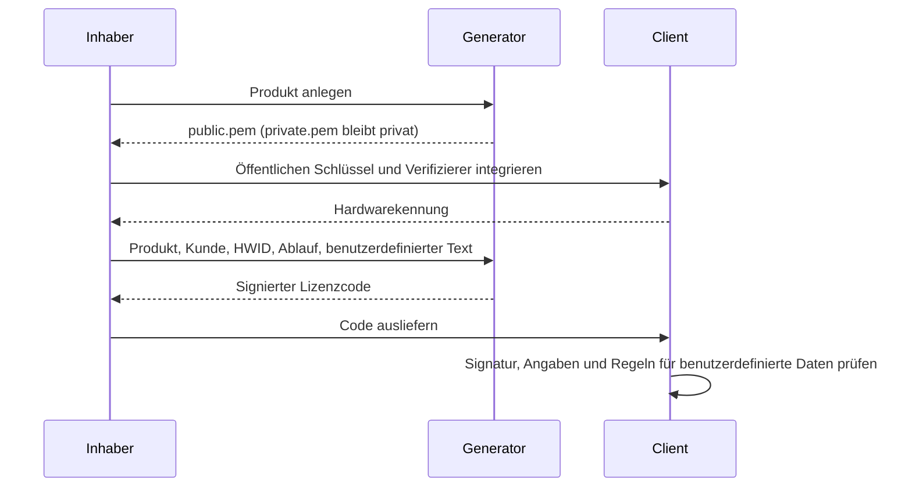

# Format- und Sicherheitsvertrag der Lizenz

[Español](../es/ARCHITECTURE.md) · [English](../../ARCHITECTURE.md) · **Deutsch** · [Português](../pt/ARCHITECTURE.md) · [中文](../zh/ARCHITECTURE.md)

Dieses Dokument legt jedes Byte fest, das eine Lizenz von License Generator
enthält, und jede Regel, die ein Client darauf anwenden muss. Der
[Integrationsleitfaden](INTEGRATION.md) zeigt, wie eine Anwendung sie anwendet;
die Referenz-Verifizierer in C#, Python und Node.js setzen sie um und bestehen
dieselben veröffentlichten Testvektoren. Die technische Referenz ist der
englische Text.

## Rollen

Der Generator verwahrt die privaten Schlüssel; Client-Anwendungen erhalten nur öffentliche Schlüssel. RSA signiert die Angaben der Lizenz. Jeder Client prüft die Signatur, das erwartete Produkt und die erwartete Hardwarekennung, den Ablauf und seine eigenen optionalen Regeln für benutzerdefinierte Daten.



## Transport und Schlüssel

Ein Lizenzcode ist UTF-8-kodiertes JSON in Standard-Base64 mit Auffüllung. JSON-Eigenschaftsnamen unterscheiden Groß- und Kleinschreibung. Leerraum zwischen den JSON-Elementen und die Reihenfolge der Eigenschaften beeinflussen die Signatur nicht, weil die signierte Nachricht aus den unten genannten Feldern gebildet wird. Der Generator rückt sein JSON mit den Zeilenumbrüchen des Systems ein, auf dem er läuft; zwei Lizenzen mit denselben Angaben können sich daher im Text unterscheiden. Vergleichen Sie nie Lizenztexte.

Die Schlüssel sind RSA-2048. `private.pem` verwendet PKCS#8 und `public.pem` SubjectPublicKeyInfo. Signaturen verwenden RSA PKCS#1 v1.5 mit SHA-256, danach Standard-Base64 mit Auffüllung. Ein Verifizierer muss diesen Algorithmus ausdrücklich wählen.

| Eigenschaft | JSON-Typ | Bedeutung |
| --- | --- | --- |
| AppId | string | Exakte Produktkennung |
| RegistrationName | string | Kunden- bzw. Registrierungsname |
| HardwareId | string | Exakte, vom Client gelieferte Hardwarekennung; leer bedeutet keine Hardwarebindung |
| ExpirationDate | ISO-Datum-Uhrzeit-Text oder null | Signiertes gregorianisches Kalenderdatum oder kein Ablauf |
| Signature | string | RSA-Signatur in Base64 |
| UserDefined | string, entfällt wenn leer | Optionaler, von der Anwendung festgelegter signierter Text |
| FormatVersion | Ganzzahl, entfällt beim bisherigen Format | `2`, wenn UserDefined nicht leer ist |

Bei jedem Text wird zwischen Groß- und Kleinschreibung unterschieden; beim Nachbilden einer Signatur muss er ohne Normalisierung und ohne Trimmen erhalten bleiben. Produkt- und Kundennamen dürfen nicht inhaltsleer sein. HardwareId ist ein String und darf bei einer ungebundenen Lizenz leer sein. Ein fehlendes, null oder leeres UserDefined wählt das bisherige Format und darf nicht als Berechtigung verwendet werden. Generatoren lassen in diesem Fall die beiden neuen Eigenschaften weg und bleiben so mit bestehenden Clients kompatibel, die unbekannte JSON-Eigenschaften ablehnen.

Textgrenzen werden in UTF-16-Codeeinheiten gemessen, wie bei C# `string.Length` und JavaScript `String.length`: AppId 128, RegistrationName 1.024, HardwareId 1.024 und UserDefined 8.192. AppId ist zusätzlich auf 255 UTF-8-Bytes begrenzt. Lehnen Sie ungültige Unicode-Surrogatfolgen ab, statt sie bei der UTF-8-Kodierung stillschweigend zu ersetzen.

## Signierte Nachricht des bisherigen Formats

Bei Lizenzen im bisherigen Format fehlt FormatVersion, ist null oder `1`, und UserDefined fehlt, ist null oder leer. Generatoren lassen die Version aus Kompatibilitätsgründen weg. Signiert werden diese UTF-8-Bytes:

```text
AppId|RegistrationName|HardwareId|yyyy-MM-dd
```

Verwenden Sie `NEVER` statt des Datums, wenn der Ablauf null ist. Formatieren Sie das gregorianische Datum mit invarianter Kultur. Die drei Textfelder dürfen kein `|` enthalten: Mehrdeutige Feldgrenzen könnten sonst erlauben, einen signierten Wert als andere Angaben zu deuten. Der Generator erstellt solche Lizenzen des bisherigen Formats nicht mehr, und die Referenz-Verifizierer lehnen sie ab; stellen Sie eine ältere Lizenz mit diesem Trennzeichen neu aus.

## Signierte Nachricht von Format 2

Ein nicht leeres UserDefined erfordert `FormatVersion: 2`. Kodieren Sie jede der folgenden fünf Zeichenketten unabhängig mit Standard-Base64 mit Auffüllung über ihre UTF-8-Bytes:

1. AppId
2. RegistrationName
3. HardwareId
4. Invariantes `yyyy-MM-dd` oder `NEVER`
5. UserDefined

Verbinden Sie die fünf kodierten Zeichenketten mit `|` und stellen Sie `LG2|` voran. Signieren Sie die UTF-8-Bytes dieser vollständigen Zeichenkette:

```text
LG2|Base64(AppId)|Base64(RegistrationName)|Base64(HardwareId)|Base64(date)|Base64(UserDefined)
```

Die Schreibweise `Base64(...)` dient der Erklärung und ist kein wörtlicher Text. Die einzelne Kodierung der Felder hält Trennzeichen, Unicode und mehrzeiligen benutzerdefinierten Text eindeutig. Format 2 mit leerem benutzerdefiniertem Text ist ungültig. Schlägt eine Prüfung in Format 2 fehl, wiederholen Sie sie nie im bisherigen Format.

Ein älterer Client kann Format 2 nicht prüfen. Aktualisieren Sie ihn zuerst oder lassen Sie UserDefined beim Ausstellen kompatibler Lizenzen leer.

## Ablauf

Signiert wird nur das Kalenderdatum; weder Uhrzeittext noch Zeitzonenumrechnung dürfen es verlängern. Die Ablaufgrenze ist **00:00:00 UTC zu Beginn dieses Datums**, nicht sein Ende. Für ein Ablaufdatum D liegt der letzte gültige Zeitpunkt vor Mitternacht UTC zu Beginn von D. Ein Datum null bedeutet keinen Ablauf. So bleibt die ursprüngliche Grenze am Tagesbeginn erhalten, und die Zeitzone wird ausdrücklich festgelegt.

Der Generator schreibt das Datum als `yyyy-MM-ddT00:00:00`. Ein Verifizierer akzeptiert einen ExpirationDate-Text nur, wenn der ganze Text auf den folgenden regulären Ausdruck passt und nichts danach folgt, nicht einmal ein Zeilenumbruch; wenn seine ersten zehn Zeichen ein gregorianisches Datum ab dem Jahr 1 sind; wenn die Stunde höchstens 23, Minuten und Sekunden höchstens 59, die Minuten des Versatzes höchstens 59 und der Versatz höchstens 14:00 betragen; und wenn der geschriebene Zeitpunkt, bei fehlendem Versatz als UTC gelesen und ohne Sekundenbruchteile, zwischen den Jahren 1 und 9999 in UTC existiert:

```text
^[0-9]{4}-[0-9]{2}-[0-9]{2}(T[0-9]{2}:[0-9]{2}(:[0-9]{2}(\.[0-9]{1,16})?)?(Z|[+-][0-9]{2}(:[0-9]{2})?)?)?$
```

Die ersten zehn Zeichen sind das signierte Datum; Uhrzeit und Versatz verschieben die Grenze nie. Die Tabelle `expirationTexts` der [Testvektoren](../examples/test-vectors.json) führt angenommene und abgelehnte Texte auf sowie die Zeitpunkte beiderseits der Grenze, zu denen jeder angenommene Text noch nicht und danach bereits abgelaufen sein muss.

## Prüfregeln

Ein Verifizierer erhält den Lizenzcode, den vertrauenswürdigen öffentlichen Schlüssel, das erwartete Produkt, die erwartete Hardwarekennung und die aktuelle Zeit von der Anwendung, nie aus der Lizenz. Ein inhaltsleeres erwartetes Produkt und ein öffentlicher Schlüssel, der inhaltsleer oder länger als 65.536 UTF-16-Codeeinheiten ist, sind Fehler der Anwendung und werden abgelehnt, bevor die Lizenz gelesen wird. Danach wendet der Verifizierer diese Regeln der Reihe nach an.

Ein Text ist **inhaltsleer**, wenn er leer ist oder nur den Leerraum enthält, den `char.IsWhiteSpace` von .NET festlegt: Tabulator, Zeilenvorschub, vertikaler Tabulator, Seitenvorschub, Wagenrücklauf, U+0085 sowie die Unicode-Leerzeichen, -Zeilen- und -Absatztrenner (Kategorien Zs, Zl und Zp). U+001C bis U+001F gelten hier nicht als Leerraum, obwohl Java und Python sie so behandeln.

1. **Umschlag.** Als fehlerhaft abgelehnt wird ein Code, der inhaltsleer oder länger als 131.072 UTF-16-Codeeinheiten ist oder kein Standard-Base64 mit Auffüllung ist; Leerzeichen, Tabulatoren, Wagenrückläufe und Zeilenvorschübe zwischen Base64-Zeichen werden ignoriert, kein anderes Zeichen. Das dekodierte JSON darf höchstens 98.304 Bytes UTF-8 ohne Byte-Order-Mark umfassen, muss striktes JSON nach RFC 8259 sein (ohne Kommentare, abschließende Kommas oder `NaN`), darf höchstens acht Ebenen tief verschachtelt sein und muss an der Wurzel ein Objekt mit eindeutigen Eigenschaftsnamen ohne Escapes für ungepaarte Surrogate haben. Unbekannte Eigenschaften werden ignoriert und ihre Werte nicht gelesen: Sie sind nicht signiert.
2. **Angaben**, in dieser Reihenfolge. Zuerst die Texte: AppId, RegistrationName, HardwareId und Signature müssen Strings sein, alle außer HardwareId nicht inhaltsleer, und UserDefined ein String oder null, und keiner davon darf ein Escape für ein ungepaartes Surrogat enthalten. Ein fehlendes ExpirationDate, UserDefined oder FormatVersion gilt als null, ebenso ein leeres UserDefined; ein UserDefined aus Leerraum ist nicht leer. Dann muss FormatVersion null oder eine ohne Nachkommastellen und Exponent geschriebene 32-Bit-Ganzzahl sein; jede andere Ganzzahl als 1 oder 2 ist ein **nicht unterstütztes Format**, ein eigener Ablehnungsgrund. Dann muss ExpirationDate null oder ein Datumstext wie oben beschrieben sein. Zuletzt werden Textgrenzen, das Trennzeichen des bisherigen Formats und die Kombination aus Format und benutzerdefinierten Daten wie in den Abschnitten oben geprüft, und der Signature-Text muss Standard-Base64 mit Auffüllung von mindestens einem Byte sein, wobei dieselben Zeichen wie im Code ignoriert werden. Jeder andere Fehler in diesem Schritt führt zur Ablehnung als fehlerhaft.
3. **Signatur.** Erst jetzt wird der Schlüssel gelesen. Der vertrauenswürdige Schlüssel muss höchstens 65.536 UTF-16-Codeeinheiten umfassen und genau einen PEM-Block enthalten, mit der Bezeichnung `PUBLIC KEY` und einem SubjectPublicKeyInfo-Inhalt oder `RSA PUBLIC KEY` und einem PKCS#1-Inhalt, mit nur Leerraum um den Block und nur Leerzeichen, Tabulatoren, Wagenrückläufen und Zeilenvorschüben in seinem Base64-Inhalt, dessen DER-Kodierung nach dem Schlüssel nichts enthält, für RSA mit mindestens 2048 Bit. Ein privater Schlüssel wird nie akzeptiert. Prüfen Sie RSA PKCS#1 v1.5 mit SHA-256 über die signierte Nachricht; ein Fehlschlag ist eine **nicht übereinstimmende Signatur**, die einen falschen öffentlichen Schlüssel nicht von veränderten signierten Daten unterscheidet.
4. **Richtlinie.** Nur eine authentifizierte Lizenz wird mit den Erwartungen der Anwendung verglichen, und jede Prüfung wird getrennt gemeldet: Das Produkt stimmt überein, wenn AppId bei ordinalem Vergleich dem erwarteten Produkt entspricht; die Hardware ist ungebunden, wenn HardwareId leer ist, stimmt überein, wenn sie bei ordinalem Vergleich dem erwarteten Wert entspricht, und ist nur dann **nicht geprüft**, wenn die Anwendung bewusst keinen erwarteten Wert übergibt; die Lizenz ist abgelaufen, wenn die aktuelle Zeit auf oder nach der Grenze liegt.

Eine Lizenz ist nur gültig, wenn ihr Produkt übereinstimmt, ihre Hardware ungebunden ist oder übereinstimmt und sie nie abläuft oder noch nicht abgelaufen ist. Eine Lizenz, deren Hardware nicht geprüft wurde, ist nicht gültig. Eine Funktion, die nur gültige Lizenzen zurückgibt, verlangt eine erwartete Hardwarekennung und gibt ohne sie keine Lizenz zurück, auch keine ungebundene, damit ein fehlender Wert die Prüfung nicht überspringen kann. Prüfen Sie bei jeder Zugriffsentscheidung erneut; ein zwischengespeichertes erfolgreiches Ergebnis darf den Ablauf nicht umgehen. Lesen und deuten Sie UserDefined nur aus einem gültigen Ergebnis.

Eine authentifizierte Lizenz hat außerdem eine **Widerrufskennung**: den SHA-256-Hash der dekodierten Signaturbytes, hexadezimal in Kleinschreibung. Dieselbe Lizenz lässt sich auf mehr als eine Weise schreiben, etwa mit Leerraum oder Escapes im Signature-Text, und jede Schreibweise ergibt dieselbe Kennung; eine Widerrufsliste enthält daher Kennungen und nie Signaturtexte. Eine mit denselben Angaben und demselben Schlüssel neu ausgestellte Lizenz hat dieselbe Signatur und damit dieselbe Kennung.

Die Referenz-Verifizierer melden Ablehnungen als `malformed`, `unsupported-format`, `signature-mismatch`, `invalid-public-key` und `invalid-expected-product` und die Prüfungen einer authentifizierten Lizenz mit den Namen, die die [Testvektoren](../examples/test-vectors.json) verwenden. Eine andere Umsetzung muss vor der Veröffentlichung für jeden Vektor das veröffentlichte Ergebnis liefern.

## Sicherheitsgrenzen

- Signaturen erkennen veränderte Angaben; sie verbergen weder Kundennamen noch benutzerdefinierte Daten.
- Die HWID ist eine Regel der Anwendung, kein Nachweis eines unveränderlichen physischen Computers. Verwenden Sie eine stabile Kennung mit ausreichender Entropie; brechen Sie ab, wenn sie nicht ermittelt werden kann, statt einen gemeinsamen Platzhalter zurückzugeben.
- Offline-Lizenzen lassen sich nicht aus der Ferne widerrufen. Updates können eine Liste widerrufener Lizenzkennungen oder einen bewussten Schlüsselwechsel durchsetzen.
- Client-Code und Uhr können von einem Benutzer verändert werden, der den Computer kontrolliert. Ergänzen Sie einen Online-Vertrauensmechanismus, wenn Ihre Anforderungen einen stärkeren Widerruf oder eine vertrauenswürdige Zeit verlangen.
- Halten Sie private Schlüssel aus Client-Anwendungen, Versionsverwaltung, Supportanfragen und veröffentlichten Versionen heraus. Ein offengelegter privater Schlüssel erfordert einen Plan für Schlüsselwechsel und Client-Updates.

Die rechtlichen Bedingungen des Produkts stehen in der [EULA](../../LICENSE) (auf Englisch).
