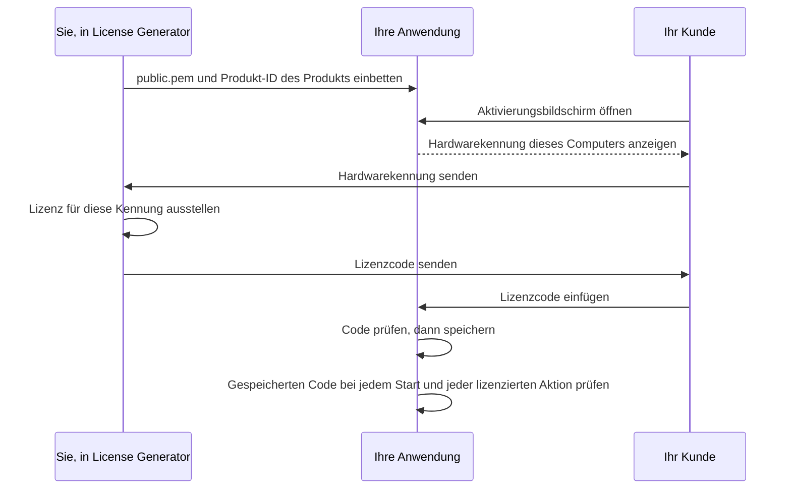

# Leitfaden zur Client-Integration

[Español](../es/INTEGRATION.md) · [English](../../INTEGRATION.md) · **Deutsch** · [Português](../pt/INTEGRATION.md) · [中文](../zh/INTEGRATION.md)

Dieser Leitfaden zeigt, wie Sie Lizenzen von License Generator in Ihrer eigenen
Anwendung prüfen: welchen Verifizierer Sie verwenden, wie ihn ein
Aktivierungsbildschirm und eine Prüfung beim Start nutzen, wie Sie eine
Hardwarekennung wählen und wie Sie Ihre Integration testen. Der
[Format- und Sicherheitsvertrag](ARCHITECTURE.md) legt jedes Byte und jede Regel
fest, die die Verifizierer anwenden; die [Bedienungsanleitung](OPERATIONS.md)
behandelt den Generator selbst.

## So funktionieren die Lizenzen



Der Generator signiert jede Lizenz mit dem privaten Schlüssel des Produkts, der
Ihren Computer nie verlässt. Ihre Anwendung enthält nur den öffentlichen
Schlüssel, der eine Signatur prüfen, aber nie erzeugen kann. Die Prüfung braucht
keinen Server: Sie läuft auf dem Gerät des Benutzers mit dem öffentlichen
Schlüssel, der Produkt-ID, der Hardwarekennung und der aktuellen Zeit, die
Ihre Anwendung übergibt.

## Einen Verifizierer wählen

Drei Referenz-Verifizierer setzen den [Vertrag](ARCHITECTURE.md) um. Jeder liefert
für jeden veröffentlichten [Testvektor](#die-integration-testen) dieselben
Ergebnisse.

| Technologie | In Ihre Anwendung kopieren | Voraussetzungen | Tests |
| --- | --- | --- | --- |
| C# | [LicenseVerifier.cs](../examples/LicenseVerifier.cs) und [LicenseProtocol.cs](../examples/LicenseProtocol.cs) | .NET 8 oder neuer; keine Pakete | Von den eigenen, nicht öffentlichen Regressionstests der Anwendung gegen die Vektoren geprüft |
| Python | [license_verifier.py](../examples/python/license_verifier.py) | Python 3.11 oder neuer und das Paket [cryptography](https://pypi.org/project/cryptography/) | [test_license_verifier.py](../examples/python/test_license_verifier.py) |
| Node.js | [license-verifier.mjs](../examples/node/license-verifier.mjs) | Node.js 20 oder neuer; nur eingebaute Module | [license-verifier.test.mjs](../examples/node/license-verifier.test.mjs) |

Die Verifizierer führen keine Ein- oder Ausgabe aus: Sie lesen weder Dateien noch
Uhr noch Netzwerk und ermitteln nie eine Hardwarekennung. Ihre Anwendung übergibt
diese Werte, sodass jede Entscheidung sichtbar und testbar bleibt.

Eine andere Technologie kann Lizenzen mit ihrer eigenen RSA-Bibliothek prüfen.
Diese Standard-APIs prüfen RSA-Signaturen nach PKCS#1 v1.5 mit SHA-256 anhand
eines öffentlichen Schlüssels im Format SubjectPublicKeyInfo; sie sind Hinweise,
keine getesteten Beispiele. Setzen Sie daher jede Regel des Vertrags um und
bestehen Sie vor der Veröffentlichung jeden Testvektor.

| Technologie | API |
| --- | --- |
| Java, Kotlin, Android | `java.security.Signature` mit `SHA256withRSA`, Schlüssel aus `X509EncodedKeySpec` |
| Go | `crypto/x509.ParsePKIXPublicKey` und `crypto/rsa.VerifyPKCS1v15` mit `crypto.SHA256`; `VerifyPKCS1v15` erwartet den SHA-256-Hash, nicht die Nachricht |
| Swift | `SecKeyCreateWithData` mit dem Schlüssel im PKCS#1-Format und `SecKeyVerifySignature` mit `.rsaSignatureMessagePKCS1v15SHA256` |
| C, C++ | `EVP_DigestVerify` von OpenSSL mit `EVP_sha256()` oder `BCryptVerifySignature` von Windows CNG mit `BCRYPT_PAD_PKCS1` |
| PHP | `openssl_verify` mit `OPENSSL_ALGO_SHA256` |
| Rust | der PKCS#1-v1.5-Verifizierer des Crates `rsa` mit SHA-256 |
| Dart, Flutter | der RSA-Signierer des Pakets `pointycastle` mit SHA-256 |
| Browser | `crypto.subtle.importKey` mit `spki` und `crypto.subtle.verify` mit `RSASSA-PKCS1-v1_5` und SHA-256 |

Eine Electron-Anwendung führt den Node.js-Verifizierer in ihrem Hauptprozess aus,
nicht in einem Renderer, der Webinhalte anzeigt. React Native bietet kein
`node:crypto`, daher läuft der Node.js-Verifizierer dort nicht unverändert. Eine
Webseite, die der Benutzer kontrolliert, kann keine Lizenz durchsetzen; prüfen
Sie dort, wo Ihre Anwendung über den Zugriff entscheidet.

Bibliotheken unterscheiden sich in Details, die den Vertrag brechen, wenn Sie ihre
Standardeinstellungen beibehalten:

| Wo | Was passiert | Was zu tun ist |
| --- | --- | --- |
| Die meisten JSON-Parser | Bei zwei gleichen Eigenschaftsnamen behalten sie den letzten. | Lehnen Sie ein Wurzelobjekt mit einem wiederholten Namen ab, bevor Sie Angaben lesen. |
| `encoding/json` in Go | Es vergleicht Namen ohne Unterscheidung von Groß- und Kleinschreibung und ersetzt ungültiges UTF-8 und ungepaarte Surrogate durch U+FFFD. | Lesen Sie das Wurzelobjekt mit `json.Decoder.Token` und vergleichen Sie Namen exakt. |
| `java.util.Base64` in Java | `getDecoder()` lehnt Leerraum ab, und `getMimeDecoder()` ignoriert jedes Zeichen außerhalb des Alphabets. | Entfernen Sie Leerzeichen, Tabulatoren und Zeilenumbrüche und dekodieren Sie dann mit `getDecoder()`. |
| `KeyFactory` in Java und Kotlin | `X509EncodedKeySpec` liest nur SubjectPublicKeyInfo. | Betten Sie `public.pem` so ein, wie der Generator sie schreibt, oder wandeln Sie einen PKCS#1-Schlüssel vorher um. |
| `SecKeyCreateWithData` in Swift | Es erwartet einen öffentlichen RSA-Schlüssel im PKCS#1-Format. | Entfernen Sie zuerst den SubjectPublicKeyInfo-Kopf oder betten Sie den Schlüssel im PKCS#1-Format ein. |
| Textlängen | Python zählt Codepunkte, Go und Rust zählen Bytes. | Zählen Sie für die Grenzen des Vertrags UTF-16-Codeeinheiten. |
| Python `cryptography` | `load_pem_public_key` liest auch einen SubjectPublicKeyInfo-Inhalt unter der Bezeichnung `RSA PUBLIC KEY`, und `load_der_public_key` liest beide Formen. | Prüfen Sie, ob der Inhalt die Form hat, die seine Bezeichnung nennt. |
| Reguläre Ausdrücke | In Python, Java und .NET passt `$` auch vor einem abschließenden Zeilenumbruch, und in Python und .NET erkennt `\d` Ziffern jeder Schrift. | Verlangen Sie, dass der ganze Text passt (`re.fullmatch`, `Matcher.matches`, `\z` in .NET), und schreiben Sie `[0-9]`. |
| Trimmfunktionen | `strip()` in Python, `trim()` in JavaScript und `Trim()` in .NET entfernen unterschiedliche Zeichen. | Entfernen Sie genau die Zeichen, die der Vertrag oder dieser Leitfaden nennt. |

## Den Verifizierer zur Anwendung hinzufügen

**C#.** Kopieren Sie beide Dateien in Ihr Projekt. Der Verifizierer liegt im
Namespace `LicenseGenerator.IntegrationExample` und verwendet den gemeinsamen
Parser in `LicenseGenerator.Protocol`; Sie können die Namespaces umbenennen. Die
Dateien verwenden .NET-8-APIs wie `PemEncoding` und C#-12-Syntax und lassen sich
daher unter .NET Framework, Unity oder Xamarin nicht unverändert kompilieren;
setzen Sie dort den Vertrag mit den verfügbaren APIs um, ausgehend von diesen
Dateien, und bestehen Sie jeden Testvektor.

**Python.** Kopieren Sie `license_verifier.py` und installieren Sie
`cryptography`. Die Beispiele werden mit den Versionen und Hashes getestet, die in
[requirements.txt](../examples/python/requirements.txt) festgelegt sind:

```text
python -m pip install --require-hashes --only-binary :all: -r requirements.txt
```

**Node.js.** Kopieren Sie `license-verifier.mjs`, ein ES-Modul, und importieren
Sie es mit `import { inspect, verify } from "./license-verifier.mjs"`.

**Der öffentliche Schlüssel.** Betten Sie die `public.pem` des Produkts als
Textkonstante oder kompilierte Ressource in Ihre Anwendung ein, zusammen mit der
exakten Produkt-ID. Lesen Sie den Schlüssel nie aus der Lizenz, aus einer Datei,
die der Benutzer ersetzen kann, oder aus einem Download, dessen Quelle Sie nicht
kontrollieren. Liefern Sie nie `private.pem` aus.

## Eine Lizenz prüfen

Jeder Verifizierer bietet zwei Aufrufe mit denselben Eingaben: den Lizenzcode,
den vertrauenswürdigen öffentlichen Schlüssel, die erwartete Produkt-ID, die
erwartete Hardwarekennung und die aktuelle UTC-Zeit. Eine Zeit, die sich nicht in
UTC einordnen lässt, ist ein Programmierfehler: Der Python-Verifizierer löst bei
einem `datetime` ohne Zeitzone `ValueError` aus, der Node.js-Verifizierer bei
einem ungültigen `Date` einen `TypeError`.

- **verify** (`TryVerify` in C#) gibt die Lizenz nur zurück, wenn sie für dieses
  Produkt, diesen Computer und diesen Zeitpunkt gültig ist. Es verlangt die
  erwartete Hardwarekennung: Ohne sie gibt es keine Lizenz zurück, auch keine
  ungebundene. Verwenden Sie es überall, wo über den Zugriff entschieden wird.
- **inspect** (`Inspect` in C#) gibt entweder eine Ablehnung mit ihrem Grund
  zurück oder eine authentifizierte Lizenz mit getrennten Prüfungen von Produkt,
  Hardware und Ablauf sowie ihrer Gesamtgültigkeit. Verwenden Sie es dort, wo Sie
  dem Benutzer sagen müssen, was nicht stimmt.

Die Ergebnisse haben in jedem Verifizierer diese Form:

| Verifizierer | Ablehnung | Authentifiziert | Lizenz |
| --- | --- | --- | --- |
| C# | `LicenseInspectionResult.Rejected` mit `Reason` | `LicenseInspectionResult.Authenticated` mit `License`, `Product`, `Hardware`, `Expiration` und `IsValid` | `VerifiedLicense` mit `AppId`, `RegistrationName`, `HardwareId`, `ExpirationDate` (ein `DateTime` in UTC), `UserDefined`, `FormatVersion` und `RevocationId` |
| Python | `Rejected` mit `reason` | `Authenticated` mit `license`, `product`, `hardware`, `expiration` und `is_valid` | `VerifiedLicense` mit `app_id`, `registration_name`, `hardware_id`, `expiration_date` (ein `date`), `user_defined`, `format_version` und `revocation_id` |
| Node.js | `{ result: "rejected", reason }` | `{ result: "authenticated", license, product, hardware, expiration, isValid }` | Ein Objekt mit `appId`, `registrationName`, `hardwareId`, `expirationDate` (ein Text `yyyy-MM-dd`), `userDefined`, `formatVersion` und `revocationId` |

Ein fehlendes Ablaufdatum oder ein fehlender benutzerdefinierter Text ist null
(`None` in Python), ebenso die Formatversion einer Lizenz im bisherigen Format,
die die Testvektoren als 1 schreiben. Die Gründe und Prüfungen sind die
Mitglieder von `LicenseInspectionFailure`, `LicenseProductCheck`,
`LicenseHardwareCheck` und `LicenseExpirationCheck` in C# und von
`InspectionFailure`, `ProductCheck`, `HardwareCheck` und `ExpirationCheck` in
Python und JavaScript, mit denselben Namen in Großbuchstaben mit Unterstrichen
(`MALFORMED_LICENSE`, `NOT_BOUND`, `NEVER_EXPIRES`) und den Werten, die die
Testvektoren verwenden (`malformed`, `not-bound`, `never`).

Eine Lizenz, die mit leerer Hardwarekennung ausgestellt wurde, ist ungebunden:
Sie besteht die Hardwareprüfung unabhängig davon, welche Kennung Ihre Anwendung
erwartet. Um die Hardwareprüfung bewusst auszulassen, übergeben Sie `null`
(`None` in Python) an `inspect`; eine gebundene Lizenz gilt dann als nicht
geprüft und ist nie gültig. Der Node.js-Verifizierer lehnt eine weggelassene
(`undefined`) Hardwarekennung ab, damit ein fehlendes Argument die Prüfung nicht
versehentlich auslassen kann.

## Einen Aktivierungsbildschirm erstellen

Ihre Anwendung braucht einen Bildschirm, auf dem der Benutzer die
Hardwarekennung sehen, einen Lizenzcode einfügen und ihn aktivieren kann:

```text
┌────────────────────────────────────────────────────────────────────┐
│ Lizenzaktivierung                                                  │
│                                                                    │
│ ID dieses Computers                                                │
│ 05A68D939433F5BABB1D30D04974999056C8AFAF60D867DA80241F9F99E5FA01   │
│                                                         [Kopieren] │
│ Lizenzcode                                                         │
│ ┌────────────────────────────────────────────────────────────────┐ │
│ │ ewogICJBcHBJZCI6ICJOb3J0aHN0YXItU3R1ZGlvIiwKICAiUmVnaXN0cmF... │ │
│ └────────────────────────────────────────────────────────────────┘ │
│                                                       [Aktivieren] │
│ Aktiviert für Alex Morgan.                                         │
└────────────────────────────────────────────────────────────────────┘
```

Zeigen Sie die vollständige Hardwarekennung mit einer Schaltfläche zum Kopieren:
Die Lizenz wird für genau diesen Text ausgestellt. Wenn der Benutzer aktiviert,
prüfen Sie den Code, speichern Sie ihn, wenn er gültig ist, und erklären Sie
andernfalls, was nicht stimmt. Diese Funktionen setzen voraus, dass Ihre Anwendung
`PUBLIC_KEY`, `PRODUCT_ID`, `hardware_id()` und `save_license_code()` bereitstellt
(oder deren Entsprechungen in C# und JavaScript). Die Meldungen sind wie im
getesteten Beispiel englisch; übersetzen Sie sie in Ihrer Anwendung.

<!-- excerpt: csharp-activation -->
```csharp
static string Activate(string licenseCode)
{
    var result = LicenseVerifier.Inspect(licenseCode, PublicKey, ProductId, HardwareId(), DateTimeOffset.UtcNow);
    if (result is LicenseInspectionResult.Authenticated { IsValid: true } activated)
    {
        SaveLicenseCode(licenseCode);
        return $"Activated for {activated.License.RegistrationName}.";
    }
    return ActivationProblem(result);
}

static string ActivationProblem(LicenseInspectionResult result) => result switch
{
    LicenseInspectionResult.Rejected { Reason: LicenseInspectionFailure.MalformedLicense } =>
        "Paste the complete license code you received.",
    LicenseInspectionResult.Rejected { Reason: LicenseInspectionFailure.UnsupportedFormat } =>
        "This license needs a newer version of the application.",
    LicenseInspectionResult.Rejected { Reason: LicenseInspectionFailure.SignatureMismatch } =>
        "This license was not issued for this application.",
    LicenseInspectionResult.Rejected => "This copy cannot check licenses. Contact support.",
    LicenseInspectionResult.Authenticated { Product: LicenseProductCheck.Mismatch } =>
        "This license is for another product.",
    LicenseInspectionResult.Authenticated { Hardware: LicenseHardwareCheck.Mismatch } =>
        $"This license is for another computer. Send us this computer's ID: {HardwareId()}",
    LicenseInspectionResult.Authenticated
        { Expiration: LicenseExpirationCheck.Expired, License.ExpirationDate: DateTime expired } =>
        $"This license expired on {expired.ToString("yyyy-MM-dd", CultureInfo.InvariantCulture)}.",
    _ => "This license cannot be used on this computer.",
};
```

<!-- excerpt: python-activation -->
```python
def activate(license_code):
    result = license_verifier.inspect(license_code, PUBLIC_KEY, PRODUCT_ID, hardware_id(),
                                      datetime.now(timezone.utc))
    if isinstance(result, license_verifier.Authenticated) and result.is_valid:
        save_license_code(license_code)
        return "Activated for %s." % result.license.registration_name
    return activation_problem(result)


REJECTION_MESSAGES = {
    license_verifier.InspectionFailure.MALFORMED_LICENSE: "Paste the complete license code you received.",
    license_verifier.InspectionFailure.UNSUPPORTED_FORMAT: "This license needs a newer version of the application.",
    license_verifier.InspectionFailure.SIGNATURE_MISMATCH: "This license was not issued for this application.",
}


def activation_problem(result):
    if isinstance(result, license_verifier.Rejected):
        return REJECTION_MESSAGES.get(result.reason, "This copy cannot check licenses. Contact support.")
    if result.product is license_verifier.ProductCheck.MISMATCH:
        return "This license is for another product."
    if result.hardware is license_verifier.HardwareCheck.MISMATCH:
        return "This license is for another computer. Send us this computer's ID: %s" % hardware_id()
    if result.expiration is license_verifier.ExpirationCheck.EXPIRED:
        return "This license expired on %s." % result.license.expiration_date.isoformat()
    return "This license cannot be used on this computer."
```

<!-- excerpt: javascript-activation -->
```javascript
export function activate(licenseCode) {
  const result = inspect(licenseCode, PUBLIC_KEY, PRODUCT_ID, hardwareId(), new Date());
  if (result.result === "authenticated" && result.isValid) {
    saveLicenseCode(licenseCode);
    return `Activated for ${result.license.registrationName}.`;
  }
  return activationProblem(result);
}

const REJECTION_MESSAGES = new Map([
  [InspectionFailure.MALFORMED_LICENSE, "Paste the complete license code you received."],
  [InspectionFailure.UNSUPPORTED_FORMAT, "This license needs a newer version of the application."],
  [InspectionFailure.SIGNATURE_MISMATCH, "This license was not issued for this application."],
]);

export function activationProblem(result) {
  if (result.result === "rejected") {
    return REJECTION_MESSAGES.get(result.reason) ?? "This copy cannot check licenses. Contact support.";
  }
  if (result.product === ProductCheck.MISMATCH) return "This license is for another product.";
  if (result.hardware === HardwareCheck.MISMATCH) {
    return `This license is for another computer. Send us this computer's ID: ${hardwareId()}`;
  }
  if (result.expiration === ExpirationCheck.EXPIRED) {
    return `This license expired on ${result.license.expirationDate}.`;
  }
  return "This license cannot be used on this computer.";
}
```

Die C#-Funktionen verwenden die Namespaces `System.Globalization` und
`LicenseGenerator.IntegrationExample`. Die Python-Funktionen importieren
`datetime` und `timezone` aus `datetime` sowie `license_verifier`. Die
JavaScript-Funktionen importieren `inspect`, `InspectionFailure`, `ProductCheck`,
`HardwareCheck` und `ExpirationCheck` aus dem Modul des Verifizierers.

Was jedes Ergebnis für den Benutzer bedeutet:

| Ergebnis | Bedeutung | Was Sie dem Benutzer sagen |
| --- | --- | --- |
| `malformed` | Der Text ist kein vollständiger Lizenzcode: gekürzt, verändert oder überhaupt keine Lizenz. | Den vollständigen Code einfügen. |
| `unsupported-format` | Die Lizenz verwendet ein neueres Format als dieser Verifizierer. | Die Anwendung aktualisieren. |
| `signature-mismatch` | Die Lizenz wurde mit dem Schlüssel eines anderen Produkts ausgestellt oder ihr Text wurde verändert. | Die Lizenz gilt nicht für diese Anwendung. |
| `invalid-public-key`, `invalid-expected-product` | Ihre Anwendung hat einen unbrauchbaren Schlüssel oder eine inhaltsleere Produkt-ID übergeben. | Nichts, was er beheben kann: Protokollieren Sie es und korrigieren Sie den Build. |
| Produkt `mismatch` | Echt, aber für ein anderes Ihrer Produkte ausgestellt. | Die Lizenz gilt für ein anderes Produkt. |
| Hardware `mismatch` | Echt, aber für eine andere Hardwarekennung ausgestellt. | Die Lizenz gilt für einen anderen Computer; zeigen Sie die Kennung dieses Computers. |
| Ablauf `expired` | Echt, aber ihr Ablaufdatum hat begonnen. | Die Lizenz ist an ihrem Datum abgelaufen. |

## Die Lizenz aufbewahren und erneut prüfen

Speichern Sie den Lizenzcode selbst, kein „lizenziert“-Kennzeichen und kein
Prüfergebnis. Bewahren Sie ihn im benutzerspezifischen Datenordner Ihrer
Anwendung auf: zum Beispiel `%LOCALAPPDATA%\YourApp` unter Windows,
`~/Library/Application Support/YourApp` unter macOS, `$XDG_DATA_HOME/YourApp`
(meist `~/.local/share/YourApp`) unter Linux, dem internen Speicher der App
(`Context.getFilesDir()`) unter Android oder dem Ordner Application Support im
Container der App unter iOS. Eine Sicherung kann den Code auf einem anderen Gerät
wiederherstellen; dort schlägt die Hardwareprüfung fehl, und der Benutzer
aktiviert erneut. Der Code ist signiert, nicht verschlüsselt: Wer ihn liest, sieht den Namen des Kunden, die Hardwarekennung und
die benutzerdefinierten Daten, kann sie aber nicht ändern, ohne die Signatur zu
zerstören.

Prüfen Sie den gespeicherten Code bei jedem Start und vor jeder lizenzierten
Aktion erneut mit der aktuellen Zeit. Ein zwischengespeichertes `true` ließe
eine abgelaufene Lizenz weiter funktionieren. Wenn die Prüfung fehlschlägt,
zeigen Sie wieder den Aktivierungsbildschirm. Diese Funktionen setzen voraus,
dass Ihre Anwendung `load_license_code()` bereitstellt, das den gespeicherten
Code oder nichts zurückgibt.

<!-- excerpt: csharp-startup -->
```csharp
static VerifiedLicense? CurrentLicense()
{
    var licenseCode = LoadLicenseCode();
    if (licenseCode is null) return null;
    return LicenseVerifier.TryVerify(licenseCode, PublicKey, ProductId, HardwareId(), DateTimeOffset.UtcNow,
        out var license) ? license : null;
}
```

<!-- excerpt: python-startup -->
```python
def current_license():
    license_code = load_license_code()
    if license_code is None:
        return None
    return license_verifier.verify(license_code, PUBLIC_KEY, PRODUCT_ID, hardware_id(), datetime.now(timezone.utc))
```

<!-- excerpt: javascript-startup -->
```javascript
export function currentLicense() {
  const licenseCode = loadLicenseCode();
  if (licenseCode === null) return null;
  return verify(licenseCode, PUBLIC_KEY, PRODUCT_ID, hardwareId(), new Date());
}
```

## Eine Hardwarekennung wählen

Eine hardwaregebundene Lizenz nennt eine Hardwarekennung, und Ihre Anwendung
entscheidet, wie sie berechnet wird. Der Generator signiert jeden Text, den Sie
eingeben. Eine gute Kennung ist:

- **Deterministisch.** Derselbe Computer liefert bei jedem Start und nach jedem
  Update Ihrer Anwendung denselben Text.
- **Exakt.** Der auf dem Aktivierungsbildschirm angezeigte Text ist der Text, der
  später geprüft wird. Der Vergleich ist ordinal: Groß- und Kleinschreibung,
  Leerzeichen und Zeilenumbrüche zählen.
- **Vollständig.** Kürzen Sie sie nie; eine kurze Kennung lässt zwei Computer eine
  Lizenz teilen.
- **Ehrlich bei Fehlern.** Wenn die Quelle nicht verfügbar ist, melden Sie einen
  Fehler. Weichen Sie nie auf einen gemeinsamen Wert wie `UNKNOWN-HWID`, den
  Rechnernamen oder einen leeren Text aus: Eine leere Hardwarekennung bedeutet
  eine ungebundene Lizenz.

Betriebssysteme bieten eine Computerkennung als Ausgangspunkt:

| System | Quelle | Ändert sich, wenn |
| --- | --- | --- |
| Windows | `MachineGuid` unter `HKEY_LOCAL_MACHINE\SOFTWARE\Microsoft\Cryptography` | Windows neu installiert wird; aus einem Abbild geklonte Computer können sie teilen |
| Linux | `/etc/machine-id` | das System neu installiert wird; Container und geklonte Abbilder können sie teilen oder neu erzeugen |
| macOS | `IOPlatformUUID` von `IOPlatformExpertDevice` in der I/O Registry | die Hauptplatine ersetzt wird |
| Android | `Settings.Secure.ANDROID_ID` | das Gerät auf Werkseinstellungen zurückgesetzt wird; seit Android 8.0 unterscheidet sie sich zudem je App-Signaturschlüssel und Benutzer |
| iOS, iPadOS | Apps steht keine Hardwarekennung zur Verfügung: `identifierForVendor` oder eine einmal erzeugte UUID, die Sie im Schlüsselbund ablegen | `identifierForVendor` ändert sich, wenn alle Ihre Apps vom Gerät entfernt werden; ein Schlüsselbundeintrag übersteht eine Neuinstallation meist |

Ein 32-Bit-Prozess unter 64-Bit-Windows liest eine umgeleitete Ansicht der
Registrierung ohne `MachineGuid`: Öffnen Sie die 64-Bit-Ansicht
(`RegistryView.Registry64` in .NET, `KEY_WOW64_64KEY` in Win32).

Zeigen Sie die Rohkennung nicht an: Die Handbuchseite `machine-id(5)` bittet
Anwendungen, `/etc/machine-id` nicht offenzulegen und stattdessen mit einem
anwendungsspezifischen Schlüssel zu hashen. Leiten Sie Ihre eigene Kennung mit
HMAC-SHA-256 ab, mit den UTF-8-Bytes Ihrer Produkt-ID als Schlüssel, über die
UTF-8-Bytes der Systemkennung ohne die Leerzeichen, Tabulatoren, Wagenrückläufe
und Zeilenvorschübe an ihrem Anfang und Ende, etwa den Zeilenumbruch am Ende von
`/etc/machine-id`, und schreiben Sie sie als 64 Hexadezimalzeichen in
Großschreibung. Entfernen Sie nur diese vier Zeichen und behalten Sie alle
anderen: Die Trimmfunktionen der einzelnen Sprachen entfernen unterschiedliche
Zeichen. Jede Technologie berechnet dann für denselben Computer und dasselbe
Produkt dieselbe Kennung; die `hardwareIdExamples` der
[Testvektoren](../examples/test-vectors.json) veröffentlichen zwei zum Vergleich. Diese Funktionen brauchen
`System.Security.Cryptography` und `System.Text` in C#, `hashlib` und `hmac` in
Python sowie `createHmac` aus `node:crypto` in JavaScript.

<!-- excerpt: csharp-hardware-id -->
```csharp
static string DeriveHardwareId(string machineId, string productId)
{
    var identifier = machineId.Trim(' ', '\t', '\r', '\n');
    return Convert.ToHexString(HMACSHA256.HashData(Encoding.UTF8.GetBytes(productId), Encoding.UTF8.GetBytes(identifier)));
}
```

<!-- excerpt: python-hardware-id -->
```python
def derive_hardware_id(machine_id, product_id):
    identifier = machine_id.strip(" \t\r\n")
    digest = hmac.new(product_id.encode("utf-8"), identifier.encode("utf-8"), hashlib.sha256)
    return digest.hexdigest().upper()
```

<!-- excerpt: javascript-hardware-id -->
```javascript
export function deriveHardwareId(machineId, productId) {
  const identifier = machineId.replace(/^[ \t\r\n]+|[ \t\r\n]+$/g, "");
  return createHmac("sha256", productId).update(identifier).digest("hex").toUpperCase();
}
```

Eine Hardwarekennung ist eine Regel Ihrer Anwendung, kein Nachweis eines
physischen Computers: Ein Benutzer, der das Gerät kontrolliert, kann ändern, was
Ihre Anwendung liest.

## UserDefined verwenden

Eine Lizenz kann signierten benutzerdefinierten Text, UserDefined, für Funktionen,
Tarife oder andere von Ihrer Anwendung festgelegte Daten enthalten. Lesen Sie ihn
nur aus einer gültigen Lizenz; vor der Prüfung ist er nicht vertrauenswürdiger
Text. Wählen Sie eine einfache, versionierte Syntax wie
`features=reports,export;plan=professional`, lehnen Sie einen Text ab, den Ihre
Version nicht versteht, und behandeln Sie eine Lizenz ohne ihn als Ihren
Grundumfang. Legen Sie keine Geheimnisse darin ab: Er ist kodiert, nicht
verschlüsselt.

Eine Lizenz mit UserDefined verwendet Format 2. Ein Client, der vor Format 2
entstanden ist, lehnt sie ab; aktualisieren Sie daher jeden Client, der solche
Lizenzen annehmen soll, bevor Sie sie ausstellen.

## Ablauf und Uhr

Das Ablaufdatum wird als Kalenderdatum signiert, und eine Lizenz läuft um
**00:00 UTC zu Beginn dieses Datums** ab. Um die Nutzung bis zum Ende des 10. Juni
zu erlauben, stellen Sie die Lizenz mit dem 11. Juni aus. Übergeben Sie die
aktuelle Zeit in UTC; die Verifizierer vergleichen sie unabhängig von der
Zeitzone des Benutzers mit diesem Zeitpunkt.

Ihre Anwendung liest die Uhr eines Geräts, das der Benutzer kontrolliert. Ein
Benutzer kann sie zurückstellen, damit eine abgelaufene Lizenz weiter
funktioniert. Wo das wichtig ist, prüfen Sie die Zeit zusätzlich zur
Offline-Prüfung bei einem Dienst, dem Sie vertrauen.

## Updates, Widerruf und Schlüsselwechsel

Eine Offline-Lizenz lässt sich nicht aus der Ferne widerrufen: Das Gerät des
Benutzers braucht für die Prüfung keinen Server. Was Sie in einem Update Ihrer
Anwendung tun können:

- **Einzelne Lizenzen widerrufen.** Liefern Sie eine Liste widerrufener
  Lizenzkennungen aus und lehnen Sie eine geprüfte Lizenz ab, deren Kennung auf
  der Liste steht. Jeder Verifizierer gibt sie mit der Lizenz zurück
  (`revocationId`, in C# `RevocationId`, in Python `revocation_id`); prüfen Sie
  einen Lizenzcode mit einem davon, um sie zu lesen. Nehmen Sie nie
  `Signature`-Texte in die Liste auf: Dieselbe Lizenz lässt sich auf mehr als
  eine Weise schreiben, und jede Schreibweise hat dieselbe Kennung.
- **Schlüssel für eine neue Hauptversion wechseln.** Erstellen Sie im Generator
  ein neues Produkt, zum Beispiel `MyApp-2`, und betten Sie dessen öffentlichen
  Schlüssel und Produkt-ID ein: Für das alte Produkt ausgestellte Lizenzen
  bestehen die Prüfung dann nicht mehr. Um sie eine Zeit lang weiter
  anzunehmen, prüfen Sie mit dem neuen Schlüssel und der neuen Produkt-ID und
  danach mit den alten.
- **Einen offengelegten oder verlorenen Schlüssel ersetzen.** Wird ein privater
  Schlüssel offengelegt, kann jeder Lizenzen ausstellen, die Ihre Anwendung
  annimmt; geht er verloren, können Sie keine neuen ausstellen. In beiden Fällen
  liefern Sie einen neuen öffentlichen Schlüssel aus und stellen die Lizenzen neu
  aus.

## Die Integration testen

[test-vectors.json](../examples/test-vectors.json) enthält einen öffentlichen
Testschlüssel, dem kein echtes Produkt vertraut, das erwartete Produkt und die
erwartete Hardwarekennung, einen festen Prüfzeitpunkt sowie vom Generator
ausgestellte Lizenzen mit dem Ergebnis, das jede liefern muss:

- `cases` führt jede Lizenz mit ihrem Ergebnis `expected` auf: einem
  Ablehnungsgrund `reason` oder den Prüfungen `product`, `hardware` und
  `expiration` der authentifizierten Lizenz, der Gesamtgültigkeit `valid`, den
  dekodierten Angaben und der `revocationId`. `formatVersion` ist 1 bei einer
  Lizenz im bisherigen Format, deren JSON es weglässt. `issue` hält fest, wie der
  Generator einen Fall ausgestellt hat, `derive`, wie ein Fall nach dem Signieren
  aus einem anderen verändert wurde, und `copy`, dass er die Lizenz eines anderen
  Falls unverändert übernimmt. Ein Fall kann eigene Werte für `publicKey`,
  `expectedAppId` oder `expectedHardwareId` setzen; eine Hardwarekennung null
  bedeutet, dass die Prüfung ausgelassen wird. Eine verify-Funktion gibt die
  Lizenz genau bei den gültigen Fällen zurück, die die Hardwareprüfung nicht
  auslassen.
- `expirationTexts` führt Texte für das Ablaufdatum auf, die ein Verifizierer als
  das signierte Datum lesen oder ablehnen muss, sowie die Zeitpunkte beiderseits
  der Grenze, zu denen jeder angenommene Text noch nicht und danach bereits
  abgelaufen ist.
- `hardwareIdExamples` gibt Computerkennungen mit einer Produkt-ID und der
  Hardwarekennung an, die die obige Ableitung aus jeder berechnet; die zweite
  behält an ihren Enden Zeichen, die manche Trimmfunktionen entfernen.

Verwenden Sie beim Vergleichen der Ergebnisse den veröffentlichten
Prüfzeitpunkt, nicht den aktuellen. Die Referenz-Testsuiten führen jeden Fall
aus; die Python-Suite braucht `cryptography`, installiert wie oben beschrieben:

```text
cd docs/examples/python
python -m unittest
cd ../node
node --test license-verifier.test.mjs
```

Die CI des öffentlichen Repositorys führt beide Testsuiten bei jedem Push und
Pull Request aus. Lesen Sie in einem C#-Client dieselbe Datei in Ihren eigenen
Tests und vergleichen Sie `LicenseVerifier.Inspect` mit jedem erwarteten Ergebnis.

## Fehlerbehebung

| Symptom | Prüfen |
| --- | --- |
| Jede Lizenz ergibt `signature-mismatch` | Der eingebettete Schlüssel ist die vollständige `public.pem` des Produkts einschließlich der Zeilen BEGIN und END, und die Lizenz wurde für dieses Produkt ausgestellt. |
| `malformed` bei einem Code, den der Generator korrekt prüft | Der Code wurde beim Kopieren gekürzt oder verändert; Zeilenumbrüche darin werden akzeptiert, andere Zeichen nicht. |
| `unsupported-format` | Ihr Verifizierer ist älter als das Format der Lizenz; aktualisieren Sie ihn. |
| Hardware `mismatch` auf dem richtigen Computer | Ihre Anwendung berechnet dieselbe Kennung, die sie angezeigt hat; Groß- und Kleinschreibung und Leerzeichen zählen. Container und virtuelle Maschinen können eine andere Computerkennung sehen. |
| Einen Tag zu früh abgelaufen | Die Grenze ist 00:00 UTC zu Beginn des Ablaufdatums; stellen Sie die Lizenz mit dem folgenden Tag aus. |
| Funktioniert in der Entwicklung, scheitert in der Produktion | Die Produktion bettet einen anderen öffentlichen Schlüssel oder eine andere Produkt-ID ein oder berechnet eine andere Hardwarekennung. |

## Lizenz der Beispiele

Abschnitt 2 der [EULA](../../LICENSE) (auf Englisch) erlaubt Ihnen, die
Dateien unter `docs/examples` als Teil Ihrer kommerziellen oder kostenlosen
Anwendungen, die Lizenzen prüfen, zu verwenden, zu kopieren, zu ändern und
weiterzugeben, sofern ihr Urheberrechtshinweis erhalten bleibt. Sie gewährt
keine Rechte an der Anwendung License Generator selbst.

[Problem melden](https://github.com/gonzapersonalsite/license-generator-docs/issues) · [Entwicklung unterstützen](https://ko-fi.com/gonzaloapps)
