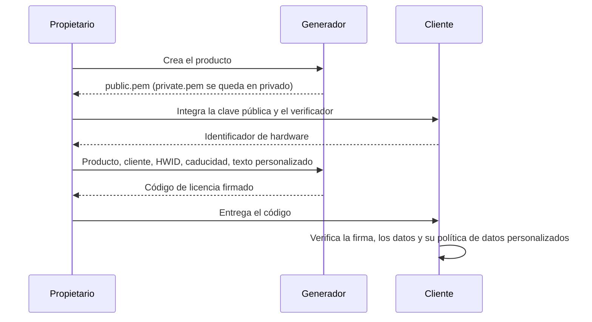

# Contrato de formato y seguridad de la licencia

**Español** · [English](../../ARCHITECTURE.md) · [Deutsch](../de/ARCHITECTURE.md) · [Português](../pt/ARCHITECTURE.md) · [中文](../zh/ARCHITECTURE.md)

Este documento define cada byte que contiene una licencia de License Generator y
cada regla que un cliente debe aplicarle. La [guía de integración](INTEGRATION.md)
muestra cómo aplicarlas en una aplicación; los verificadores de referencia en C#,
Python y Node.js las implementan y superan los mismos vectores de prueba
publicados. El texto inglés es la referencia técnica.

## Papeles

El generador conserva las claves privadas; las aplicaciones cliente reciben únicamente las públicas. RSA firma los datos de la licencia. Cada cliente verifica la firma, el producto y el identificador de hardware esperados, la caducidad y sus propias reglas opcionales sobre los datos personalizados.



## Transporte y claves

Un código de licencia es Base64 estándar con relleno de un JSON en UTF-8. Los nombres de propiedad JSON distinguen mayúsculas y minúsculas. Los espacios en blanco y el orden de las propiedades no afectan a la firma, porque el mensaje firmado se construye a partir de los campos siguientes. El generador sangra su JSON con los saltos de línea del sistema en el que se ejecuta, así que dos licencias con los mismos datos pueden tener distinto texto; no compares nunca textos de licencia.

Las claves son RSA-2048. `private.pem` usa PKCS#8 y `public.pem` usa SubjectPublicKeyInfo. Las firmas usan RSA PKCS#1 v1.5 con SHA-256 y después Base64 estándar con relleno. Un verificador debe seleccionar este algoritmo de forma explícita.

| Propiedad | Tipo JSON | Significado |
| --- | --- | --- |
| AppId | string | Identificador exacto del producto |
| RegistrationName | string | Nombre del cliente o del registro |
| HardwareId | string | Identificador de hardware exacto que aporta el cliente; vacío significa sin vinculación al hardware |
| ExpirationDate | texto de fecha y hora ISO o null | Fecha de calendario gregoriano firmada, o sin caducidad |
| Signature | string | Firma RSA en Base64 |
| UserDefined | string, omitida si está vacía | Texto firmado opcional definido por la aplicación |
| FormatVersion | entero, omitido en el formato heredado | `2` cuando UserDefined no está vacío |

Todo el texto distingue mayúsculas y minúsculas y debe conservarse sin normalizar ni recortar al reconstruir una firma. Los nombres de producto y de cliente no pueden estar en blanco. HardwareId es un string y puede estar vacío en una licencia sin vinculación. Un UserDefined ausente, null o vacío selecciona el formato heredado y no debe usarse como derecho de uso. En ese caso los generadores omiten las dos propiedades nuevas, lo que mantiene la compatibilidad con clientes existentes que rechazan propiedades JSON desconocidas.

Los límites de texto se miden en unidades de código UTF-16, como `string.Length` en C# y `String.length` en JavaScript: AppId 128, RegistrationName 1.024, HardwareId 1.024 y UserDefined 8.192. AppId tiene además un límite de 255 bytes UTF-8. Rechaza las secuencias de sustitutos Unicode no válidas en lugar de reemplazarlas en silencio al codificar en UTF-8.

## Mensaje firmado heredado

En las licencias heredadas, FormatVersion está ausente, es null o vale `1`, y UserDefined está ausente, es null o está vacío. Los generadores omiten la versión por compatibilidad. Se firman estos bytes UTF-8:

```text
AppId|RegistrationName|HardwareId|yyyy-MM-dd
```

Usa `NEVER` en lugar de la fecha cuando la caducidad es null. Formatea la fecha gregoriana con la referencia cultural invariable. Los tres campos de texto no pueden contener `|`: unos límites de campo ambiguos permitirían interpretar un valor firmado como otros datos. La generación nueva y los verificadores de referencia rechazan esas licencias heredadas; vuelve a emitir una licencia antigua que contenga ese separador.

## Mensaje firmado del formato 2

Un UserDefined no vacío exige `FormatVersion: 2`. Codifica de forma independiente cada uno de estos cinco textos en Base64 estándar con relleno sobre sus bytes UTF-8:

1. AppId
2. RegistrationName
3. HardwareId
4. `yyyy-MM-dd` invariable, o `NEVER`
5. UserDefined

Une los cinco textos codificados con `|` y antepón `LG2|`. Firma los bytes UTF-8 de ese texto completo:

```text
LG2|Base64(AppId)|Base64(RegistrationName)|Base64(HardwareId)|Base64(date)|Base64(UserDefined)
```

La notación `Base64(...)` es explicativa, no texto literal. Codificar cada campo por separado mantiene sin ambigüedad los separadores, el Unicode y el texto personalizado de varias líneas. El formato 2 con texto personalizado vacío no es válido. No reintentes nunca como heredado un fallo del formato 2.

Un cliente antiguo no puede verificar el formato 2. Actualízalo antes, o deja UserDefined vacío al emitir licencias compatibles.

## Caducidad

Solo se firma la fecha de calendario; ni el texto de la hora ni la conversión de zona horaria pueden alargarla. El límite de caducidad son **las 00:00:00 UTC del inicio de esa fecha**, no el final. Para una fecha de caducidad D, el último instante válido es anterior a la medianoche UTC del inicio de D. Una fecha null significa sin caducidad. Así se mantiene el límite original al principio de la fecha y se hace explícita la zona horaria.

El generador escribe la fecha como `yyyy-MM-ddT00:00:00`. Un verificador acepta un texto de ExpirationDate solo cuando todo el texto encaja con esta expresión, sin nada detrás, ni siquiera un salto de línea; sus diez primeros caracteres son una fecha gregoriana a partir del año 1; la hora es como máximo 23, los minutos y segundos como máximo 59, los minutos del desfase como máximo 59 y el desfase como máximo 14:00; y el instante que escribe, leído como UTC cuando no lleva desfase y sin contar las fracciones de segundo, existe entre los años 1 y 9999 en UTC:

```text
^[0-9]{4}-[0-9]{2}-[0-9]{2}(T[0-9]{2}:[0-9]{2}(:[0-9]{2}(\.[0-9]{1,16})?)?(Z|[+-][0-9]{2}(:[0-9]{2})?)?)?$
```

Los diez primeros caracteres son la fecha firmada; la hora y el desfase nunca mueven el límite. La tabla `expirationTexts` de los [vectores de prueba](../examples/test-vectors.json) recoge textos aceptados y rechazados, y los instantes a ambos lados del límite en los que cada texto aceptado debe estar vigente y después caducado.

## Reglas de verificación

Un verificador recibe de la aplicación, nunca de la licencia, el código de licencia, la clave pública de confianza, el producto esperado, el identificador de hardware esperado y la hora actual. Un producto esperado en blanco, y una clave pública en blanco o de más de 65.536 unidades de código UTF-16, son errores de la aplicación y se rechazan antes de leer la licencia. Después, el verificador aplica estas reglas por orden.

Un texto está **en blanco** cuando está vacío o solo contiene los espacios en blanco que define `char.IsWhiteSpace` de .NET: tabulador, salto de línea, tabulador vertical, avance de página, retorno de carro, U+0085 y los separadores Unicode de espacio, línea y párrafo (categorías Zs, Zl y Zp). U+001C a U+001F no son espacios en blanco aquí, aunque Java y Python los traten como tales.

1. **Envoltorio.** Rechaza como malformado un código en blanco o de más de 131.072 unidades de código UTF-16, o que no sea Base64 estándar con relleno; se ignoran los espacios, tabuladores, retornos de carro y saltos de línea entre caracteres Base64, y ningún otro carácter. El JSON decodificado debe ocupar como máximo 98.304 bytes de UTF-8 sin marca de orden de bytes, ser JSON estricto RFC 8259 (sin comentarios, comas finales ni `NaN`), anidar como máximo ocho niveles y tener en la raíz un objeto con nombres de propiedad únicos y sin escapes de sustituto sin pareja. Las propiedades desconocidas se ignoran y sus valores no se leen: no están firmadas.
2. **Datos**, en este orden. Primero los textos: AppId, RegistrationName, HardwareId y Signature deben ser strings, todos salvo HardwareId no en blanco, y UserDefined un string o null, sin que ninguno contenga un escape de sustituto sin pareja. Una ExpirationDate, un UserDefined o un FormatVersion ausentes se leen como null, igual que un UserDefined vacío; un UserDefined hecho de espacios en blanco no está vacío. Después, FormatVersion debe ser null o un entero de 32 bits escrito sin decimales ni exponente; cualquier entero distinto de 1 o 2 es un **formato no admitido**, un rechazo distinto. Después, ExpirationDate debe ser null o un texto de fecha como el descrito arriba. Por último se comprueban los límites de texto, el separador heredado y la combinación de formato y datos personalizados como en las secciones anteriores, y el texto de Signature debe ser Base64 estándar con relleno de al menos un byte, ignorando los mismos caracteres que en el código. Cualquier otro fallo de este paso es malformado.
3. **Firma.** Solo ahora se lee la clave. La clave de confianza debe tener como máximo 65.536 unidades de código UTF-16 con un único bloque PEM etiquetado `PUBLIC KEY` con un cuerpo SubjectPublicKeyInfo o `RSA PUBLIC KEY` con un cuerpo PKCS#1, con solo espacios en blanco alrededor del bloque y solo espacios, tabuladores, retornos de carro y saltos de línea dentro de su cuerpo Base64, cuya codificación DER no contenga nada tras la clave, para RSA de al menos 2048 bits. Nunca se acepta una clave privada. Verifica RSA PKCS#1 v1.5 con SHA-256 sobre el mensaje firmado; un fallo es una **firma no coincidente**, que no distingue una clave pública equivocada de unos datos firmados alterados.
4. **Política.** Solo una licencia autenticada se compara con lo que espera la aplicación, y cada comprobación se informa por separado: el producto coincide cuando AppId es igual al producto esperado en comparación ordinal; el hardware no está vinculado cuando HardwareId está vacío, coincide cuando es igual al valor esperado en comparación ordinal y queda **sin comprobar** solo cuando la aplicación no pasa a propósito ningún valor esperado; la licencia ha caducado cuando la hora actual es igual o posterior al límite.

Una licencia es válida solo cuando su producto coincide, su hardware no está vinculado o coincide, y nunca caduca o no ha caducado. Una licencia cuyo hardware no se comprobó no es válida. Una función que solo devuelve licencias válidas exige un identificador de hardware esperado y, sin él, no devuelve ninguna licencia, ni siquiera una no vinculada, para que un valor ausente no pueda saltarse la comprobación. Vuelve a validar en cada decisión de acceso; un resultado correcto en caché no debe saltarse la caducidad. Lee e interpreta UserDefined solo a partir de un resultado válido.

Una licencia autenticada tiene además un **identificador de revocación**: el SHA-256 en hexadecimal minúsculo de los bytes decodificados de la firma. Una misma licencia puede escribirse de más de una forma, por ejemplo con espacios o escapes dentro del texto de Signature, y todas dan el mismo identificador, así que una lista de revocación guarda identificadores y nunca textos de firma. Una licencia reemitida con los mismos datos y la misma clave tiene la misma firma y, por tanto, el mismo identificador.

Los verificadores de referencia informan de los rechazos como `malformed`, `unsupported-format`, `signature-mismatch`, `invalid-public-key` e `invalid-expected-product`, y de las comprobaciones de una licencia autenticada con los nombres que usan los [vectores de prueba](../examples/test-vectors.json). Otra implementación debe dar el resultado publicado para cada vector antes de publicarse.

## Límites de seguridad

- Las firmas detectan datos alterados; no ocultan los nombres de los clientes ni los datos personalizados.
- El HWID es una política de la aplicación, no una prueba de un equipo físico inmodificable. Usa un identificador estable con suficiente entropía; falla cuando no pueda obtenerse en lugar de devolver un valor compartido.
- Las licencias sin conexión no pueden revocarse a distancia. Las actualizaciones pueden aplicar una lista de identificadores de licencias revocadas o un cambio de clave deliberado.
- Un usuario que controla un equipo puede modificar el código del cliente y el reloj. Añade un mecanismo de confianza en línea si tus requisitos incluyen una revocación más fuerte o una hora de confianza.
- Mantén las claves privadas fuera de las aplicaciones cliente, del control de versiones, de las peticiones de soporte y de las publicaciones. Una clave privada filtrada exige un plan de rotación de claves y de actualización de los clientes.

Los términos legales del producto están en el [EULA](../../LICENSE).
