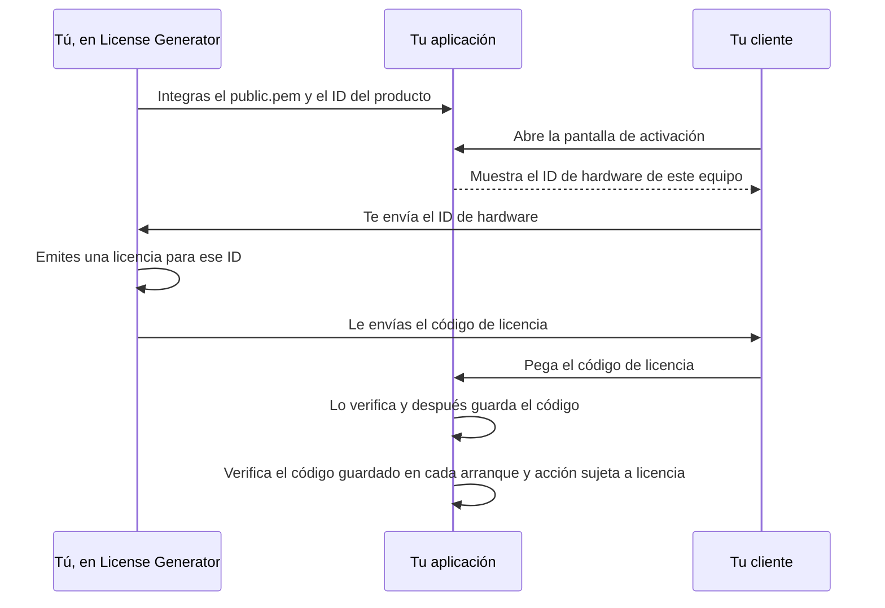

# Guía de integración del cliente

**Español** · [English](../../INTEGRATION.md) · [Deutsch](../de/INTEGRATION.md) · [Português](../pt/INTEGRATION.md) · [中文](../zh/INTEGRATION.md)

Esta guía explica cómo verificar licencias de License Generator en tu propia
aplicación: qué verificador usar, cómo lo usan una pantalla de activación y una
comprobación al arrancar, cómo elegir un identificador de hardware y cómo probar
tu integración. El [contrato de formato y seguridad](ARCHITECTURE.md) define
cada byte y cada regla que aplican los verificadores; la
[guía de uso](OPERATIONS.md) trata del propio generador.

## Cómo funcionan las licencias



El generador firma cada licencia con la clave privada del producto, que nunca
sale de tu equipo. Tu aplicación solo contiene la clave pública, que puede
verificar una firma pero nunca crearla. La verificación no necesita servidor: se
ejecuta en el dispositivo del usuario con la clave pública, el ID del producto,
el ID de hardware y la hora actual que aporta tu aplicación.

## Elegir un verificador

Tres verificadores de referencia implementan el [contrato](ARCHITECTURE.md).
Todos dan los mismos resultados para cada [vector de prueba](#probar-tu-integración)
publicado.

| Tecnología | Copia en tu aplicación | Requisitos | Pruebas |
| --- | --- | --- | --- |
| C# | [LicenseVerifier.cs](../examples/LicenseVerifier.cs) y [LicenseProtocol.cs](../examples/LicenseProtocol.cs) | .NET 8 o posterior; sin paquetes | Comprobados con los vectores por la batería de pruebas de regresión propia de la aplicación, que es privada |
| Python | [license_verifier.py](../examples/python/license_verifier.py) | Python 3.11 o posterior y el paquete [cryptography](https://pypi.org/project/cryptography/) | [test_license_verifier.py](../examples/python/test_license_verifier.py) |
| Node.js | [license-verifier.mjs](../examples/node/license-verifier.mjs) | Node.js 20 o posterior; solo módulos integrados | [license-verifier.test.mjs](../examples/node/license-verifier.test.mjs) |

Los verificadores no hacen E/S: no leen archivos, reloj ni red, y nunca buscan
un ID de hardware. Tu aplicación les pasa esos valores, y así cada decisión queda
a la vista y se puede probar.

Otra tecnología puede verificar licencias con su propia biblioteca RSA. Estas API
estándar verifican firmas RSA PKCS#1 v1.5 con SHA-256 mediante una clave pública
SubjectPublicKeyInfo; son indicaciones, no ejemplos probados, así que implementa
todas las reglas del contrato y supera todos los vectores de prueba antes de
publicar.

| Tecnología | API |
| --- | --- |
| Java, Kotlin, Android | `java.security.Signature` con `SHA256withRSA`, clave desde `X509EncodedKeySpec` |
| Go | `crypto/x509.ParsePKIXPublicKey` y `crypto/rsa.VerifyPKCS1v15` con `crypto.SHA256`, que recibe el resumen SHA-256, no el mensaje |
| Swift | `SecKeyCreateWithData` con la clave en formato PKCS#1, y `SecKeyVerifySignature` con `.rsaSignatureMessagePKCS1v15SHA256` |
| C, C++ | `EVP_DigestVerify` de OpenSSL con `EVP_sha256()`, o `BCryptVerifySignature` de Windows CNG con `BCRYPT_PAD_PKCS1` |
| PHP | `openssl_verify` con `OPENSSL_ALGO_SHA256` |
| Rust | el verificador PKCS#1 v1.5 del crate `rsa` con SHA-256 |
| Dart, Flutter | el firmante RSA del paquete `pointycastle` con SHA-256 |
| Navegador | `crypto.subtle.importKey` con `spki`, y `crypto.subtle.verify` con `RSASSA-PKCS1-v1_5` y SHA-256 |

Una aplicación Electron ejecuta el verificador de Node.js en su proceso
principal, no en un proceso de renderizado que muestra contenido web. React
Native no ofrece `node:crypto`, así que el verificador de Node.js no funciona ahí
tal cual. Una página web que controla el usuario no puede hacer cumplir una
licencia; verifica allí donde tu aplicación decide el acceso.

Las bibliotecas difieren en detalles que rompen el contrato si mantienes sus
valores por defecto:

| Dónde | Qué ocurre | Qué hacer |
| --- | --- | --- |
| La mayoría de analizadores JSON | Se quedan con el último de dos nombres de propiedad iguales. | Rechaza un objeto raíz que repita un nombre antes de leer ningún dato. |
| `encoding/json` de Go | Compara los nombres sin distinguir mayúsculas de minúsculas y reemplaza el UTF-8 no válido y los sustitutos sin pareja por U+FFFD. | Lee el objeto raíz con `json.Decoder.Token` y compara los nombres exactamente. |
| `java.util.Base64` de Java | `getDecoder()` rechaza los espacios en blanco, y `getMimeDecoder()` ignora cualquier carácter fuera del alfabeto. | Quita los espacios, tabuladores, retornos de carro y saltos de línea, y después decodifica con `getDecoder()`. |
| `KeyFactory` de Java y Kotlin | `X509EncodedKeySpec` solo lee SubjectPublicKeyInfo. | Integra `public.pem` tal como lo escribe el generador, o convierte antes una clave PKCS#1. |
| `SecKeyCreateWithData` de Swift | Espera una clave pública RSA en formato PKCS#1. | Quita antes la cabecera SubjectPublicKeyInfo, o integra la clave en formato PKCS#1. |
| Longitudes de texto | Python cuenta puntos de código, y Go y Rust cuentan bytes. | Cuenta unidades de código UTF-16 para los límites del contrato. |
| `cryptography` de Python | `load_pem_public_key` también lee un cuerpo SubjectPublicKeyInfo bajo una etiqueta `RSA PUBLIC KEY`, y `load_der_public_key` lee cualquiera de las dos formas. | Comprueba que el cuerpo tiene la forma que nombra su etiqueta. |
| Expresiones regulares | En Python, Java y .NET, `$` también encaja antes de un salto de línea final, y en Python y .NET `\d` acepta dígitos de cualquier sistema de escritura. | Exige que encaje el texto entero (`re.fullmatch`, `Matcher.matches`, `\z` en .NET) y escribe `[0-9]`. |
| Funciones de recorte | `strip()` de Python, `trim()` de JavaScript y `Trim()` de .NET quitan caracteres distintos. | Quita exactamente los caracteres que nombran el contrato o esta guía. |

## Añadir el verificador a tu aplicación

**C#.** Copia ambos archivos en tu proyecto. El verificador está en el espacio de
nombres `LicenseGenerator.IntegrationExample` y usa el analizador compartido de
`LicenseGenerator.Protocol`; puedes renombrar los espacios de nombres. Los
archivos usan API de .NET 8 como `PemEncoding` y sintaxis de C# 12, así que no
compilan tal cual en .NET Framework, Unity ni Xamarin; allí, implementa el
contrato con las API que tengas, partiendo de estos archivos, y supera todos los
vectores de prueba.

**Python.** Copia `license_verifier.py` e instala `cryptography`. Los ejemplos se
prueban con las versiones y los hashes fijados en
[requirements.txt](../examples/python/requirements.txt):

```text
python -m pip install --require-hashes --only-binary :all: -r requirements.txt
```

**Node.js.** Copia `license-verifier.mjs`, un módulo ES, e impórtalo con
`import { inspect, verify } from "./license-verifier.mjs"`.

**La clave pública.** Integra el `public.pem` del producto en tu aplicación, como
constante de texto o recurso compilado, junto con el ID exacto del producto.
Nunca leas la clave de la licencia, de un archivo que el usuario pueda sustituir
ni de una descarga cuyo origen no controles. Nunca distribuyas `private.pem`.

## Verificar una licencia

Cada verificador ofrece dos llamadas con las mismas entradas: el código de
licencia, la clave pública de confianza, el ID de producto esperado, el ID de
hardware esperado y la hora UTC actual. Una hora que no pueda situarse en UTC es
un error de programación: el verificador de Python lanza `ValueError` ante un
`datetime` sin zona horaria, y el de Node.js lanza `TypeError` ante un `Date` no
válido.

- **verify** (`TryVerify` en C#) devuelve la licencia solo cuando es válida para
  este producto, equipo y momento. Exige el ID de hardware esperado: sin él no
  devuelve ninguna licencia, ni siquiera una no vinculada. Úsala allí donde se
  decide el acceso.
- **inspect** (`Inspect` en C#) devuelve un rechazo con su motivo, o una licencia
  autenticada con comprobaciones separadas de producto, hardware y caducidad, y su
  validez global. Úsala cuando tengas que explicar al usuario qué falla.

Los resultados tienen esta forma en cada verificador:

| Verificador | Rechazo | Autenticada | Licencia |
| --- | --- | --- | --- |
| C# | `LicenseInspectionResult.Rejected` con `Reason` | `LicenseInspectionResult.Authenticated` con `License`, `Product`, `Hardware`, `Expiration` e `IsValid` | `VerifiedLicense` con `AppId`, `RegistrationName`, `HardwareId`, `ExpirationDate` (un `DateTime` en UTC), `UserDefined`, `FormatVersion` y `RevocationId` |
| Python | `Rejected` con `reason` | `Authenticated` con `license`, `product`, `hardware`, `expiration` e `is_valid` | `VerifiedLicense` con `app_id`, `registration_name`, `hardware_id`, `expiration_date` (un `date`), `user_defined`, `format_version` y `revocation_id` |
| Node.js | `{ result: "rejected", reason }` | `{ result: "authenticated", license, product, hardware, expiration, isValid }` | Un objeto con `appId`, `registrationName`, `hardwareId`, `expirationDate` (un texto `yyyy-MM-dd`), `userDefined`, `formatVersion` y `revocationId` |

Una fecha de caducidad o un texto personalizado ausentes son null (`None` en
Python), y también lo es la versión de formato de una licencia heredada, que los
vectores de prueba escriben como 1. Los motivos y las comprobaciones son los
miembros de `LicenseInspectionFailure`, `LicenseProductCheck`,
`LicenseHardwareCheck` y `LicenseExpirationCheck` en C#, y de `InspectionFailure`,
`ProductCheck`, `HardwareCheck` y `ExpirationCheck` en Python y JavaScript, con los
mismos nombres en mayúsculas y con guiones bajos (`MALFORMED_LICENSE`,
`NOT_BOUND`, `NEVER_EXPIRES`) y los valores que usan los vectores de prueba
(`malformed`, `not-bound`, `never`).

Una licencia emitida con un ID de hardware vacío no está vinculada: supera la
comprobación de hardware sea cual sea el ID que espere tu aplicación. Para omitir
la comprobación de hardware a propósito, pasa `null` (`None` en Python) a
`inspect`; una licencia vinculada queda entonces sin comprobar y nunca es válida.
El verificador de Node.js no admite un ID de hardware omitido (`undefined`), para
que un argumento olvidado no pueda omitir la comprobación por accidente.

## Crear una pantalla de activación

Tu aplicación necesita una pantalla donde el usuario pueda ver el ID de hardware,
pegar un código de licencia y activarlo:

```text
┌────────────────────────────────────────────────────────────────────┐
│ Activación de la licencia                                          │
│                                                                    │
│ ID de este equipo                                                  │
│ 05A68D939433F5BABB1D30D04974999056C8AFAF60D867DA80241F9F99E5FA01   │
│                                                           [Copiar] │
│ Código de licencia                                                 │
│ ┌────────────────────────────────────────────────────────────────┐ │
│ │ ewogICJBcHBJZCI6ICJOb3J0aHN0YXItU3R1ZGlvIiwKICAiUmVnaXN0cmF... │ │
│ └────────────────────────────────────────────────────────────────┘ │
│                                                          [Activar] │
│ Activada para Alex Morgan.                                         │
└────────────────────────────────────────────────────────────────────┘
```

Muestra el ID de hardware completo con un botón para copiarlo: la licencia se
emite exactamente para ese texto. Cuando el usuario la active, inspecciona el
código, guárdalo si es válido y, si no, explica qué falla. Estas funciones dan
por hecho que tu aplicación aporta `PUBLIC_KEY`, `PRODUCT_ID`, `hardware_id()` y
`save_license_code()` (o sus equivalentes en C# y JavaScript). Los mensajes están
en inglés como en el ejemplo probado; tradúcelos en tu aplicación.

<!-- excerpt: csharp-activation -->
```csharp
static string Activate(string licenseCode)
{
    var result = LicenseVerifier.Inspect(licenseCode, PublicKey, ProductId, HardwareId(), DateTimeOffset.UtcNow);
    if (result is LicenseInspectionResult.Authenticated { IsValid: true } activated)
    {
        SaveLicenseCode(licenseCode);
        return $"Activated for {activated.License.RegistrationName}.";
    }
    return ActivationProblem(result);
}

static string ActivationProblem(LicenseInspectionResult result) => result switch
{
    LicenseInspectionResult.Rejected { Reason: LicenseInspectionFailure.MalformedLicense } =>
        "Paste the complete license code you received.",
    LicenseInspectionResult.Rejected { Reason: LicenseInspectionFailure.UnsupportedFormat } =>
        "This license needs a newer version of the application.",
    LicenseInspectionResult.Rejected { Reason: LicenseInspectionFailure.SignatureMismatch } =>
        "This license was not issued for this application.",
    LicenseInspectionResult.Rejected => "This copy cannot check licenses. Contact support.",
    LicenseInspectionResult.Authenticated { Product: LicenseProductCheck.Mismatch } =>
        "This license is for another product.",
    LicenseInspectionResult.Authenticated { Hardware: LicenseHardwareCheck.Mismatch } =>
        $"This license is for another computer. Send us this computer's ID: {HardwareId()}",
    LicenseInspectionResult.Authenticated
        { Expiration: LicenseExpirationCheck.Expired, License.ExpirationDate: DateTime expired } =>
        $"This license expired on {expired.ToString("yyyy-MM-dd", CultureInfo.InvariantCulture)}.",
    _ => "This license cannot be used on this computer.",
};
```

<!-- excerpt: python-activation -->
```python
def activate(license_code):
    result = license_verifier.inspect(license_code, PUBLIC_KEY, PRODUCT_ID, hardware_id(),
                                      datetime.now(timezone.utc))
    if isinstance(result, license_verifier.Authenticated) and result.is_valid:
        save_license_code(license_code)
        return "Activated for %s." % result.license.registration_name
    return activation_problem(result)


REJECTION_MESSAGES = {
    license_verifier.InspectionFailure.MALFORMED_LICENSE: "Paste the complete license code you received.",
    license_verifier.InspectionFailure.UNSUPPORTED_FORMAT: "This license needs a newer version of the application.",
    license_verifier.InspectionFailure.SIGNATURE_MISMATCH: "This license was not issued for this application.",
}


def activation_problem(result):
    if isinstance(result, license_verifier.Rejected):
        return REJECTION_MESSAGES.get(result.reason, "This copy cannot check licenses. Contact support.")
    if result.product is license_verifier.ProductCheck.MISMATCH:
        return "This license is for another product."
    if result.hardware is license_verifier.HardwareCheck.MISMATCH:
        return "This license is for another computer. Send us this computer's ID: %s" % hardware_id()
    if result.expiration is license_verifier.ExpirationCheck.EXPIRED:
        return "This license expired on %s." % result.license.expiration_date.isoformat()
    return "This license cannot be used on this computer."
```

<!-- excerpt: javascript-activation -->
```javascript
export function activate(licenseCode) {
  const result = inspect(licenseCode, PUBLIC_KEY, PRODUCT_ID, hardwareId(), new Date());
  if (result.result === "authenticated" && result.isValid) {
    saveLicenseCode(licenseCode);
    return `Activated for ${result.license.registrationName}.`;
  }
  return activationProblem(result);
}

const REJECTION_MESSAGES = new Map([
  [InspectionFailure.MALFORMED_LICENSE, "Paste the complete license code you received."],
  [InspectionFailure.UNSUPPORTED_FORMAT, "This license needs a newer version of the application."],
  [InspectionFailure.SIGNATURE_MISMATCH, "This license was not issued for this application."],
]);

export function activationProblem(result) {
  if (result.result === "rejected") {
    return REJECTION_MESSAGES.get(result.reason) ?? "This copy cannot check licenses. Contact support.";
  }
  if (result.product === ProductCheck.MISMATCH) return "This license is for another product.";
  if (result.hardware === HardwareCheck.MISMATCH) {
    return `This license is for another computer. Send us this computer's ID: ${hardwareId()}`;
  }
  if (result.expiration === ExpirationCheck.EXPIRED) {
    return `This license expired on ${result.license.expirationDate}.`;
  }
  return "This license cannot be used on this computer.";
}
```

Las funciones de C# usan los espacios de nombres `System.Globalization` y
`LicenseGenerator.IntegrationExample`. Las de Python importan `datetime` y
`timezone` de `datetime`, y `license_verifier`. Las de JavaScript importan
`inspect`, `InspectionFailure`, `ProductCheck`, `HardwareCheck` y
`ExpirationCheck` del módulo del verificador.

Qué significa cada resultado para el usuario:

| Resultado | Significado | Qué decir al usuario |
| --- | --- | --- |
| `malformed` | El texto no es un código de licencia completo: está cortado, alterado o no es una licencia. | Que pegue el código completo. |
| `unsupported-format` | La licencia usa un formato más nuevo que este verificador. | Que actualice la aplicación. |
| `signature-mismatch` | La licencia se emitió con la clave de otro producto, o su texto se modificó. | Que la licencia no es para esta aplicación. |
| `invalid-public-key`, `invalid-expected-product` | Tu aplicación pasó una clave inutilizable o un ID de producto en blanco. | Nada que pueda arreglar: regístralo y corrige la compilación. |
| producto `mismatch` | Auténtica, pero emitida para otro de tus productos. | Que la licencia es para otro producto. |
| hardware `mismatch` | Auténtica, pero emitida para otro ID de hardware. | Que la licencia es para otro equipo; muestra el ID de este equipo. |
| caducidad `expired` | Auténtica, pero ya ha llegado su fecha de caducidad. | Que la licencia caducó en su fecha. |

## Conservar la licencia y volver a comprobarla

Guarda el propio código de licencia, no un indicador de «con licencia» ni un
resultado de verificación. Guárdalo en la carpeta de datos por usuario de tu
aplicación: por ejemplo `%LOCALAPPDATA%\YourApp` en Windows,
`~/Library/Application Support/YourApp` en macOS, `$XDG_DATA_HOME/YourApp`
(normalmente `~/.local/share/YourApp`) en Linux, el almacenamiento interno de la
app (`Context.getFilesDir()`) en Android o la carpeta Application Support del
contenedor de la app en iOS. Una copia de seguridad puede restaurar el código en
otro dispositivo, donde la comprobación de hardware falla y el usuario tiene que
volver a activarla. El código está firmado, no cifrado: quien lo lea ve el nombre
del cliente, el ID de hardware y los datos personalizados, pero no puede
cambiarlos sin romper la firma.

Vuelve a verificar el código guardado en cada arranque y antes de cada acción
sujeta a licencia, con la hora actual. Un `true` en caché mantendría funcionando
una licencia caducada. Cuando la verificación falle, muestra otra vez la pantalla
de activación. Estas funciones dan por hecho que tu aplicación aporta
`load_license_code()`, que devuelve el código guardado o nada.

<!-- excerpt: csharp-startup -->
```csharp
static VerifiedLicense? CurrentLicense()
{
    var licenseCode = LoadLicenseCode();
    if (licenseCode is null) return null;
    return LicenseVerifier.TryVerify(licenseCode, PublicKey, ProductId, HardwareId(), DateTimeOffset.UtcNow,
        out var license) ? license : null;
}
```

<!-- excerpt: python-startup -->
```python
def current_license():
    license_code = load_license_code()
    if license_code is None:
        return None
    return license_verifier.verify(license_code, PUBLIC_KEY, PRODUCT_ID, hardware_id(), datetime.now(timezone.utc))
```

<!-- excerpt: javascript-startup -->
```javascript
export function currentLicense() {
  const licenseCode = loadLicenseCode();
  if (licenseCode === null) return null;
  return verify(licenseCode, PUBLIC_KEY, PRODUCT_ID, hardwareId(), new Date());
}
```

## Elegir un identificador de hardware

Una licencia vinculada nombra un ID de hardware, y tu aplicación decide cómo
calcularlo. El generador firma el texto que introduzcas. Un buen identificador es:

- **Determinista.** El mismo equipo da el mismo texto en cada arranque y después
  de cada actualización de tu aplicación.
- **Exacto.** El texto que muestra la pantalla de activación es el que se verifica
  después. La comparación es ordinal: cuentan las mayúsculas, los espacios y los
  saltos de línea.
- **Completo.** No lo trunques nunca; un ID corto hace que dos equipos compartan
  una licencia.
- **Honesto ante los fallos.** Si la fuente no está disponible, informa del error.
  Nunca recurras a un valor compartido como `UNKNOWN-HWID`, el nombre del equipo o
  un texto vacío: un ID de hardware vacío significa una licencia no vinculada.

Los sistemas operativos ofrecen un identificador de equipo del que partir:

| Sistema | Fuente | Cambia cuando |
| --- | --- | --- |
| Windows | `MachineGuid` en `HKEY_LOCAL_MACHINE\SOFTWARE\Microsoft\Cryptography` | Se reinstala Windows; equipos clonados de una misma imagen pueden compartirlo |
| Linux | `/etc/machine-id` | Se reinstala el sistema; contenedores e imágenes clonadas pueden compartirlo o regenerarlo |
| macOS | `IOPlatformUUID` de `IOPlatformExpertDevice` en el I/O Registry | Se sustituye la placa base |
| Android | `Settings.Secure.ANDROID_ID` | Se restablecen los valores de fábrica del dispositivo; desde Android 8.0 además difiere por clave de firma de la app y por usuario |
| iOS, iPadOS | Las apps no tienen acceso a ningún identificador de hardware; usa `identifierForVendor` o un UUID que crees una vez y guardes en el llavero | `identifierForVendor` cambia cuando se eliminan del dispositivo todas tus apps; un elemento del llavero suele sobrevivir a una reinstalación |

Un proceso de 32 bits en Windows de 64 bits lee una vista redirigida del registro
sin `MachineGuid`: abre la vista de 64 bits (`RegistryView.Registry64` en .NET,
`KEY_WOW64_64KEY` en Win32).

No muestres el identificador en bruto: el manual `machine-id(5)` pide a las
aplicaciones que no expongan `/etc/machine-id` y que lo pasen por un hash con una
clave propia de la aplicación. Deriva tu propio ID con HMAC-SHA-256 usando como
clave los bytes UTF-8 del ID de tu producto, sobre los bytes UTF-8 del
identificador del sistema sin los espacios, tabuladores, retornos de carro y
saltos de línea de su principio y su final, como el salto de línea final de
`/etc/machine-id`, y escríbelo como 64 caracteres hexadecimales en mayúsculas.
Quita solo esos cuatro caracteres y conserva todos los demás: las funciones de
recorte de cada lenguaje quitan conjuntos distintos. Así todas las tecnologías
calculan el mismo ID para el mismo equipo y producto; los `hardwareIdExamples` de
los [vectores de prueba](../examples/test-vectors.json) publican dos para
comprobarlo.
Estas funciones necesitan `System.Security.Cryptography` y `System.Text` en C#,
`hashlib` y `hmac` en Python, y `createHmac` de `node:crypto` en JavaScript.

<!-- excerpt: csharp-hardware-id -->
```csharp
static string DeriveHardwareId(string machineId, string productId)
{
    var identifier = machineId.Trim(' ', '\t', '\r', '\n');
    return Convert.ToHexString(HMACSHA256.HashData(Encoding.UTF8.GetBytes(productId), Encoding.UTF8.GetBytes(identifier)));
}
```

<!-- excerpt: python-hardware-id -->
```python
def derive_hardware_id(machine_id, product_id):
    identifier = machine_id.strip(" \t\r\n")
    digest = hmac.new(product_id.encode("utf-8"), identifier.encode("utf-8"), hashlib.sha256)
    return digest.hexdigest().upper()
```

<!-- excerpt: javascript-hardware-id -->
```javascript
export function deriveHardwareId(machineId, productId) {
  const identifier = machineId.replace(/^[ \t\r\n]+|[ \t\r\n]+$/g, "");
  return createHmac("sha256", productId).update(identifier).digest("hex").toUpperCase();
}
```

Un ID de hardware es una política de tu aplicación, no una prueba de un equipo
físico: un usuario que controla el dispositivo puede cambiar lo que lee tu
aplicación.

## Usar UserDefined

Una licencia puede llevar texto personalizado firmado, UserDefined, para
funciones, planes u otros datos que defina tu aplicación. Léelo solo de una
licencia válida; antes de verificarla es texto no fiable. Elige una sintaxis
sencilla y con versión, como `features=reports,export;plan=professional`, rechaza
un texto que tu versión no entienda y trata una licencia sin él como tu derecho
de uso básico. No pongas secretos en él: está codificado, no cifrado.

Una licencia con UserDefined usa el formato 2. Un cliente anterior al formato 2
la rechaza, así que, antes de emitir esas licencias, actualiza todos los clientes
que deban aceptarlas.

## Caducidad y reloj

La fecha de caducidad se firma como fecha de calendario, y una licencia caduca a
las **00:00 UTC del inicio de esa fecha**. Para permitir el uso hasta el final
del 10 de junio, emite la licencia con fecha de caducidad 11 de junio. Pasa la
hora actual en UTC; los verificadores la comparan con ese instante sea cual sea
la zona horaria del usuario.

Tu aplicación lee el reloj de un dispositivo que controla el usuario. Un usuario
puede atrasarlo para que una licencia caducada siga funcionando. Donde eso
importe, comprueba la hora con un servicio de tu confianza además de la
verificación sin conexión.

## Actualizaciones, revocación y cambios de clave

Una licencia sin conexión no se puede revocar a distancia: el dispositivo del
usuario no necesita ningún servidor para verificarla. Lo que puedes hacer en una
actualización de tu aplicación:

- **Revocar licencias concretas.** Distribuye una lista de identificadores de
  licencias revocadas y rechaza una licencia verificada cuyo identificador esté en
  la lista. Todos los verificadores lo devuelven con la licencia (`revocationId`,
  `RevocationId` en C#, `revocation_id` en Python); inspecciona un código de
  licencia con cualquiera de ellos para leerlo. No listes nunca textos de
  `Signature`: una misma licencia puede escribirse de más de una forma, y todas
  tienen el mismo identificador.
- **Cambiar de clave en una nueva versión principal.** Crea un producto nuevo en
  el generador, por ejemplo `MyApp-2`, e integra su clave pública y su ID de
  producto: las licencias emitidas para el producto anterior dejan de verificarse.
  Para seguir aceptándolas durante un tiempo, verifica con la clave y el ID nuevos
  y después con los anteriores.
- **Sustituir una clave filtrada o perdida.** Si una clave privada se filtra,
  cualquiera puede emitir licencias que tu aplicación acepta; si se pierde, no
  puedes emitir otras nuevas. En ambos casos distribuye una clave pública nueva y
  vuelve a emitir las licencias.

## Probar tu integración

[test-vectors.json](../examples/test-vectors.json) contiene una clave pública de
prueba en la que no confía ningún producto real, el producto y el ID de hardware
esperados, una hora de comprobación fija y licencias emitidas por el generador
con el resultado que debe dar cada una:

- `cases` enumera cada licencia con su resultado `expected`: un `reason` de
  rechazo, o las comprobaciones `product`, `hardware` y `expiration` de la licencia
  autenticada, el `valid` global, los datos decodificados y el `revocationId`.
  `formatVersion` vale 1 en una licencia heredada, cuyo JSON lo omite. `issue`
  registra cómo emitió el generador un caso, `derive` cómo se obtuvo un caso
  alterando otro después de firmarlo, y `copy` que reutiliza sin cambios la
  licencia de otro caso. Un caso puede fijar su propio `publicKey`,
  `expectedAppId` o `expectedHardwareId`; un ID de hardware null significa que se
  omite la comprobación. Una función verify devuelve la licencia en los casos
  válidos que no omiten la comprobación de hardware, y solo en ellos.
- `expirationTexts` enumera textos de fecha de caducidad que un verificador debe
  leer como la fecha firmada o rechazar, y los instantes a ambos lados del límite
  en los que cada texto aceptado está vigente y después caducado.
- `hardwareIdExamples` da identificadores de equipo con un ID de producto y el ID
  de hardware que la derivación de arriba calcula a partir de cada uno; el segundo
  conserva en sus extremos caracteres que algunas funciones de recorte quitan.

Usa la hora de comprobación publicada, no la actual, al comparar resultados. Las
baterías de pruebas de referencia ejecutan todos los casos; la de Python necesita
`cryptography` instalado como se indica arriba:

```text
cd docs/examples/python
python -m unittest
cd ../node
node --test license-verifier.test.mjs
```

La CI del repositorio público ejecuta ambas baterías en cada push y pull request.
En un cliente C#, lee el mismo archivo en tus propias pruebas y compara
`LicenseVerifier.Inspect` con cada resultado esperado.

## Solución de problemas

| Síntoma | Comprobación |
| --- | --- |
| Todas las licencias dan `signature-mismatch` | La clave integrada es el `public.pem` completo del producto, con sus líneas BEGIN y END, y la licencia se emitió para ese producto. |
| `malformed` para un código que el generador inspecciona bien | El código se cortó o se alteró al copiarlo; se aceptan saltos de línea dentro de él, otros caracteres no. |
| `unsupported-format` | Tu verificador es anterior al formato de la licencia; actualízalo. |
| `mismatch` de hardware en el equipo correcto | Tu aplicación calcula el mismo ID que mostró; cuentan las mayúsculas y los espacios. Los contenedores y las máquinas virtuales pueden ver otro identificador de equipo. |
| Caduca un día antes | El límite son las 00:00 UTC del inicio de la fecha de caducidad; emite la licencia con fecha de caducidad del día siguiente. |
| Funciona en desarrollo y falla en producción | La versión de producción integra otra clave pública u otro ID de producto, o calcula otro ID de hardware. |

## Licencia de los ejemplos

La sección 2 del [EULA](../../LICENSE) (en inglés) te permite usar, copiar,
modificar y distribuir los archivos de `docs/examples` como parte de tus
aplicaciones comerciales o gratuitas que verifiquen licencias, conservando su
aviso de copyright. No concede ningún derecho sobre la propia aplicación License
Generator.

[Comunicar un problema](https://github.com/gonzapersonalsite/license-generator-docs/issues) · [Apoyar el desarrollo](https://ko-fi.com/gonzaloapps)
