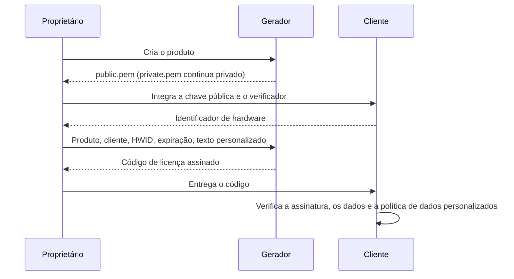

# Contrato de formato e segurança da licença

[Español](../es/ARCHITECTURE.md) · [English](../../ARCHITECTURE.md) · [Deutsch](../de/ARCHITECTURE.md) · **Português** · [中文](../zh/ARCHITECTURE.md)

Este documento define cada byte que uma licença do License Generator contém e
cada regra que um cliente deve aplicar a ela. O [guia de integração](INTEGRATION.md)
mostra como aplicá-las em um aplicativo; os verificadores de referência em C#,
Python e Node.js as implementam e passam nos mesmos vetores de teste publicados.
A referência técnica é o texto em inglês.

## Papéis

O gerador guarda as chaves privadas; os aplicativos clientes recebem apenas as chaves públicas. O RSA assina os dados da licença. Cada cliente verifica a assinatura, o produto e o identificador de hardware esperados, a expiração e as próprias regras opcionais sobre os dados personalizados.



## Transporte e chaves

Um código de licença é Base64 padrão com preenchimento de um JSON em UTF-8. Os nomes de propriedade JSON diferenciam maiúsculas de minúsculas. Os espaços em branco e a ordem das propriedades não afetam a assinatura, porque a mensagem assinada é construída a partir dos campos abaixo. O gerador indenta o JSON com as quebras de linha do sistema em que é executado, então duas licenças com os mesmos dados podem ter textos diferentes; nunca compare textos de licença.

As chaves são RSA-2048. `private.pem` usa PKCS#8 e `public.pem` usa SubjectPublicKeyInfo. As assinaturas usam RSA PKCS#1 v1.5 com SHA-256 e depois Base64 padrão com preenchimento. Um verificador deve selecionar esse algoritmo explicitamente.

| Propriedade | Tipo JSON | Significado |
| --- | --- | --- |
| AppId | string | Identificador exato do produto |
| RegistrationName | string | Nome do cliente ou do registro |
| HardwareId | string | Identificador de hardware exato fornecido pelo cliente; vazio significa sem vínculo ao hardware |
| ExpirationDate | texto de data e hora ISO ou null | Data de calendário gregoriano assinada, ou sem expiração |
| Signature | string | Assinatura RSA em Base64 |
| UserDefined | string, omitida quando vazia | Texto assinado opcional definido pelo aplicativo |
| FormatVersion | inteiro, omitido no formato legado | `2` quando UserDefined não está vazio |

Todo texto diferencia maiúsculas de minúsculas e deve ser preservado sem normalização nem corte ao reconstruir uma assinatura. Os nomes de produto e de cliente não podem estar em branco. HardwareId é uma string e pode estar vazio em uma licença sem vínculo. Um UserDefined ausente, null ou vazio seleciona o formato legado e não deve ser usado como direito de uso. Nesse caso os geradores omitem as duas propriedades novas, mantendo a compatibilidade com clientes existentes que rejeitam propriedades JSON desconhecidas.

Os limites de texto são medidos em unidades de código UTF-16, como `string.Length` em C# e `String.length` em JavaScript: AppId 128, RegistrationName 1.024, HardwareId 1.024 e UserDefined 8.192. AppId também tem um limite de 255 bytes UTF-8. Rejeite sequências de substitutos Unicode inválidas em vez de substituí-las silenciosamente ao codificar em UTF-8.

## Mensagem assinada legada

Nas licenças legadas, FormatVersion está ausente, é null ou vale `1`, e UserDefined está ausente, é null ou está vazio. Os geradores omitem a versão por compatibilidade. Assinam-se estes bytes UTF-8:

```text
AppId|RegistrationName|HardwareId|yyyy-MM-dd
```

Use `NEVER` em vez da data quando a expiração é null. Formate a data gregoriana com a cultura invariável. Os três campos de texto não podem conter `|`: limites de campo ambíguos poderiam permitir que um valor assinado fosse interpretado como outros dados. A nova geração e os verificadores de referência rejeitam essas licenças legadas; emita de novo uma licença antiga que contenha esse separador.

## Mensagem assinada do formato 2

Um UserDefined não vazio exige `FormatVersion: 2`. Codifique de forma independente cada um destes cinco textos em Base64 padrão com preenchimento sobre seus bytes UTF-8:

1. AppId
2. RegistrationName
3. HardwareId
4. `yyyy-MM-dd` invariável, ou `NEVER`
5. UserDefined

Junte os cinco textos codificados com `|` e prefixe `LG2|`. Assine os bytes UTF-8 desse texto completo:

```text
LG2|Base64(AppId)|Base64(RegistrationName)|Base64(HardwareId)|Base64(date)|Base64(UserDefined)
```

A notação `Base64(...)` é explicativa, não texto literal. Codificar cada campo separadamente mantém sem ambiguidade os separadores, o Unicode e o texto personalizado de várias linhas. O formato 2 com texto personalizado vazio é inválido. Nunca tente de novo como legado uma falha do formato 2.

Um cliente antigo não consegue verificar o formato 2. Atualize-o primeiro, ou deixe UserDefined vazio ao emitir licenças compatíveis.

## Expiração

Apenas a data de calendário é assinada; nem o texto da hora nem a conversão de fuso horário podem prolongá-la. O limite de expiração é **00:00:00 UTC do início dessa data**, não o fim. Para uma data de expiração D, o último instante válido é anterior à meia-noite UTC do início de D. Uma data null significa sem expiração. Isso mantém o limite original no início da data e torna o fuso horário explícito.

O gerador escreve a data como `yyyy-MM-ddT00:00:00`. Um verificador aceita um texto de ExpirationDate somente quando o texto inteiro corresponde a esta expressão, sem nada depois, nem mesmo uma quebra de linha; seus dez primeiros caracteres são uma data gregoriana a partir do ano 1; a hora é no máximo 23, os minutos e segundos no máximo 59, os minutos do deslocamento no máximo 59 e o deslocamento no máximo 14:00; e o instante que ele escreve, lido como UTC quando não tem deslocamento e sem contar frações de segundo, existe entre os anos 1 e 9999 em UTC:

```text
^[0-9]{4}-[0-9]{2}-[0-9]{2}(T[0-9]{2}:[0-9]{2}(:[0-9]{2}(\.[0-9]{1,16})?)?(Z|[+-][0-9]{2}(:[0-9]{2})?)?)?$
```

Os dez primeiros caracteres são a data assinada; a hora e o deslocamento nunca movem o limite. A tabela `expirationTexts` dos [vetores de teste](../examples/test-vectors.json) lista textos aceitos e rejeitados, e os instantes dos dois lados do limite em que cada texto aceito deve estar vigente e depois expirado.

## Regras de verificação

Um verificador recebe do aplicativo, nunca da licença, o código da licença, a chave pública confiável, o produto esperado, o identificador de hardware esperado e a hora atual. Um produto esperado em branco, e uma chave pública em branco ou com mais de 65.536 unidades de código UTF-16, são erros do aplicativo e são rejeitados antes de a licença ser lida. Depois, o verificador aplica estas regras em ordem.

Um texto está **em branco** quando está vazio ou contém apenas os espaços em branco que o `char.IsWhiteSpace` do .NET define: tabulação, quebra de linha, tabulação vertical, avanço de página, retorno de carro, U+0085 e os separadores Unicode de espaço, linha e parágrafo (categorias Zs, Zl e Zp). U+001C a U+001F não são espaços em branco aqui, embora Java e Python os tratem como tais.

1. **Envelope.** Rejeite como malformado um código em branco ou com mais de 131.072 unidades de código UTF-16, ou que não seja Base64 padrão com preenchimento; espaços, tabulações, retornos de carro e quebras de linha entre caracteres Base64 são ignorados, e nenhum outro caractere. O JSON decodificado deve ter no máximo 98.304 bytes de UTF-8 sem marca de ordem de bytes, ser JSON estrito RFC 8259 (sem comentários, vírgulas finais nem `NaN`), aninhar no máximo oito níveis e ter na raiz um objeto com nomes de propriedade únicos e sem escapes de substituto sem par. Propriedades desconhecidas são ignoradas e seus valores não são lidos: elas não são assinadas.
2. **Dados**, nesta ordem. Primeiro os textos: AppId, RegistrationName, HardwareId e Signature devem ser strings, todas exceto HardwareId não em branco, e UserDefined uma string ou null, sem que nenhum deles contenha um escape de substituto sem par. ExpirationDate, UserDefined ou FormatVersion ausentes são lidos como null, assim como um UserDefined vazio; um UserDefined feito de espaços em branco não está vazio. Depois, FormatVersion deve ser null ou um inteiro de 32 bits escrito sem casas decimais nem expoente; qualquer inteiro diferente de 1 ou 2 é um **formato não suportado**, uma rejeição distinta. Depois, ExpirationDate deve ser null ou um texto de data como o descrito acima. Por último, os limites de texto, o separador legado e a combinação de formato e dados personalizados são verificados como nas seções anteriores, e o texto de Signature deve ser Base64 padrão com preenchimento de pelo menos um byte, ignorando os mesmos caracteres que no código. Qualquer outra falha desta etapa é malformada.
3. **Assinatura.** Só agora a chave é lida. A chave confiável deve ter no máximo 65.536 unidades de código UTF-16 com um único bloco PEM rotulado `PUBLIC KEY` com um corpo SubjectPublicKeyInfo ou `RSA PUBLIC KEY` com um corpo PKCS#1, com apenas espaços em branco ao redor do bloco e apenas espaços, tabulações, retornos de carro e quebras de linha dentro do seu corpo Base64, cuja codificação DER não contenha nada depois da chave, para RSA de pelo menos 2048 bits. Uma chave privada nunca é aceita. Verifique RSA PKCS#1 v1.5 com SHA-256 sobre a mensagem assinada; uma falha é uma **assinatura que não confere**, que não distingue uma chave pública errada de dados assinados alterados.
4. **Política.** Apenas uma licença autenticada é comparada com o que o aplicativo espera, e cada verificação é informada separadamente: o produto confere quando AppId é igual ao produto esperado em comparação ordinal; o hardware não está vinculado quando HardwareId está vazio, confere quando é igual ao valor esperado em comparação ordinal e fica **não verificado** apenas quando o aplicativo deliberadamente não passa nenhum valor esperado; a licença expirou quando a hora atual é igual ou posterior ao limite.

Uma licença só é válida quando o produto confere, o hardware não está vinculado ou confere, e ela nunca expira ou ainda não expirou. Uma licença cujo hardware não foi verificado não é válida. Uma função que só retorna licenças válidas exige um identificador de hardware esperado e, sem ele, não retorna nenhuma licença, nem mesmo uma não vinculada, para que um valor ausente não possa pular a verificação. Valide novamente a cada decisão de acesso; um resultado bem-sucedido em cache não deve contornar a expiração. Leia e interprete UserDefined somente a partir de um resultado válido.

Uma licença autenticada tem também um **identificador de revogação**: o SHA-256 em hexadecimal minúsculo dos bytes decodificados da assinatura. A mesma licença pode ser escrita de mais de uma forma, por exemplo com espaços ou escapes dentro do texto de Signature, e todas dão o mesmo identificador, então uma lista de revogação guarda identificadores e nunca textos de assinatura. Uma licença emitida de novo com os mesmos dados e a mesma chave tem a mesma assinatura e, portanto, o mesmo identificador.

Os verificadores de referência informam as rejeições como `malformed`, `unsupported-format`, `signature-mismatch`, `invalid-public-key` e `invalid-expected-product`, e as verificações de uma licença autenticada com os nomes que os [vetores de teste](../examples/test-vectors.json) usam. Outra implementação deve dar o resultado publicado para cada vetor antes de ser publicada.

## Limites de segurança

- As assinaturas detectam dados alterados; elas não ocultam nomes de clientes nem dados personalizados.
- O HWID é uma política do aplicativo, não uma prova de um computador físico imutável. Use um identificador estável com entropia suficiente; falhe quando ele não puder ser obtido em vez de retornar um valor compartilhado.
- Licenças offline não podem ser revogadas remotamente. Atualizações podem aplicar uma lista de identificadores de licenças revogadas ou uma troca de chave deliberada.
- O código do cliente e o relógio podem ser modificados por um usuário que controla a máquina. Adicione um mecanismo de confiança online se seus requisitos incluírem revogação mais forte ou hora confiável.
- Mantenha as chaves privadas fora dos aplicativos clientes, do controle de versão, dos pedidos de suporte e das publicações. Uma chave privada vazada exige um plano de rotação de chaves e de atualização dos clientes.

Os termos legais do produto estão no [EULA](../../LICENSE).
