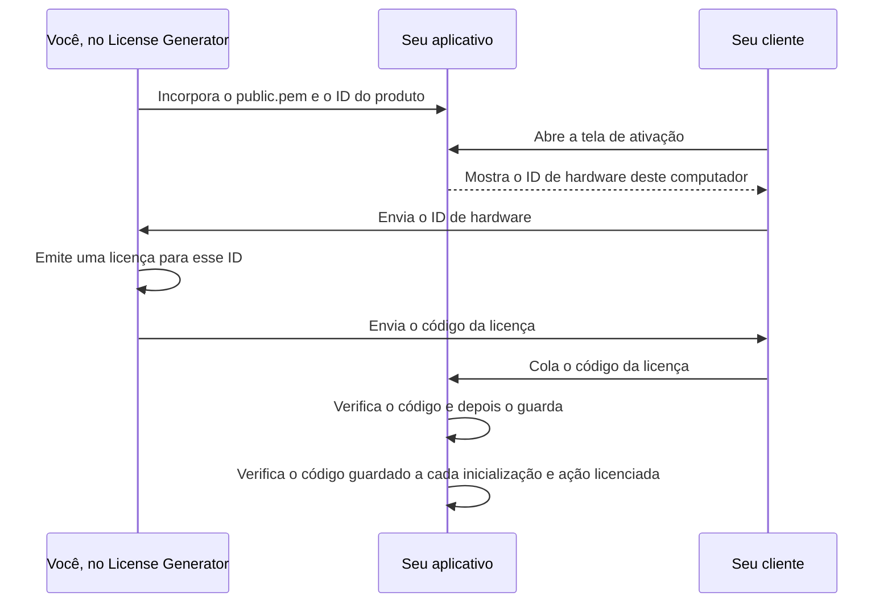

# Guia de integração do cliente

[Español](../es/INTEGRATION.md) · [English](../../INTEGRATION.md) · [Deutsch](../de/INTEGRATION.md) · **Português** · [中文](../zh/INTEGRATION.md)

Este guia mostra como verificar licenças do License Generator no seu próprio
aplicativo: qual verificador usar, como uma tela de ativação e uma verificação na
inicialização o utilizam, como escolher um identificador de hardware e como
testar sua integração. O [contrato de formato e segurança](ARCHITECTURE.md)
define cada byte e cada regra que os verificadores aplicam; o
[guia de uso](OPERATIONS.md) trata do próprio gerador.

## Como funcionam as licenças



O gerador assina cada licença com a chave privada do produto, que nunca sai do
seu computador. Seu aplicativo contém apenas a chave pública, que pode verificar
uma assinatura, mas nunca criá-la. A verificação não precisa de servidor: ela é
executada no dispositivo do usuário com a chave pública, o ID do produto, o ID
de hardware e a hora atual que seu aplicativo fornece.

## Escolher um verificador

Três verificadores de referência implementam o [contrato](ARCHITECTURE.md). Todos
retornam os mesmos resultados para cada [vetor de teste](#testar-sua-integração)
publicado.

| Tecnologia | Copie para o seu aplicativo | Requisitos | Testes |
| --- | --- | --- | --- |
| C# | [LicenseVerifier.cs](../examples/LicenseVerifier.cs) e [LicenseProtocol.cs](../examples/LicenseProtocol.cs) | .NET 8 ou posterior; sem pacotes | Verificados com os vetores pela bateria de regressão do próprio aplicativo, que é privada |
| Python | [license_verifier.py](../examples/python/license_verifier.py) | Python 3.11 ou posterior e o pacote [cryptography](https://pypi.org/project/cryptography/) | [test_license_verifier.py](../examples/python/test_license_verifier.py) |
| Node.js | [license-verifier.mjs](../examples/node/license-verifier.mjs) | Node.js 20 ou posterior; apenas módulos integrados | [license-verifier.test.mjs](../examples/node/license-verifier.test.mjs) |

Os verificadores não fazem E/S: não leem arquivos, relógio nem rede e nunca
buscam um ID de hardware. Seu aplicativo passa esses valores, o que mantém cada
decisão visível e testável.

Outra tecnologia pode verificar licenças com a própria biblioteca RSA. Estas APIs
padrão oferecem assinaturas RSA PKCS#1 v1.5 com SHA-256 sobre uma chave pública
SubjectPublicKeyInfo; são indicações, não exemplos testados, então implemente
todas as regras do contrato e passe em todos os vetores de teste antes de
publicar.

| Tecnologia | API |
| --- | --- |
| Java, Kotlin, Android | `java.security.Signature` com `SHA256withRSA`, chave a partir de `X509EncodedKeySpec` |
| Go | `crypto/x509.ParsePKIXPublicKey` e `crypto/rsa.VerifyPKCS1v15` com `crypto.SHA256`, que recebe o resumo SHA-256, não a mensagem |
| Swift | `SecKeyCreateWithData` com a chave no formato PKCS#1, e `SecKeyVerifySignature` com `.rsaSignatureMessagePKCS1v15SHA256` |
| C, C++ | `EVP_DigestVerify` do OpenSSL com `EVP_sha256()`, ou `BCryptVerifySignature` do Windows CNG com `BCRYPT_PAD_PKCS1` |
| PHP | `openssl_verify` com `OPENSSL_ALGO_SHA256` |
| Rust | o verificador PKCS#1 v1.5 do crate `rsa` com SHA-256 |
| Dart, Flutter | o assinador RSA do pacote `pointycastle` com SHA-256 |
| Navegador | `crypto.subtle.importKey` com `spki`, e `crypto.subtle.verify` com `RSASSA-PKCS1-v1_5` e SHA-256 |

Um aplicativo Electron executa o verificador Node.js no processo principal, não
em um processo de renderização que exibe conteúdo da web. O React Native não
oferece `node:crypto`, então o verificador Node.js não funciona nele sem
alterações. Uma página da web que o usuário controla não consegue impor uma
licença; verifique onde o seu aplicativo decide o acesso.

As bibliotecas diferem em detalhes que quebram o contrato se você mantiver os
padrões delas:

| Onde | O que acontece | O que fazer |
| --- | --- | --- |
| A maioria dos analisadores JSON | Ficam com o último de dois nomes de propriedade iguais. | Rejeite um objeto raiz que repita um nome antes de ler qualquer dado. |
| `encoding/json` do Go | Compara nomes sem diferenciar maiúsculas e substitui UTF-8 inválido e substitutos sem par por U+FFFD. | Leia o objeto raiz com `json.Decoder.Token` e compare os nomes exatamente. |
| `java.util.Base64` do Java | `getDecoder()` rejeita espaços em branco, e `getMimeDecoder()` ignora qualquer caractere fora do alfabeto. | Remova espaços, tabulações e quebras de linha e decodifique com `getDecoder()`. |
| `KeyFactory` do Java e do Kotlin | `X509EncodedKeySpec` só lê SubjectPublicKeyInfo. | Incorpore `public.pem` como o gerador o escreve, ou converta antes uma chave PKCS#1. |
| `SecKeyCreateWithData` do Swift | Espera uma chave pública RSA no formato PKCS#1. | Remova antes o cabeçalho SubjectPublicKeyInfo, ou incorpore a chave no formato PKCS#1. |
| Comprimentos de texto | Python conta pontos de código, e Go e Rust contam bytes. | Conte unidades de código UTF-16 para os limites do contrato. |
| `cryptography` do Python | `load_pem_public_key` também lê um corpo SubjectPublicKeyInfo sob um rótulo `RSA PUBLIC KEY`, e `load_der_public_key` lê qualquer uma das duas formas. | Verifique se o corpo tem a forma que seu rótulo indica. |
| Expressões regulares | Em Python, Java e .NET, `$` também corresponde antes de uma quebra de linha final, e em Python e .NET `\d` aceita dígitos de qualquer escrita. | Exija que o texto inteiro corresponda (`re.fullmatch`, `Matcher.matches`, `\z` em .NET) e escreva `[0-9]`. |
| Funções de corte | `strip()` do Python, `trim()` do JavaScript e `Trim()` do .NET removem caracteres diferentes. | Remova exatamente os caracteres que o contrato ou este guia indicam. |

## Adicionar o verificador ao seu aplicativo

**C#.** Copie os dois arquivos para o seu projeto. O verificador fica no
namespace `LicenseGenerator.IntegrationExample` e usa o analisador compartilhado
de `LicenseGenerator.Protocol`; você pode renomear os namespaces. Os arquivos
usam APIs do .NET 8 como `PemEncoding` e sintaxe do C# 12, então não compilam sem
alterações no .NET Framework, no Unity nem no Xamarin; nesses casos, implemente o
contrato com as APIs disponíveis, partindo destes arquivos, e passe em todos os
vetores de teste.

**Python.** Copie `license_verifier.py` e instale `cryptography`. Os exemplos são
testados com as versões e os hashes fixados em
[requirements.txt](../examples/python/requirements.txt):

```text
python -m pip install --require-hashes --only-binary :all: -r requirements.txt
```

**Node.js.** Copie `license-verifier.mjs`, um módulo ES, e importe-o com
`import { inspect, verify } from "./license-verifier.mjs"`.

**A chave pública.** Incorpore o `public.pem` do produto ao seu aplicativo, como
constante de texto ou recurso compilado, junto com o ID exato do produto. Nunca
leia a chave da licença, de um arquivo que o usuário possa substituir ou de um
download cuja origem você não controla. Nunca distribua `private.pem`.

## Verificar uma licença

Cada verificador oferece duas chamadas com as mesmas entradas: o código da
licença, a chave pública confiável, o ID de produto esperado, o ID de hardware
esperado e a hora UTC atual. Uma hora que não possa ser situada em UTC é um erro
de programação: o verificador Python lança `ValueError` para um `datetime` sem
fuso horário, e o verificador Node.js lança `TypeError` para um `Date` inválido.

- **verify** (`TryVerify` em C#) retorna a licença somente quando ela é válida
  para este produto, computador e momento. Ela exige o ID de hardware esperado:
  sem ele, não retorna nenhuma licença, nem mesmo uma não vinculada. Use-a onde o
  acesso é decidido.
- **inspect** (`Inspect` em C#) retorna uma rejeição com o motivo, ou uma licença
  autenticada com verificações separadas de produto, hardware e expiração e a
  validade geral. Use-a quando precisar explicar ao usuário o que está errado.

Os resultados têm esta forma em cada verificador:

| Verificador | Rejeição | Autenticada | Licença |
| --- | --- | --- | --- |
| C# | `LicenseInspectionResult.Rejected` com `Reason` | `LicenseInspectionResult.Authenticated` com `License`, `Product`, `Hardware`, `Expiration` e `IsValid` | `VerifiedLicense` com `AppId`, `RegistrationName`, `HardwareId`, `ExpirationDate` (um `DateTime` em UTC), `UserDefined`, `FormatVersion` e `RevocationId` |
| Python | `Rejected` com `reason` | `Authenticated` com `license`, `product`, `hardware`, `expiration` e `is_valid` | `VerifiedLicense` com `app_id`, `registration_name`, `hardware_id`, `expiration_date` (um `date`), `user_defined`, `format_version` e `revocation_id` |
| Node.js | `{ result: "rejected", reason }` | `{ result: "authenticated", license, product, hardware, expiration, isValid }` | Um objeto com `appId`, `registrationName`, `hardwareId`, `expirationDate` (um texto `yyyy-MM-dd`), `userDefined`, `formatVersion` e `revocationId` |

Uma data de expiração ou um texto personalizado ausentes são null (`None` em
Python), e também a versão de formato de uma licença legada, que os vetores de
teste escrevem como 1. Os motivos e as verificações são os membros de
`LicenseInspectionFailure`, `LicenseProductCheck`, `LicenseHardwareCheck` e
`LicenseExpirationCheck` em C#, e de `InspectionFailure`, `ProductCheck`,
`HardwareCheck` e `ExpirationCheck` em Python e JavaScript, com os mesmos nomes em
maiúsculas e com sublinhados (`MALFORMED_LICENSE`, `NOT_BOUND`, `NEVER_EXPIRES`) e
os valores que os vetores de teste usam (`malformed`, `not-bound`, `never`).

Uma licença emitida com ID de hardware vazio não é vinculada: ela passa na
verificação de hardware seja qual for o ID que seu aplicativo espera. Para pular
a verificação de hardware de propósito, passe `null` (`None` em Python) para
`inspect`; uma licença vinculada é então informada como não verificada e nunca é
válida. O verificador Node.js recusa um ID de hardware omitido (`undefined`),
para que um argumento esquecido não possa pular a verificação por acidente.

## Criar uma tela de ativação

Seu aplicativo precisa de uma tela em que o usuário possa ver o ID de hardware,
colar um código de licença e ativá-lo:

```text
┌────────────────────────────────────────────────────────────────────┐
│ Ativação da licença                                                │
│                                                                    │
│ ID deste computador                                                │
│ 05A68D939433F5BABB1D30D04974999056C8AFAF60D867DA80241F9F99E5FA01   │
│                                                           [Copiar] │
│ Código da licença                                                  │
│ ┌────────────────────────────────────────────────────────────────┐ │
│ │ ewogICJBcHBJZCI6ICJOb3J0aHN0YXItU3R1ZGlvIiwKICAiUmVnaXN0cmF... │ │
│ └────────────────────────────────────────────────────────────────┘ │
│                                                           [Ativar] │
│ Ativada para Alex Morgan.                                          │
└────────────────────────────────────────────────────────────────────┘
```

Mostre o ID de hardware completo com um botão para copiá-lo: a licença é emitida
exatamente para esse texto. Quando o usuário ativar, inspecione o código, guarde-o
se for válido e, caso contrário, explique o que está errado. Estas funções
supõem que seu aplicativo fornece `PUBLIC_KEY`, `PRODUCT_ID`, `hardware_id()` e
`save_license_code()` (ou seus equivalentes em C# e JavaScript). As mensagens
estão em inglês como no exemplo testado; traduza-as no seu aplicativo.

<!-- excerpt: csharp-activation -->
```csharp
static string Activate(string licenseCode)
{
    var result = LicenseVerifier.Inspect(licenseCode, PublicKey, ProductId, HardwareId(), DateTimeOffset.UtcNow);
    if (result is LicenseInspectionResult.Authenticated { IsValid: true } activated)
    {
        SaveLicenseCode(licenseCode);
        return $"Activated for {activated.License.RegistrationName}.";
    }
    return ActivationProblem(result);
}

static string ActivationProblem(LicenseInspectionResult result) => result switch
{
    LicenseInspectionResult.Rejected { Reason: LicenseInspectionFailure.MalformedLicense } =>
        "Paste the complete license code you received.",
    LicenseInspectionResult.Rejected { Reason: LicenseInspectionFailure.UnsupportedFormat } =>
        "This license needs a newer version of the application.",
    LicenseInspectionResult.Rejected { Reason: LicenseInspectionFailure.SignatureMismatch } =>
        "This license was not issued for this application.",
    LicenseInspectionResult.Rejected => "This copy cannot check licenses. Contact support.",
    LicenseInspectionResult.Authenticated { Product: LicenseProductCheck.Mismatch } =>
        "This license is for another product.",
    LicenseInspectionResult.Authenticated { Hardware: LicenseHardwareCheck.Mismatch } =>
        $"This license is for another computer. Send us this computer's ID: {HardwareId()}",
    LicenseInspectionResult.Authenticated
        { Expiration: LicenseExpirationCheck.Expired, License.ExpirationDate: DateTime expired } =>
        $"This license expired on {expired.ToString("yyyy-MM-dd", CultureInfo.InvariantCulture)}.",
    _ => "This license cannot be used on this computer.",
};
```

<!-- excerpt: python-activation -->
```python
def activate(license_code):
    result = license_verifier.inspect(license_code, PUBLIC_KEY, PRODUCT_ID, hardware_id(),
                                      datetime.now(timezone.utc))
    if isinstance(result, license_verifier.Authenticated) and result.is_valid:
        save_license_code(license_code)
        return "Activated for %s." % result.license.registration_name
    return activation_problem(result)


REJECTION_MESSAGES = {
    license_verifier.InspectionFailure.MALFORMED_LICENSE: "Paste the complete license code you received.",
    license_verifier.InspectionFailure.UNSUPPORTED_FORMAT: "This license needs a newer version of the application.",
    license_verifier.InspectionFailure.SIGNATURE_MISMATCH: "This license was not issued for this application.",
}


def activation_problem(result):
    if isinstance(result, license_verifier.Rejected):
        return REJECTION_MESSAGES.get(result.reason, "This copy cannot check licenses. Contact support.")
    if result.product is license_verifier.ProductCheck.MISMATCH:
        return "This license is for another product."
    if result.hardware is license_verifier.HardwareCheck.MISMATCH:
        return "This license is for another computer. Send us this computer's ID: %s" % hardware_id()
    if result.expiration is license_verifier.ExpirationCheck.EXPIRED:
        return "This license expired on %s." % result.license.expiration_date.isoformat()
    return "This license cannot be used on this computer."
```

<!-- excerpt: javascript-activation -->
```javascript
export function activate(licenseCode) {
  const result = inspect(licenseCode, PUBLIC_KEY, PRODUCT_ID, hardwareId(), new Date());
  if (result.result === "authenticated" && result.isValid) {
    saveLicenseCode(licenseCode);
    return `Activated for ${result.license.registrationName}.`;
  }
  return activationProblem(result);
}

const REJECTION_MESSAGES = new Map([
  [InspectionFailure.MALFORMED_LICENSE, "Paste the complete license code you received."],
  [InspectionFailure.UNSUPPORTED_FORMAT, "This license needs a newer version of the application."],
  [InspectionFailure.SIGNATURE_MISMATCH, "This license was not issued for this application."],
]);

export function activationProblem(result) {
  if (result.result === "rejected") {
    return REJECTION_MESSAGES.get(result.reason) ?? "This copy cannot check licenses. Contact support.";
  }
  if (result.product === ProductCheck.MISMATCH) return "This license is for another product.";
  if (result.hardware === HardwareCheck.MISMATCH) {
    return `This license is for another computer. Send us this computer's ID: ${hardwareId()}`;
  }
  if (result.expiration === ExpirationCheck.EXPIRED) {
    return `This license expired on ${result.license.expirationDate}.`;
  }
  return "This license cannot be used on this computer.";
}
```

As funções em C# usam os namespaces `System.Globalization` e
`LicenseGenerator.IntegrationExample`. As funções em Python importam `datetime` e
`timezone` de `datetime`, e `license_verifier`. As funções em JavaScript importam
`inspect`, `InspectionFailure`, `ProductCheck`, `HardwareCheck` e
`ExpirationCheck` do módulo do verificador.

O que cada resultado significa para o usuário:

| Resultado | Significado | O que dizer ao usuário |
| --- | --- | --- |
| `malformed` | O texto não é um código de licença completo: está cortado, alterado ou nem é uma licença. | Que cole o código completo. |
| `unsupported-format` | A licença usa um formato mais novo que este verificador. | Que atualize o aplicativo. |
| `signature-mismatch` | A licença foi emitida com a chave de outro produto, ou o texto dela foi alterado. | Que a licença não é para este aplicativo. |
| `invalid-public-key`, `invalid-expected-product` | Seu aplicativo passou uma chave inutilizável ou um ID de produto em branco. | Nada que ele possa corrigir: registre o erro e corrija a compilação. |
| produto `mismatch` | Autêntica, mas emitida para outro dos seus produtos. | Que a licença é para outro produto. |
| hardware `mismatch` | Autêntica, mas emitida para outro ID de hardware. | Que a licença é para outro computador; mostre o ID deste computador. |
| expiração `expired` | Autêntica, mas a data de expiração já começou. | Que a licença expirou na data dela. |

## Guardar a licença e verificá-la de novo

Guarde o próprio código da licença, não um indicador de "licenciado" nem um
resultado de verificação. Mantenha-o na pasta de dados por usuário do seu
aplicativo: por exemplo `%LOCALAPPDATA%\YourApp` no Windows,
`~/Library/Application Support/YourApp` no macOS, `$XDG_DATA_HOME/YourApp`
(normalmente `~/.local/share/YourApp`) no Linux, o armazenamento interno do app
(`Context.getFilesDir()`) no Android ou a pasta Application Support do contêiner
do app no iOS. Um backup pode restaurar o código em outro dispositivo, onde a
verificação de hardware falha e o usuário ativa de novo. O código é assinado, não
criptografado: quem o lê vê o nome do cliente, o ID de hardware e os dados
personalizados, mas não consegue alterá-los sem quebrar a assinatura.

Verifique o código guardado novamente a cada inicialização e antes de cada ação
licenciada, com a hora atual. Um `true` em cache manteria funcionando uma licença
expirada. Quando a verificação falhar, mostre de novo a tela de ativação. Estas
funções supõem que seu aplicativo fornece `load_license_code()`, que retorna o
código guardado ou nada.

<!-- excerpt: csharp-startup -->
```csharp
static VerifiedLicense? CurrentLicense()
{
    var licenseCode = LoadLicenseCode();
    if (licenseCode is null) return null;
    return LicenseVerifier.TryVerify(licenseCode, PublicKey, ProductId, HardwareId(), DateTimeOffset.UtcNow,
        out var license) ? license : null;
}
```

<!-- excerpt: python-startup -->
```python
def current_license():
    license_code = load_license_code()
    if license_code is None:
        return None
    return license_verifier.verify(license_code, PUBLIC_KEY, PRODUCT_ID, hardware_id(), datetime.now(timezone.utc))
```

<!-- excerpt: javascript-startup -->
```javascript
export function currentLicense() {
  const licenseCode = loadLicenseCode();
  if (licenseCode === null) return null;
  return verify(licenseCode, PUBLIC_KEY, PRODUCT_ID, hardwareId(), new Date());
}
```

## Escolher um identificador de hardware

Uma licença vinculada ao hardware indica um ID de hardware, e seu aplicativo
decide como calculá-lo. O gerador assina o texto que você digitar. Um bom
identificador é:

- **Determinístico.** O mesmo computador gera o mesmo texto a cada inicialização
  e depois de cada atualização do seu aplicativo.
- **Exato.** O texto mostrado na tela de ativação é o texto verificado depois. A
  comparação é ordinal: contam maiúsculas, espaços e quebras de linha.
- **Completo.** Nunca o corte; um ID curto faz dois computadores compartilharem uma
  licença.
- **Honesto diante de falhas.** Quando a fonte não estiver disponível, informe um
  erro. Nunca recorra a um valor compartilhado como `UNKNOWN-HWID`, o nome do
  computador ou um texto vazio: um ID de hardware vazio significa uma licença sem
  vínculo.

Os sistemas operacionais oferecem um identificador de máquina como ponto de
partida:

| Sistema | Fonte | Muda quando |
| --- | --- | --- |
| Windows | `MachineGuid` em `HKEY_LOCAL_MACHINE\SOFTWARE\Microsoft\Cryptography` | O Windows é reinstalado; computadores clonados de uma mesma imagem podem compartilhá-lo |
| Linux | `/etc/machine-id` | O sistema é reinstalado; contêineres e imagens clonadas podem compartilhá-lo ou regenerá-lo |
| macOS | `IOPlatformUUID` de `IOPlatformExpertDevice` no I/O Registry | A placa-mãe é substituída |
| Android | `Settings.Secure.ANDROID_ID` | O dispositivo é restaurado para as configurações de fábrica; desde o Android 8.0 ele também difere por chave de assinatura do app e por usuário |
| iOS, iPadOS | Nenhum identificador de hardware está disponível para apps: `identifierForVendor`, ou um UUID que você cria uma vez e guarda no Keychain | `identifierForVendor` muda quando todos os seus apps são removidos do dispositivo; um item do Keychain normalmente sobrevive a uma reinstalação |

Um processo de 32 bits no Windows de 64 bits lê uma visão redirecionada do
registro sem `MachineGuid`: abra a visão de 64 bits (`RegistryView.Registry64` no
.NET, `KEY_WOW64_64KEY` no Win32).

Não mostre o identificador bruto: o manual `machine-id(5)` pede aos aplicativos
que não exponham `/etc/machine-id` e que o passem por um hash com uma chave
própria do aplicativo. Derive seu próprio ID com HMAC-SHA-256, usando como chave
os bytes UTF-8 do ID do seu produto, sobre os bytes UTF-8 do identificador do
sistema sem os espaços, tabulações, retornos de carro e quebras de linha do seu
início e fim, como a quebra de linha no fim de `/etc/machine-id`, e escreva-o
como 64 caracteres hexadecimais em maiúsculas. Remova apenas esses quatro
caracteres e mantenha todos os outros: as funções de corte de cada linguagem
removem conjuntos diferentes. Assim todas as tecnologias calculam o mesmo ID para
o mesmo computador e produto; os `hardwareIdExamples` dos
[vetores de teste](../examples/test-vectors.json) publicam dois para conferir. Estas
funções precisam de `System.Security.Cryptography` e `System.Text` em C#, de
`hashlib` e `hmac` em Python, e de `createHmac` de `node:crypto` em JavaScript.

<!-- excerpt: csharp-hardware-id -->
```csharp
static string DeriveHardwareId(string machineId, string productId)
{
    var identifier = machineId.Trim(' ', '\t', '\r', '\n');
    return Convert.ToHexString(HMACSHA256.HashData(Encoding.UTF8.GetBytes(productId), Encoding.UTF8.GetBytes(identifier)));
}
```

<!-- excerpt: python-hardware-id -->
```python
def derive_hardware_id(machine_id, product_id):
    identifier = machine_id.strip(" \t\r\n")
    digest = hmac.new(product_id.encode("utf-8"), identifier.encode("utf-8"), hashlib.sha256)
    return digest.hexdigest().upper()
```

<!-- excerpt: javascript-hardware-id -->
```javascript
export function deriveHardwareId(machineId, productId) {
  const identifier = machineId.replace(/^[ \t\r\n]+|[ \t\r\n]+$/g, "");
  return createHmac("sha256", productId).update(identifier).digest("hex").toUpperCase();
}
```

Um ID de hardware é uma política do seu aplicativo, não uma prova de um
computador físico: um usuário que controla o dispositivo pode mudar o que seu
aplicativo lê.

## Usar UserDefined

Uma licença pode trazer texto personalizado assinado, UserDefined, para recursos,
planos ou outros dados que seu aplicativo define. Leia-o somente de uma licença
válida; antes da verificação ele é texto não confiável. Escolha uma sintaxe
simples e versionada, como `features=reports,export;plan=professional`, rejeite
um texto que sua versão não entenda e trate uma licença sem ele como o seu
direito de uso básico. Não coloque segredos nele: ele é codificado, não
criptografado.

Uma licença com UserDefined usa o formato 2. Um cliente anterior ao formato 2 a
rejeita, então atualize todos os clientes que devem aceitar essas licenças antes
de emiti-las.

## Expiração e relógio

A data de expiração é assinada como data de calendário, e uma licença expira às
**00:00 UTC do início dessa data**. Para permitir o uso até o fim de 10 de junho,
emita a licença com 11 de junho. Passe a hora atual em UTC; os verificadores a
comparam com esse instante seja qual for o fuso horário do usuário.

Seu aplicativo lê o relógio de um dispositivo que o usuário controla. Um usuário
pode atrasá-lo para manter funcionando uma licença expirada. Onde isso importar,
verifique a hora com um serviço em que você confia, além da verificação offline.

## Atualizações, revogação e troca de chaves

Uma licença offline não pode ser revogada remotamente: o dispositivo do usuário
não precisa de servidor para verificá-la. O que você pode fazer em uma
atualização do seu aplicativo:

- **Revogar licenças específicas.** Distribua uma lista de identificadores de
  licenças revogadas e recuse uma licença verificada cujo identificador esteja na
  lista. Todos os verificadores o retornam com a licença (`revocationId`,
  `RevocationId` em C#, `revocation_id` em Python); inspecione um código de
  licença com qualquer um deles para lê-lo. Nunca liste textos de `Signature`: a
  mesma licença pode ser escrita de mais de uma forma, e todas têm o mesmo
  identificador.
- **Trocar de chave em uma nova versão principal.** Crie um novo produto no
  gerador, por exemplo `MyApp-2`, e incorpore a chave pública e o ID de produto
  dele: as licenças emitidas para o produto anterior deixam de ser verificadas.
  Para continuar aceitando-as por um tempo, verifique com a chave e o ID novos e
  depois com os anteriores.
- **Substituir uma chave vazada ou perdida.** Se uma chave privada vazar,
  qualquer pessoa pode emitir licenças que seu aplicativo aceita; se ela se
  perder, você não pode emitir novas. Nos dois casos, distribua uma nova chave
  pública e emita as licenças novamente.

## Testar sua integração

[test-vectors.json](../examples/test-vectors.json) contém uma chave pública de
teste em que nenhum produto real confia, o produto e o ID de hardware esperados,
uma hora de verificação fixa e licenças emitidas pelo gerador com o resultado que
cada uma deve dar:

- `cases` lista cada licença com seu resultado `expected`: um `reason` de
  rejeição, ou as verificações `product`, `hardware` e `expiration` da licença
  autenticada, o `valid` geral, os dados decodificados e o `revocationId`.
  `formatVersion` vale 1 em uma licença legada, cujo JSON o omite. `issue`
  registra como o gerador emitiu um caso, `derive` como um caso foi alterado a
  partir de outro depois de assinado, e `copy` que ele reutiliza sem alterações a
  licença de outro caso. Um caso pode definir seu próprio `publicKey`,
  `expectedAppId` ou `expectedHardwareId`; um ID de hardware null significa que a
  verificação é pulada. Uma função verify retorna a licença exatamente nos casos
  válidos que não pulam a verificação de hardware.
- `expirationTexts` lista textos de data de expiração que um verificador deve ler
  como a data assinada ou rejeitar, e os instantes dos dois lados do limite em
  que cada texto aceito está vigente e depois expirado.
- `hardwareIdExamples` traz identificadores de máquina com um ID de produto e o ID
  de hardware que a derivação acima calcula a partir de cada um; o segundo mantém
  nos seus extremos caracteres que algumas funções de corte removem.

Use a hora de verificação publicada, não a atual, ao comparar resultados. As
baterias de referência executam todos os casos; a de Python precisa do
`cryptography` instalado como acima:

```text
cd docs/examples/python
python -m unittest
cd ../node
node --test license-verifier.test.mjs
```

O CI do repositório público executa as duas baterias a cada push e pull request.
Em um cliente C#, leia o mesmo arquivo nos seus próprios testes e compare
`LicenseVerifier.Inspect` com cada resultado esperado.

## Solução de problemas

| Sintoma | Verificação |
| --- | --- |
| Toda licença dá `signature-mismatch` | A chave incorporada é o `public.pem` completo do produto, com as linhas BEGIN e END, e a licença foi emitida para esse produto. |
| `malformed` para um código que o gerador inspeciona corretamente | O código foi cortado ou alterado ao ser copiado; quebras de linha dentro dele são aceitas, outros caracteres não. |
| `unsupported-format` | Seu verificador é anterior ao formato da licença; atualize-o. |
| `mismatch` de hardware no computador certo | Seu aplicativo calcula o mesmo ID que mostrou; contam maiúsculas e espaços. Contêineres e máquinas virtuais podem ver outro identificador de máquina. |
| Expirou um dia antes | O limite é 00:00 UTC do início da data de expiração; emita a licença com o dia seguinte. |
| Funciona em desenvolvimento e falha em produção | A produção incorpora outra chave pública ou outro ID de produto, ou calcula outro ID de hardware. |

## Licença dos exemplos

A seção 2 do [EULA](../../LICENSE) permite que você use, copie, modifique e
distribua os arquivos de `docs/examples` como parte dos seus aplicativos
comerciais ou gratuitos que verificam licenças, mantendo o aviso de direitos
autorais deles. Ela não concede nenhum direito sobre o próprio aplicativo License
Generator.

[Relatar um problema](https://github.com/gonzapersonalsite/LicenseGenerator-Docs-/issues) · [Apoiar o desenvolvimento](https://ko-fi.com/gonzaloapps)
