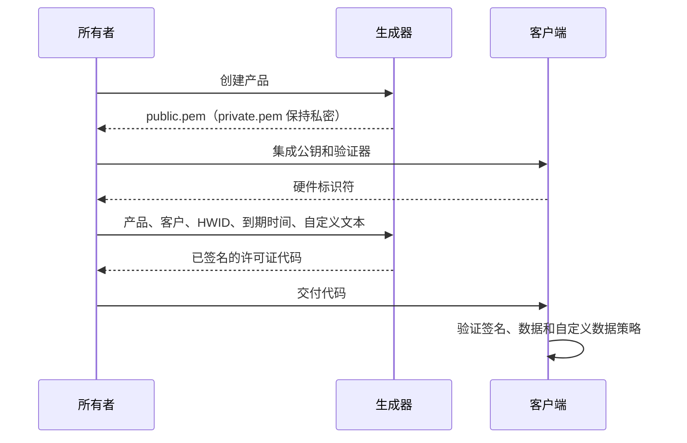

# 许可证格式与安全契约

[Español](../es/ARCHITECTURE.md) · [English](../../ARCHITECTURE.md) · [Deutsch](../de/ARCHITECTURE.md) · [Português](../pt/ARCHITECTURE.md) · **中文**

本文档定义了 License Generator 许可证包含的每个字节，以及客户端必须对其应用的每条规则。[集成指南](INTEGRATION.md)展示了如何在应用中实施这些规则；C#、Python 和 Node.js 参考验证器实现了这些规则，并通过相同的已发布测试向量。技术内容以英文原文为准。

## 角色

生成器保管私钥；客户端应用只获得公钥。RSA 对许可证数据签名。每个客户端都会验证签名、预期的产品和硬件标识符、到期时间，以及它自己可选的自定义数据规则。



## 传输与密钥

许可证代码是 UTF-8 JSON 的带填充标准 Base64。JSON 属性名称区分大小写。JSON 中的空白字符和属性顺序不影响签名，因为签名消息由下列字段构造而成。生成器输出带缩进的 JSON，并使用其运行所在系统的换行符，因此数据相同的两个许可证文本可能不同；切勿比较许可证文本。

密钥为 RSA-2048。`private.pem` 使用 PKCS#8，`public.pem` 使用 SubjectPublicKeyInfo。签名使用带 SHA-256 的 RSA PKCS#1 v1.5，然后转为带填充的标准 Base64。验证器必须明确选择此算法。

| 属性 | JSON 类型 | 含义 |
| --- | --- | --- |
| AppId | 字符串 | 确切的产品标识符 |
| RegistrationName | 字符串 | 客户或注册名称 |
| HardwareId | 字符串 | 客户端提供的确切硬件标识符；为空表示不绑定硬件 |
| ExpirationDate | ISO 日期时间字符串或 null | 已签名的公历日期，或不到期 |
| Signature | 字符串 | Base64 格式的 RSA 签名 |
| UserDefined | 字符串，为空时省略 | 由应用定义、可选的已签名文本 |
| FormatVersion | 整数，旧版格式中省略 | UserDefined 非空时为 `2` |

所有文本都区分大小写，重建签名时必须原样保留，不得规范化或修剪。产品名称和客户名称不能为空白。HardwareId 是字符串，不绑定硬件的许可证中可以为空。缺失、为 null 或为空的 UserDefined 会选择旧版格式，且不得用作授权依据。此时生成器会省略这两个新属性，从而与拒绝未知 JSON 属性的现有客户端保持兼容。

文本长度限制以 UTF-16 代码单元计量，与 C# 的 `string.Length` 和 JavaScript 的 `String.length` 相同：AppId 128、RegistrationName 1,024、HardwareId 1,024、UserDefined 8,192。AppId 另有 255 个 UTF-8 字节的限制。请拒绝无效的 Unicode 代理序列，而不是在 UTF-8 编码时静默替换它们。

## 旧版签名消息

对于旧版许可证，FormatVersion 缺失、为 null 或为 `1`，且 UserDefined 缺失、为 null 或为空。为保持兼容，生成器会省略版本。签名的是以下 UTF-8 字节：

```text
AppId|RegistrationName|HardwareId|yyyy-MM-dd
```

到期时间为 null 时，用 `NEVER` 代替日期。请使用固定区域性格式化公历日期。三个文本字段不能包含 `|`：否则字段边界会产生歧义，签名后的值可能被解读为不同的数据。新的生成过程和参考验证器都会拒绝此类旧版许可证；请重新签发包含该分隔符的旧许可证。

## 格式 2 签名消息

非空的 UserDefined 要求 `FormatVersion: 2`。对以下五个字符串分别就其 UTF-8 字节进行带填充的标准 Base64 编码：

1. AppId
2. RegistrationName
3. HardwareId
4. 固定区域性的 `yyyy-MM-dd`，或 `NEVER`
5. UserDefined

用 `|` 连接这五个编码后的字符串，并加上前缀 `LG2|`。对该完整字符串的 UTF-8 字节签名：

```text
LG2|Base64(AppId)|Base64(RegistrationName)|Base64(HardwareId)|Base64(date)|Base64(UserDefined)
```

`Base64(...)` 记法仅用于说明，并非字面文本。逐字段编码可以让分隔符、Unicode 和多行自定义文本保持无歧义。自定义文本为空的格式 2 无效。格式 2 验证失败时，切勿改按旧版格式重试。

旧客户端无法验证格式 2。请先更新它，或在签发兼容许可证时将 UserDefined 留空。

## 到期

只有日历日期会被签名；时间文本和时区转换都不得延长它。到期截止时间是**该日期开始时的 UTC 00:00:00**，而不是结束时。对于到期日期 D，最后一个有效时刻早于 D 开始时的 UTC 午夜。日期为 null 表示不到期。这样既保留了原有的日期开始时截止，又明确了时区。

生成器将日期写为 `yyyy-MM-ddT00:00:00`。只有当整个 ExpirationDate 文本匹配下面的表达式且其后没有任何内容（连换行也没有）、其前十个字符是自 1 年起的公历日期、小时不超过 23、分钟和秒不超过 59、偏移量的分钟不超过 59 且偏移量不超过 14:00，并且所写的时刻（没有偏移量时按 UTC 读取，忽略秒的小数部分）在 UTC 下位于 1 年到 9999 年之间时，验证器才接受该文本：

```text
^[0-9]{4}-[0-9]{2}-[0-9]{2}(T[0-9]{2}:[0-9]{2}(:[0-9]{2}(\.[0-9]{1,16})?)?(Z|[+-][0-9]{2}(:[0-9]{2})?)?)?$
```

前十个字符是已签名的日期；时间和偏移量永远不会移动截止时间。[测试向量](../examples/test-vectors.json)中的 `expirationTexts` 表列出了被接受和被拒绝的文本，以及截止时间两侧的时刻：每个被接受的文本在前一时刻必须尚未到期，在后一时刻必须已到期。

## 验证规则

许可证代码、可信公钥、预期产品、预期硬件标识符和当前时间都由应用提供给验证器，绝不取自许可证。空白的预期产品，以及空白或超过 65,536 个 UTF-16 代码单元的公钥，都属于应用错误，会在读取许可证之前被拒绝。随后，验证器按顺序应用以下规则。

当文本为空，或只包含 .NET 的 `char.IsWhiteSpace` 所定义的空白字符时，该文本即为**空白**。这些空白字符是：制表符、换行符、垂直制表符、换页符、回车符、U+0085，以及 Unicode 空格、行分隔符和段落分隔符（类别 Zs、Zl 和 Zp）。U+001C 到 U+001F 在此不算空白字符，尽管 Java 和 Python 将它们视为空白字符。

1. **信封。** 满足以下任一条件的许可证代码按格式错误拒绝：为空白、超过 131,072 个 UTF-16 代码单元，或不是带填充的标准 Base64；Base64 字符之间的空格、制表符、回车和换行会被忽略，其他字符都不会被忽略。解码后的 JSON 必须是不超过 98,304 字节、不带字节顺序标记的 UTF-8，必须是严格的 RFC 8259 JSON（无注释、尾随逗号或 `NaN`），嵌套不超过八层，并且根是属性名称唯一且不含未配对代理转义的对象。未知属性会被忽略，其值也不会被读取：它们不在签名范围内。
2. **数据**，按以下顺序检查。首先是文本：AppId、RegistrationName、HardwareId 和 Signature 必须是字符串，除 HardwareId 外都不能为空白，UserDefined 必须是字符串或 null，且其中任何一个都不能包含未配对代理转义。缺失的 ExpirationDate、UserDefined 或 FormatVersion 读作 null，空的 UserDefined 也读作 null；由空白字符组成的 UserDefined 不算空。然后，FormatVersion 必须是 null，或不带小数和指数书写的 32 位整数；1 和 2 以外的任何整数都是**不支持的格式**，这是一种独立的拒绝。然后，ExpirationDate 必须是 null 或上文所述的日期文本。最后，按上文各节检查文本长度限制、旧版分隔符以及格式与自定义数据的组合，并且 Signature 文本必须是带填充的标准 Base64，至少一个字节，忽略的字符与许可证代码相同。此步骤的其他任何失败都属于格式错误。
3. **签名。** 直到此时才读取密钥。可信密钥不得超过 65,536 个 UTF-16 代码单元，且只包含一个 PEM 块：标签为 `PUBLIC KEY` 且内容为 SubjectPublicKeyInfo，或标签为 `RSA PUBLIC KEY` 且内容为 PKCS#1；块的周围只能有空白字符，其 Base64 内容中只能有空格、制表符、回车和换行，其 DER 编码在密钥之后不得包含任何内容，并且是至少 2048 位的 RSA 密钥。永远不接受私钥。对签名消息验证带 SHA-256 的 RSA PKCS#1 v1.5；失败即为**签名不匹配**，它无法区分公钥错误和已签名的数据被修改。
4. **策略。** 只有已认证的许可证才会与应用的预期进行比较，每项检查分别报告：AppId 与预期产品按序号比较相等时，产品匹配；HardwareId 为空时，硬件未绑定，与预期值按序号比较相等时匹配，仅当应用有意不传入预期值时才为**未检查**；当前时间等于或晚于截止时间时，许可证已到期。

只有当产品匹配、硬件未绑定或匹配，并且许可证永不到期或尚未到期时，许可证才有效。硬件未经检查的许可证无效。只返回有效许可证的函数要求提供预期硬件标识符；没有它时不返回任何许可证，即使是未绑定的许可证也不返回，这样缺失的值就无法跳过检查。每次做出访问决定时都要重新验证；缓存的成功结果不得绕过到期检查。只能从有效结果中读取和解释 UserDefined。

已认证的许可证还有一个**吊销标识符**：签名解码后所得字节的 SHA-256，以小写十六进制表示。同一个许可证可以有不止一种写法，例如在 Signature 文本中加入空白字符或转义，而每种写法都得到相同的标识符，因此吊销列表保存的是标识符，而不是签名文本。以相同数据和相同密钥重新签发的许可证具有相同的签名，因而也具有相同的标识符。

参考验证器将拒绝报告为 `malformed`、`unsupported-format`、`signature-mismatch`、`invalid-public-key` 和 `invalid-expected-product`，并使用[测试向量](../examples/test-vectors.json)中的名称报告已认证许可证的各项检查。其他实现在发布之前，必须对每个向量给出已发布的结果。

## 安全边界

- 签名能发现被修改的数据，但不会隐藏客户名称或自定义数据。
- HWID 是应用策略，而不是对不可更改的物理计算机的证明。请使用熵足够的稳定标识符；无法获取时应失败，而不是返回共享的占位值。
- 离线许可证无法远程吊销。更新可以强制执行已吊销许可证标识符的列表，或有意更换密钥。
- 控制某台计算机的用户可以修改客户端代码和时钟。如果您的需求包括更强的吊销能力或可信时间，请增加在线信任机制。
- 不要让私钥进入客户端应用、版本控制、支持工单和公开发布。私钥泄露后需要制定密钥轮换和客户端更新计划。

产品的法律条款见 [EULA](../../LICENSE)（英文）。
