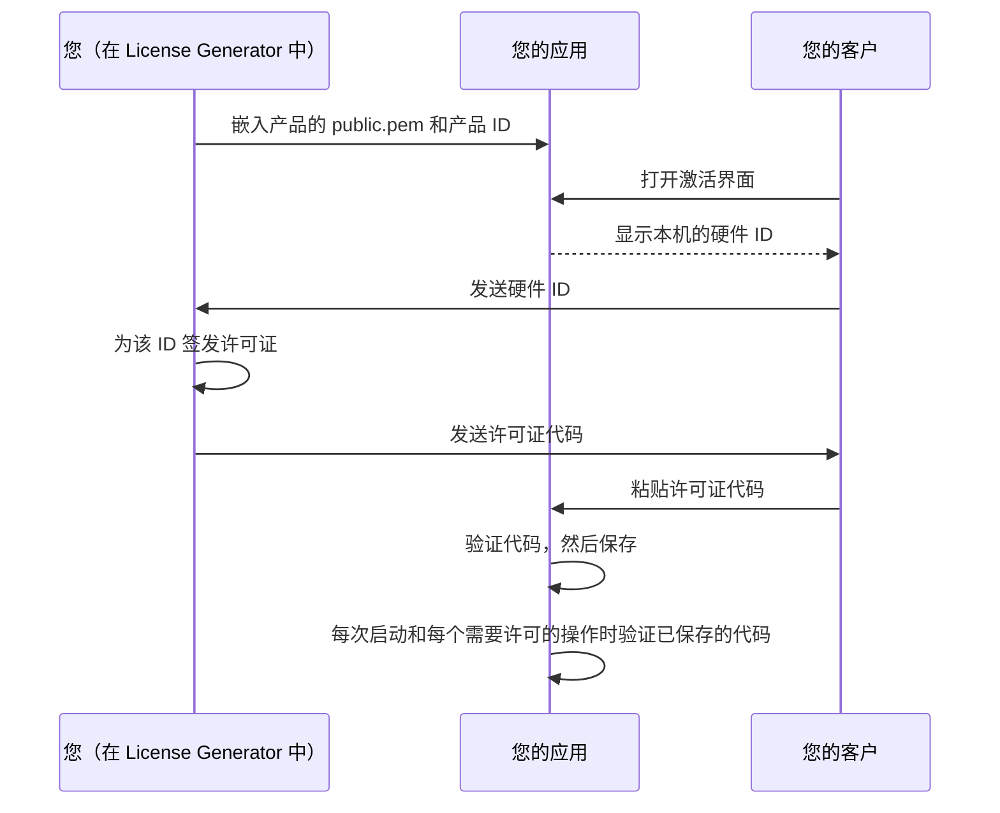

# 客户端集成指南

[Español](../es/INTEGRATION.md) · [English](../../INTEGRATION.md) · [Deutsch](../de/INTEGRATION.md) · [Português](../pt/INTEGRATION.md) · **中文**

本指南介绍如何在您自己的应用中验证 License Generator 许可证：使用哪个验证器、激活界面和启动检查如何使用它、如何选择硬件标识符，以及如何测试您的集成。[格式与安全契约](ARCHITECTURE.md)定义了验证器所依据的每个字节和每条规则；[使用指南](OPERATIONS.md)介绍生成器本身。

## 许可证的工作方式



生成器使用产品的私钥为每个许可证签名，私钥从不离开您的计算机。您的应用只包含公钥，公钥可以验证签名，但永远无法生成签名。验证不需要服务器：它在用户的设备上运行，使用您的应用提供的公钥、产品 ID、硬件 ID 和当前时间。

## 选择验证器

三个参考验证器实现了该[契约](ARCHITECTURE.md)。对每个已发布的[测试向量](#测试您的集成)，它们都返回相同的结果。

| 技术栈 | 复制到您的应用中 | 要求 | 测试 |
| --- | --- | --- | --- |
| C# | [LicenseVerifier.cs](../examples/LicenseVerifier.cs) 和 [LicenseProtocol.cs](../examples/LicenseProtocol.cs) | .NET 8 或更高版本；无需任何包 | 由 License Generator 自身的非公开回归测试套件对照测试向量检查 |
| Python | [license_verifier.py](../examples/python/license_verifier.py) | Python 3.11 或更高版本以及 [cryptography](https://pypi.org/project/cryptography/) 包 | [test_license_verifier.py](../examples/python/test_license_verifier.py) |
| Node.js | [license-verifier.mjs](../examples/node/license-verifier.mjs) | Node.js 20 或更高版本；仅使用内置模块 | [license-verifier.test.mjs](../examples/node/license-verifier.test.mjs) |

验证器不执行任何 I/O：它们不读取文件、时钟或网络，也从不查询硬件 ID。这些值由您的应用传入，从而让每个判断都清晰可见、便于测试。

其他技术栈可以用自己的 RSA 库验证许可证。下列标准 API 使用 SubjectPublicKeyInfo 公钥验证带 SHA-256 的 RSA PKCS#1 v1.5 签名；它们仅供参考，并非经过测试的示例，因此请实现契约中的每条规则，并在发布前通过每个测试向量。

| 技术栈 | API |
| --- | --- |
| Java、Kotlin、Android | `java.security.Signature` 配合 `SHA256withRSA`，密钥来自 `X509EncodedKeySpec` |
| Go | `crypto/x509.ParsePKIXPublicKey` 和 `crypto/rsa.VerifyPKCS1v15` 配合 `crypto.SHA256`，后者接收的是 SHA-256 摘要而不是消息 |
| Swift | 使用 PKCS#1 格式密钥的 `SecKeyCreateWithData`，以及配合 `.rsaSignatureMessagePKCS1v15SHA256` 的 `SecKeyVerifySignature` |
| C、C++ | OpenSSL 的 `EVP_DigestVerify` 配合 `EVP_sha256()`，或 Windows CNG 的 `BCryptVerifySignature` 配合 `BCRYPT_PAD_PKCS1` |
| PHP | `openssl_verify` 配合 `OPENSSL_ALGO_SHA256` |
| Rust | `rsa` crate 中配合 SHA-256 的 PKCS#1 v1.5 验证器 |
| Dart、Flutter | `pointycastle` 包中配合 SHA-256 的 RSA 签名器 |
| 浏览器 | 使用 `spki` 的 `crypto.subtle.importKey`，以及配合 `RSASSA-PKCS1-v1_5` 和 SHA-256 的 `crypto.subtle.verify` |

Electron 应用应在主进程中运行 Node.js 验证器，而不是在显示网页内容的渲染进程中运行。React Native 不提供 `node:crypto`，因此 Node.js 验证器无法原样在其中运行。用户控制的网页无法强制执行许可证；请在应用决定访问权限的地方进行验证。

各个库在一些细节上有差异，如果沿用它们的默认行为就会违反契约：

| 位置 | 会发生什么 | 应该怎么做 |
| --- | --- | --- |
| 大多数 JSON 解析器 | 遇到两个同名属性时保留最后一个。 | 在读取任何数据之前，拒绝属性名称重复的根对象。 |
| Go 的 `encoding/json` | 它不区分大小写地匹配名称，并把无效的 UTF-8 和未配对的代理替换为 U+FFFD。 | 使用 `json.Decoder.Token` 读取根对象，并精确比较名称。 |
| Java 的 `java.util.Base64` | `getDecoder()` 拒绝空白字符，而 `getMimeDecoder()` 会忽略字母表之外的所有字符。 | 先去掉空格、制表符和换行，再用 `getDecoder()` 解码。 |
| Java 和 Kotlin 的 `KeyFactory` | `X509EncodedKeySpec` 只能读取 SubjectPublicKeyInfo。 | 按生成器写出的原样嵌入 `public.pem`，或先转换 PKCS#1 密钥。 |
| Swift 的 `SecKeyCreateWithData` | 它要求 PKCS#1 格式的 RSA 公钥。 | 先去掉 SubjectPublicKeyInfo 头部，或以 PKCS#1 格式嵌入密钥。 |
| 文本长度 | Python 计算的是码位，Go 和 Rust 计算的是字节。 | 按 UTF-16 代码单元计算契约中的长度限制。 |
| Python `cryptography` | `load_pem_public_key` 也会读取 `RSA PUBLIC KEY` 标签下的 SubjectPublicKeyInfo 内容，`load_der_public_key` 两种形式都会读取。 | 检查内容是否为其标签所指的形式。 |
| 正则表达式 | 在 Python、Java 和 .NET 中，`$` 也会在末尾换行之前匹配；在 Python 和 .NET 中，`\d` 会匹配任何书写系统中的数字。 | 要求匹配整个文本（`re.fullmatch`、`Matcher.matches`、.NET 中的 `\z`），并改用 `[0-9]`。 |
| 修剪函数 | Python 的 `strip()`、JavaScript 的 `trim()` 和 .NET 的 `Trim()` 去除的字符各不相同。 | 只去除契约或本指南所列的字符。 |

## 将验证器添加到您的应用

**C#。** 将两个文件都复制到您的项目中。验证器位于 `LicenseGenerator.IntegrationExample` 命名空间，并使用 `LicenseGenerator.Protocol` 中的共享解析器；您可以重命名这些命名空间。这些文件使用了 `PemEncoding` 等 .NET 8 API 和 C# 12 语法，因此无法在 .NET Framework、Unity 或 Xamarin 上原样编译；在这些平台上，请以这些文件为起点，用可用的 API 实现契约，并通过每个测试向量。

**Python。** 复制 `license_verifier.py` 并安装 `cryptography`。这些示例使用 [requirements.txt](../examples/python/requirements.txt) 中锁定的版本和哈希进行测试：

```text
python -m pip install --require-hashes --only-binary :all: -r requirements.txt
```

**Node.js。** 复制 ES 模块 `license-verifier.mjs`，并用 `import { inspect, verify } from "./license-verifier.mjs"` 导入。

**公钥。** 将产品的 `public.pem` 以字符串常量或编译资源的形式嵌入您的应用，并附上确切的产品 ID。切勿从许可证、用户可以替换的文件，或来源不受您控制的下载中读取公钥。切勿分发 `private.pem`。

## 验证许可证

每个验证器都提供两个调用，二者的输入相同：许可证代码、可信公钥、预期的产品 ID、预期的硬件 ID 和当前的 UTC 时间。无法换算为 UTC 的时间属于编程错误：对于不带时区的 `datetime`，Python 验证器会引发 `ValueError`；对于无效的 `Date`，Node.js 验证器会抛出 `TypeError`。

- **verify**（C# 中为 `TryVerify`）仅当许可证对此产品、此计算机和此时刻有效时才返回许可证。它要求提供预期硬件 ID：没有它时不返回任何许可证，即使是未绑定的许可证也不返回。凡是决定访问权限的地方都应使用它。
- **inspect**（C# 中为 `Inspect`）返回带原因的拒绝，或返回已认证的许可证，其中分别包含产品、硬件和到期检查以及总体有效性。需要告诉用户哪里出错时使用它。

各验证器中的结果形式如下：

| 验证器 | 拒绝 | 已认证 | 许可证 |
| --- | --- | --- | --- |
| C# | 带 `Reason` 的 `LicenseInspectionResult.Rejected` | 带 `License`、`Product`、`Hardware`、`Expiration` 和 `IsValid` 的 `LicenseInspectionResult.Authenticated` | 带 `AppId`、`RegistrationName`、`HardwareId`、`ExpirationDate`（UTC 的 `DateTime`）、`UserDefined`、`FormatVersion` 和 `RevocationId` 的 `VerifiedLicense` |
| Python | 带 `reason` 的 `Rejected` | 带 `license`、`product`、`hardware`、`expiration` 和 `is_valid` 的 `Authenticated` | 带 `app_id`、`registration_name`、`hardware_id`、`expiration_date`（`date`）、`user_defined`、`format_version` 和 `revocation_id` 的 `VerifiedLicense` |
| Node.js | `{ result: "rejected", reason }` | `{ result: "authenticated", license, product, hardware, expiration, isValid }` | 带 `appId`、`registrationName`、`hardwareId`、`expirationDate`（`yyyy-MM-dd` 文本）、`userDefined`、`formatVersion` 和 `revocationId` 的对象 |

缺失的到期日期或自定义文本为 null（Python 中为 `None`），旧版许可证的格式版本也是如此，测试向量将其写为 1。原因和检查是 C# 中 `LicenseInspectionFailure`、`LicenseProductCheck`、`LicenseHardwareCheck` 和 `LicenseExpirationCheck` 的成员，以及 Python 和 JavaScript 中 `InspectionFailure`、`ProductCheck`、`HardwareCheck` 和 `ExpirationCheck` 的成员，名称相同，但为大写并以下划线连接（`MALFORMED_LICENSE`、`NOT_BOUND`、`NEVER_EXPIRES`），其值为测试向量使用的名称（`malformed`、`not-bound`、`never`）。

使用空硬件 ID 签发的许可证不绑定硬件：无论您的应用期望哪个 ID，它都能通过硬件检查。若要有意跳过硬件检查，请向 `inspect` 传入 `null`（Python 中为 `None`）；此时绑定硬件的许可证会显示为未检查，且永远无效。Node.js 验证器拒绝省略的（`undefined`）硬件 ID，以免遗漏的参数意外跳过检查。

## 构建激活界面

您的应用需要一个界面，让用户可以查看硬件 ID、粘贴许可证代码并激活：

```text
┌────────────────────────────────────────────────────────────────────┐
│ 许可证激活                                                         │
│                                                                    │
│ 本机 ID                                                            │
│ 05A68D939433F5BABB1D30D04974999056C8AFAF60D867DA80241F9F99E5FA01   │
│                                                             [复制] │
│ 许可证代码                                                         │
│ ┌────────────────────────────────────────────────────────────────┐ │
│ │ ewogICJBcHBJZCI6ICJOb3J0aHN0YXItU3R1ZGlvIiwKICAiUmVnaXN0cmF... │ │
│ └────────────────────────────────────────────────────────────────┘ │
│                                                             [激活] │
│ 已为 Alex Morgan 激活。                                            │
└────────────────────────────────────────────────────────────────────┘
```

请显示完整的硬件 ID 并提供复制按钮：许可证正是为这段文本签发的。用户激活时，检查许可证代码，有效则保存，否则说明问题所在。这些函数假定您的应用提供 `PUBLIC_KEY`、`PRODUCT_ID`、`hardware_id()` 和 `save_license_code()`（或它们在 C# 和 JavaScript 中的对应项）。与经过测试的示例一致，这些消息是英文的；请在您的应用中翻译它们。

<!-- excerpt: csharp-activation -->
```csharp
static string Activate(string licenseCode)
{
    var result = LicenseVerifier.Inspect(licenseCode, PublicKey, ProductId, HardwareId(), DateTimeOffset.UtcNow);
    if (result is LicenseInspectionResult.Authenticated { IsValid: true } activated)
    {
        SaveLicenseCode(licenseCode);
        return $"Activated for {activated.License.RegistrationName}.";
    }
    return ActivationProblem(result);
}

static string ActivationProblem(LicenseInspectionResult result) => result switch
{
    LicenseInspectionResult.Rejected { Reason: LicenseInspectionFailure.MalformedLicense } =>
        "Paste the complete license code you received.",
    LicenseInspectionResult.Rejected { Reason: LicenseInspectionFailure.UnsupportedFormat } =>
        "This license needs a newer version of the application.",
    LicenseInspectionResult.Rejected { Reason: LicenseInspectionFailure.SignatureMismatch } =>
        "This license was not issued for this application.",
    LicenseInspectionResult.Rejected => "This copy cannot check licenses. Contact support.",
    LicenseInspectionResult.Authenticated { Product: LicenseProductCheck.Mismatch } =>
        "This license is for another product.",
    LicenseInspectionResult.Authenticated { Hardware: LicenseHardwareCheck.Mismatch } =>
        $"This license is for another computer. Send us this computer's ID: {HardwareId()}",
    LicenseInspectionResult.Authenticated
        { Expiration: LicenseExpirationCheck.Expired, License.ExpirationDate: DateTime expired } =>
        $"This license expired on {expired.ToString("yyyy-MM-dd", CultureInfo.InvariantCulture)}.",
    _ => "This license cannot be used on this computer.",
};
```

<!-- excerpt: python-activation -->
```python
def activate(license_code):
    result = license_verifier.inspect(license_code, PUBLIC_KEY, PRODUCT_ID, hardware_id(),
                                      datetime.now(timezone.utc))
    if isinstance(result, license_verifier.Authenticated) and result.is_valid:
        save_license_code(license_code)
        return "Activated for %s." % result.license.registration_name
    return activation_problem(result)


REJECTION_MESSAGES = {
    license_verifier.InspectionFailure.MALFORMED_LICENSE: "Paste the complete license code you received.",
    license_verifier.InspectionFailure.UNSUPPORTED_FORMAT: "This license needs a newer version of the application.",
    license_verifier.InspectionFailure.SIGNATURE_MISMATCH: "This license was not issued for this application.",
}


def activation_problem(result):
    if isinstance(result, license_verifier.Rejected):
        return REJECTION_MESSAGES.get(result.reason, "This copy cannot check licenses. Contact support.")
    if result.product is license_verifier.ProductCheck.MISMATCH:
        return "This license is for another product."
    if result.hardware is license_verifier.HardwareCheck.MISMATCH:
        return "This license is for another computer. Send us this computer's ID: %s" % hardware_id()
    if result.expiration is license_verifier.ExpirationCheck.EXPIRED:
        return "This license expired on %s." % result.license.expiration_date.isoformat()
    return "This license cannot be used on this computer."
```

<!-- excerpt: javascript-activation -->
```javascript
export function activate(licenseCode) {
  const result = inspect(licenseCode, PUBLIC_KEY, PRODUCT_ID, hardwareId(), new Date());
  if (result.result === "authenticated" && result.isValid) {
    saveLicenseCode(licenseCode);
    return `Activated for ${result.license.registrationName}.`;
  }
  return activationProblem(result);
}

const REJECTION_MESSAGES = new Map([
  [InspectionFailure.MALFORMED_LICENSE, "Paste the complete license code you received."],
  [InspectionFailure.UNSUPPORTED_FORMAT, "This license needs a newer version of the application."],
  [InspectionFailure.SIGNATURE_MISMATCH, "This license was not issued for this application."],
]);

export function activationProblem(result) {
  if (result.result === "rejected") {
    return REJECTION_MESSAGES.get(result.reason) ?? "This copy cannot check licenses. Contact support.";
  }
  if (result.product === ProductCheck.MISMATCH) return "This license is for another product.";
  if (result.hardware === HardwareCheck.MISMATCH) {
    return `This license is for another computer. Send us this computer's ID: ${hardwareId()}`;
  }
  if (result.expiration === ExpirationCheck.EXPIRED) {
    return `This license expired on ${result.license.expirationDate}.`;
  }
  return "This license cannot be used on this computer.";
}
```

C# 函数使用 `System.Globalization` 和 `LicenseGenerator.IntegrationExample` 命名空间。Python 函数从 `datetime` 导入 `datetime` 和 `timezone`，并导入 `license_verifier`。JavaScript 函数从验证器模块导入 `inspect`、`InspectionFailure`、`ProductCheck`、`HardwareCheck` 和 `ExpirationCheck`。

每个结果对用户意味着什么：

| 结果 | 含义 | 应告诉用户 |
| --- | --- | --- |
| `malformed` | 文本不是完整的许可证代码：被截断、被修改，或根本不是许可证。 | 粘贴完整的代码。 |
| `unsupported-format` | 许可证使用了比此验证器更新的格式。 | 更新应用。 |
| `signature-mismatch` | 许可证是用其他产品的密钥签发的，或其文本已被修改。 | 该许可证不适用于此应用。 |
| `invalid-public-key`、`invalid-expected-product` | 您的应用传入了不可用的密钥或空白的产品 ID。 | 用户无法自行解决：请记录日志并修复构建。 |
| 产品 `mismatch` | 签名真实，但签发给您的另一个产品。 | 该许可证属于另一个产品。 |
| 硬件 `mismatch` | 签名真实，但签发给另一个硬件 ID。 | 该许可证属于另一台计算机；显示本机的 ID。 |
| 到期 `expired` | 签名真实，但其到期日期已开始。 | 该许可证已于其日期到期。 |

## 保存许可证并再次检查

请保存许可证代码本身，而不是“已授权”标志或验证结果。将它保存在应用的每用户数据文件夹中：例如 Windows 上的 `%LOCALAPPDATA%\YourApp`、macOS 上的 `~/Library/Application Support/YourApp`、Linux 上的 `$XDG_DATA_HOME/YourApp`（通常为 `~/.local/share/YourApp`）、Android 上应用的内部存储（`Context.getFilesDir()`），或 iOS 上应用容器中的 Application Support 文件夹。备份可能会把代码恢复到另一台设备上，在那里硬件检查会失败，用户需要重新激活。代码经过签名，但未加密：任何读取它的人都能看到客户名称、硬件 ID 和自定义数据，但无法在不破坏签名的情况下修改它们。

每次启动时以及每个需要许可的操作之前，都使用当前时间再次验证已保存的代码。缓存的 `true` 会让已到期的许可证继续生效。验证失败时，再次显示激活界面。这些函数假定您的应用提供 `load_license_code()`，它返回已保存的代码或空值。

<!-- excerpt: csharp-startup -->
```csharp
static VerifiedLicense? CurrentLicense()
{
    var licenseCode = LoadLicenseCode();
    if (licenseCode is null) return null;
    return LicenseVerifier.TryVerify(licenseCode, PublicKey, ProductId, HardwareId(), DateTimeOffset.UtcNow,
        out var license) ? license : null;
}
```

<!-- excerpt: python-startup -->
```python
def current_license():
    license_code = load_license_code()
    if license_code is None:
        return None
    return license_verifier.verify(license_code, PUBLIC_KEY, PRODUCT_ID, hardware_id(), datetime.now(timezone.utc))
```

<!-- excerpt: javascript-startup -->
```javascript
export function currentLicense() {
  const licenseCode = loadLicenseCode();
  if (licenseCode === null) return null;
  return verify(licenseCode, PUBLIC_KEY, PRODUCT_ID, hardwareId(), new Date());
}
```

## 选择硬件标识符

绑定硬件的许可证指明一个硬件 ID，由您的应用决定如何计算它。生成器对您输入的任何文本签名。好的标识符应当：

- **具有确定性。** 同一台计算机在每次启动以及应用每次更新之后都给出相同的文本。
- **确切。** 激活界面上显示的文本就是之后验证的文本。采用序号比较：大小写、空格和换行都会影响结果。
- **完整。** 切勿截断；过短的 ID 会让两台计算机共享同一个许可证。
- **如实报告失败。** 来源不可用时请报告错误。切勿回退到 `UNKNOWN-HWID`、主机名或空文本之类的共享值：空的硬件 ID 表示不绑定硬件的许可证。

操作系统提供了可作为起点的机器标识符：

| 系统 | 来源 | 何时会变化 |
| --- | --- | --- |
| Windows | `HKEY_LOCAL_MACHINE\SOFTWARE\Microsoft\Cryptography` 下的 `MachineGuid` | 重新安装 Windows 时；从同一镜像克隆的计算机可能共享它 |
| Linux | `/etc/machine-id` | 重新安装系统时；容器和克隆的镜像可能共享或重新生成它 |
| macOS | I/O Registry 中 `IOPlatformExpertDevice` 的 `IOPlatformUUID` | 更换主板时 |
| Android | `Settings.Secure.ANDROID_ID` | 设备恢复出厂设置时；自 Android 8.0 起，它还会因应用签名密钥和用户而不同 |
| iOS、iPadOS | 应用无法获取任何硬件标识符：可使用 `identifierForVendor`，或一个只创建一次并保存在钥匙串中的 UUID | 当您的所有应用都从设备上移除时，`identifierForVendor` 会变化；钥匙串中的条目通常在重新安装后仍然保留 |

64 位 Windows 上的 32 位进程读取的是经过重定向、不含 `MachineGuid` 的注册表视图：请打开 64 位视图（.NET 中为 `RegistryView.Registry64`，Win32 中为 `KEY_WOW64_64KEY`）。

请勿显示原始标识符：`machine-id(5)` 手册要求应用不要公开 `/etc/machine-id`，而应使用应用专属的密钥对其进行哈希。请使用 HMAC-SHA-256 派生您自己的 ID：先去掉系统标识符首尾的空格、制表符、回车和换行（例如 `/etc/machine-id` 末尾的换行），再以产品 ID 的 UTF-8 字节为密钥，对其 UTF-8 字节进行计算，并将结果写成 64 个大写十六进制字符。只去除这四种字符，保留其他所有字符：各语言的修剪函数去除的字符集合各不相同。这样，每种技术栈都会为相同的计算机和产品算出相同的 ID；[测试向量](../examples/test-vectors.json)中的 `hardwareIdExamples` 公布了两个可供核对的示例。这些函数在 C# 中需要 `System.Security.Cryptography` 和 `System.Text`，在 Python 中需要 `hashlib` 和 `hmac`，在 JavaScript 中需要 `node:crypto` 的 `createHmac`。

<!-- excerpt: csharp-hardware-id -->
```csharp
static string DeriveHardwareId(string machineId, string productId)
{
    var identifier = machineId.Trim(' ', '\t', '\r', '\n');
    return Convert.ToHexString(HMACSHA256.HashData(Encoding.UTF8.GetBytes(productId), Encoding.UTF8.GetBytes(identifier)));
}
```

<!-- excerpt: python-hardware-id -->
```python
def derive_hardware_id(machine_id, product_id):
    identifier = machine_id.strip(" \t\r\n")
    digest = hmac.new(product_id.encode("utf-8"), identifier.encode("utf-8"), hashlib.sha256)
    return digest.hexdigest().upper()
```

<!-- excerpt: javascript-hardware-id -->
```javascript
export function deriveHardwareId(machineId, productId) {
  const identifier = machineId.replace(/^[ \t\r\n]+|[ \t\r\n]+$/g, "");
  return createHmac("sha256", productId).update(identifier).digest("hex").toUpperCase();
}
```

硬件 ID 是应用的策略，而不是物理计算机的证明：控制设备的用户可以改变您的应用读取到的内容。

## 使用 UserDefined

许可证可以携带已签名的自定义文本 UserDefined，用于功能、套餐或您的应用定义的其他数据。只能从有效的许可证中读取它；验证之前它是不可信的文本。请选择简单且带版本的语法，例如 `features=reports,export;plan=professional`，拒绝您的版本无法理解的文本，并把不含它的许可证视为基础授权。不要在其中放置机密：它只是编码，并未加密。

带有 UserDefined 的许可证使用格式 2。格式 2 之前构建的客户端会拒绝它，因此请在签发此类许可证之前，更新所有需要接受它们的客户端。

## 到期与时钟

到期日期以日历日期的形式签名，许可证在**该日期开始时的 UTC 00:00** 到期。若要允许使用到 6 月 10 日结束，请在签发许可证时将到期日期设为 6 月 11 日。请传入 UTC 当前时间；无论用户处于哪个时区，验证器都会将其与该时刻比较。

您的应用读取的是用户控制的设备上的时钟。用户可以把时钟调回，让已到期的许可证继续生效。在这一点很重要的场景中，除离线验证外，还应通过您信任的服务核对时间。

## 更新、吊销与更换密钥

离线许可证无法远程吊销：用户的设备验证它不需要任何服务器。您可以在应用更新中这样做：

- **吊销特定许可证。** 随更新发布已吊销许可证的标识符列表，并拒绝标识符在列表中的已验证许可证。每个验证器都会随许可证返回该标识符（`revocationId`，C# 中为 `RevocationId`，Python 中为 `revocation_id`）；用其中任意一个检查许可证代码即可读取它。切勿列出 `Signature` 文本：同一个许可证可以有不止一种写法，而每种写法的标识符都相同。
- **为新的主版本更换密钥。** 在生成器中创建一个新产品，例如 `MyApp-2`，并嵌入它的公钥和产品 ID：为旧产品签发的许可证将无法再通过验证。若要在一段时间内继续接受它们，请先用新的密钥和产品 ID 验证，再用旧的验证。
- **替换泄露或丢失的密钥。** 私钥泄露后，任何人都能签发您的应用会接受的许可证；私钥丢失后，您将无法签发新的许可证。这两种情况都需要发布新的公钥并重新签发许可证。

## 测试您的集成

[test-vectors.json](../examples/test-vectors.json) 包含一个不受任何真实产品信任的测试公钥、预期的产品和硬件 ID、一个固定的检查时间，以及由生成器签发的许可证和每个许可证必须给出的结果：

- `cases` 列出每个许可证及其 `expected` 结果：拒绝原因 `reason`，或已认证许可证的 `product`、`hardware` 和 `expiration` 检查、总体 `valid`、解码后的数据以及 `revocationId`。对于 JSON 中省略了 `formatVersion` 的旧版许可证，其值为 1。`issue` 记录生成器如何签发某个用例，`derive` 记录某个用例在签名后如何由另一个用例修改而来，`copy` 表示它原样复用另一个用例的许可证。用例可以设置自己的 `publicKey`、`expectedAppId` 或 `expectedHardwareId`；硬件 ID 为 null 表示跳过该检查。verify 函数恰好在那些有效且未跳过硬件检查的用例中返回许可证。
- `expirationTexts` 列出到期日期的文本，验证器必须将其读取为已签名的日期或予以拒绝，并给出截止时间两侧的时刻：每个被接受的文本在前一时刻尚未到期，在后一时刻已到期。
- `hardwareIdExamples` 给出若干机器标识符及一个产品 ID，以及上述派生方法据每个标识符计算出的硬件 ID；第二个示例在首尾保留了某些修剪函数会去除的字符。

比较结果时请使用已发布的检查时间，而不是当前时间。参考测试套件会运行每个用例；Python 套件需要按上文安装 `cryptography`：

```text
cd docs/examples/python
python -m unittest
cd ../node
node --test license-verifier.test.mjs
```

公共仓库的 CI 会在每次推送和拉取请求时运行这两个测试套件。对于 C# 客户端，请在您自己的测试中读取同一个文件，并将 `LicenseVerifier.Inspect` 与每个预期结果进行比较。

## 故障排除

| 现象 | 检查 |
| --- | --- |
| 每个许可证都得到 `signature-mismatch` | 嵌入的密钥是产品完整的 `public.pem`，包括 BEGIN 和 END 行，并且许可证是为该产品签发的。 |
| 生成器能正确检查的代码得到 `malformed` | 代码在复制时被截断或修改；代码内部的换行可以接受，其他字符不行。 |
| `unsupported-format` | 您的验证器早于该许可证的格式；请更新它。 |
| 在正确的计算机上出现硬件 `mismatch` | 您的应用计算出的 ID 与它显示的相同；大小写和空格都会影响结果。容器和虚拟机可能看到不同的机器标识符。 |
| 提前一天到期 | 截止时间是到期日期开始时的 UTC 00:00；请在签发许可证时将到期日期设为下一天。 |
| 在开发环境中正常，在生产环境中失败 | 生产环境嵌入了另一个公钥或产品 ID，或者计算出了另一个硬件 ID。 |

## 示例的许可

[EULA](../../LICENSE)（英文）第 2 节允许您在验证许可证的商业或免费应用中使用、复制、修改和分发 `docs/examples` 下的文件，但须保留其版权声明。它不授予对 License Generator 应用本身的任何权利。

[报告问题](https://github.com/gonzapersonalsite/LicenseGenerator-Docs-/issues) · [支持开发](https://ko-fi.com/gonzaloapps)
